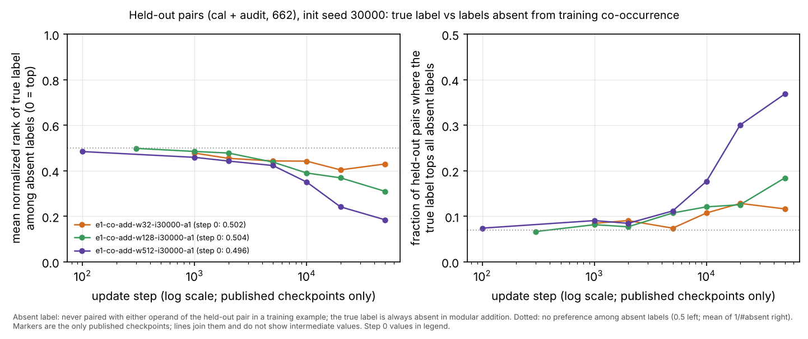
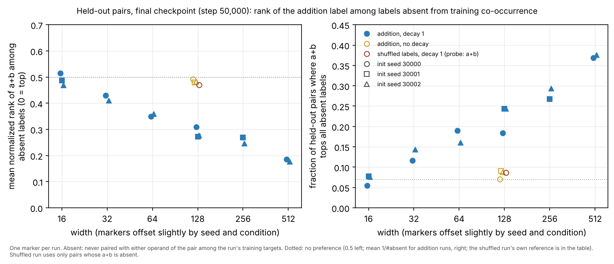

# Independent audit, expedition e1

Contents: [Part 1, first preview runs](#part-1-first-preview-runs) · [Part 2, mechanism lane first deliverable](#part-2-mechanism-lane-first-deliverable) · [Part 3, size/time lane runs and controls](#part-3-sizetime-lane-runs-and-controls)

## Part 1: first preview runs

Auditor session `au-cloud-1`, 2026-10-21. Branch `claude/project-thread-id1tmm` (this session's designated branch, used instead of `swarm/audit`), started from `c7c1c2ad8ac0bb23c9d0f84f9f1c9438764d03c6` (shared code identical to `ebd874e`). Published runs read from `swarm/exploration` at `67a10d8d282fd1d57ae6b3aba5a992f8d040203d`.

**Checked scope:** the Stage 0 diff `e0a6e0f..ebd874e` and the three preview runs `e1-co-add-w{32,128,512}-i30000-a1` with their registry, figures and index table. Part 2 covers the mechanism lane; nothing from the size/time lane yet. A software PASS means the stated check passed. It does not confirm any scientific claim.

**Independence:** `independent.py` imports no project code. It rebuilds the split from the written rule, uses one-hot matrix products instead of indexing and `np.add.at`, `np.logaddexp.reduce` for cross-entropy, an explicit other-logits matrix for margins, and AdamW in PyTorch's update order. `shared_checks.py` and `divergence.py` import `experiment.py` only as the code under test.

### Figure: held-out true label vs labels never seen with either operand



Look before reading: in modular addition, the true label of a held-out pair (a, b) never appears with a or b in any training pair. Does the network treat it like the other labels that never co-occur with a or b, or does it prefer it?

Source: `results/preview-1-heldout-rank.jsonl`. The figure uses only the published checkpoints. Vector version: `figures/heldout-rank.svg`.

### Software checks

Tolerances were fixed before running. Recomputed metrics must match to 1e-12 relative, with accuracies identical. Replays must match to 1e-8 relative (weights, both moments, logged loss and margins), with accuracies identical.

| # | Check | Result | Evidence |
|---|---|---|---|
| 1 | Shared unit tests at `c7c1c2a` | PASS | `test_exploration`, `test_instrumentation`: 9 tests OK |
| 2 | Cross-session handoff | PASS | Every published file (11 or 12 per run) matches `manifest.json` in SHA-256 and size, `published` flags match the files present, and everything loads |
| 3 | Split identity | PASS | Rebuilding from data seed 31000 and control seed 32000 reproduces `research/data/e1-split.npz` byte for byte. The split hash `aa8f…1f24`, addition target `6f15…2046` and shuffled target `80a9…d35f` all equal the plan |
| 4 | Split structure | PASS | The 961 pairs split 299/118/544 with no overlap and nothing missing. Every split is transpose-closed and holds exactly 5/2/9 unordered groups per residue (train/cal/audit). Labels are (a+b) mod 31. The shuffled table keeps each split's class counts and changes 96% of labels |
| 5 | Same data in every run | PASS | Each run's `data.npz` equals the frozen split (inputs, both label arrays, split indices) |
| 6 | Seed separation and initialization | PASS | Configured seeds equal the plan. Step-0 weights at every width exactly equal an independent draw from init seed 30000, and both moments are zero |
| 7 | Recipe, code and environment identity | PASS | Width, steps, lr 1e-3, wd 1, p 31, cadences, `diagnostics none` and task all equal the plan. Recorded SHA-256 of `experiment.py`, `launch_runs.py`, `instrumentation.py`, `publish_run.py` and `report_map.py`, plus the lock files, equal the `ebd874e` blobs. One BLAS thread; CPython 3.12.14 and NumPy 2.3.5 |
| 8 | Logits, accuracy, cross-entropy, margins and norm | PASS | Recomputed at every published checkpoint (7 or 8 per run, all three splits). Accuracies are identical, cross-entropy and margins agree to 4e-16 relative, the norm to 2e-16, with no ties |
| 9 | Gradients | PASS | Central differences (120 coordinates, eps 1e-6) at w32@1000, w128@0 and w512@100 agree within 1e-7 of the largest gradient. Shared `lossgrad` equals the independent gradient to 4e-15. At w512@50000 (train CE 1.8e-6) rounding limits FD (error 7% of a 1.6e-8 gradient), so that point is uninformative |
| 10 | AdamW and logged update, short replays | PASS | Independent AdamW was run between consecutive published checkpoints up to step 10,000 at all three widths. Weights and both moments agree to at most 3.4e-11 relative. At every logged row, accuracies are identical, CE agrees to 2.7e-14, margins to 2.6e-13, the adaptive and decay displacement norms to 2.3e-13 and the cosine to 6e-15. So `optimizer_update` is the actual displacement of the logged step, not an interval average |
| 11 | Long replays (10k→20k, 20k→50k) | PASS for same-host determinism; bitwise agreement is not expected | After about 17k updates the weights differ by 0.1 to 1 relative, yet logged accuracies stay within 1 example (10k→20k) and at most 6 (w32 20k→50k; 0 at w128 and w512), with CE within 7% at w32 and 0.35% at w128 and w512. Control: on this host the shared code reproduces checkpoint 20000 bitwise from 10000 (w32, w128). Moving every weight by **one ulp** makes the shared code diverge on the same schedule (w32: 1e-3 by step 18.5k; w128: 0.14 by step 21.3k; `results/div-*.json`). This is rounding amplification, not a formula difference |
| 12 | Checkpoint round-trip and contents | PASS | All published checkpoints load, are float64 and finite, have v ≥ 0, and their `step` field matches the filename. Continuing from them reproduces the next checkpoint (rows 10 and 11) |
| 13 | Checkpoint schedule | PASS | Each manifest lists steps 0 to 50000 every 1000 plus the first-fit step: 51 checkpoints at w32 (first fit at 1000), 52 at w128 (300) and w512 (100) |
| 14 | Logging semantics | PASS | 501 rows at steps 0 to 50000 by 100, no gaps. `optimizer_update` is null at step 0. `runtime.json` shows complete at 50000. `first_interpolation` equals the first logged train accuracy ≥ .99, and it stays ≥ .99 afterwards |
| 15 | Run accounting | PASS | Each of the 3 attempted runs has one `running` and one `complete` registry event. The terminal event matches `runtime.json`, and the launch command matches the plan. All 3 appear in `status.csv`, `curves.csv` and both figures. No run failed or was capped |
| 16 | Figure and index provenance | PASS (presentation notes below) | `curves.csv` equals `metrics.jsonl` on every column of all 1503 rows. `status.csv` matches. Every number in the INDEX.md observation table recomputes from `metrics.jsonl`. The exported PNGs were inspected |
| 17 | Stage 0 diff review | PASS (no defect affecting these runs; notes below) | Read `experiment.py`, `launch_runs.py`, `publish_run.py`, `report_map.py`, `test_exploration.py`, `analysis.py` and `run_study.py` |
| – | Size/time and mechanism outputs, the add0 and shuffled controls | NOT CHECKED | Not produced yet |
| – | Cross-host reproducibility | NOT CHECKED | Only one host type was used: 4 vCPU Xeon 2.1 GHz with the OpenBLAS 0.3.30 Haswell kernel |
| – | Rescaling invariance, offline vs inline diagnostics, capped/failed launcher path | NOT CHECKED | Mechanism-lane deliverable; e1 has no inline diagnostics; no run was capped |
| – | Unpublished checkpoints | NOT CHECKED | Listed by hash only |

Notes (none blocks a run, metric or figure):

- **Long-horizon sensitivity (affects all e1 runs).** Beyond about 15k updates, a trajectory depends on rounding at the 1-ulp level. Replays on another host (BLAS kernel, macOS) should reproduce logged accuracy and loss closely, but not the weights. Weight-level analyses of late checkpoints (unit identities, frequency rankings) are specific to the trajectory and the host that produced them. Run IDs: `e1-co-add-w{32,128,512}-i30000-a1`.
- `launch_runs.py` checks for run-ID reuse only against its own lane registry and output root. It does not consult other lanes' registries or the plan's `owner`. The risk is low because IDs carry the session prefix.
- Only the split hash is checked before training. The target hash is recorded but not checked, so the shuffled-label runs need a post-hoc check of `target_sha256` (`audit_preview.py` does this).
- `publish_run.py`: `producing_tree_dirty` is always true while the tracked registry is modified, so it carries no information. `published_from_commit` is the commit checked out during copying (`c7c1c2a`), not the commit that contains the files (`67a10d8`).
- INDEX.md says `git_status` lists only the untracked registry. The w32 config also lists untracked `research/coordinator/WORKER_PROMPTS.md`, which is documentation; the source hashes still match `ebd874e`.
- `loss.png`: the train and held-out rows share a log y-axis from 1e-6 to about 10, which squeezes the held-out rise (about 3.5 to 10 nats) into the top decade. The figure's prompt ("does held-out loss move with training loss") is hard to answer from it, so a separate held-out panel scale or a linear inset would help. `accuracy.png` starts at step 100, by which point width 512 has already fitted (step 0 is in `curves.csv`).

### Interpretations (seed 30000, one split, three widths)

| Statement (source) | Status | Basis |
|---|---|---|
| All three widths fit the 299 training pairs within 1000 updates and stay fitted (INDEX) | SUPPORTED LOCALLY | Checks 8 and 14 |
| The near-zero held-out accuracy is a label, split or evaluation defect (alternative, INTERPRETATION.md) | CONTRADICTED | Checks 3 to 5 and 8. Positive control: an exact modular-addition network in the same bias-free ReLU architecture (one unit per input pair) scores 1.0 on every split under both the independent evaluator and the shared `forward`/`accuracy`/`objective_metrics` |
| No held-out pair's true label co-occurs with either operand in training (premise) | SUPPORTED | It follows from the addition table, and holds for 0 of 662 held-out pairs |
| Held-out accuracy falls below chance because predictions go to labels that co-occur with an operand in training | SUPPORTED LOCALLY | At 50k, the argmax is such a label for 96% / 99.8% / 100% of held-out pairs (w32/w128/w512), against 45-51% at step 0 |
| "Fitting the training rows and columns pushes the correct class down" | AMBIGUOUS | The correct class sits below the co-occurring labels. But among the labels that never co-occur, it rises over training (figure): mean normalized rank goes from 0.50 at step 0 to 0.43 / 0.31 / 0.18 at 50k, and the true label tops them for 12% / 18% / 37% of pairs, against 7.0% expected without preference |
| "Does not generalize within 50,000 updates" | SUPPORTED LOCALLY for argmax accuracy; AMBIGUOUS about learned structure | Held-out accuracy and CE do not show the structure-dependent preference in the figure, which grows with width and time. The delayed-generalization alternative is not excluded |

The figure's preference cannot come from co-occurrence statistics: every absent label, including the true one, has zero co-occurrence with both operands. It needs relational structure. A distinguishing check would be the same rank statistic on all 51 or 52 checkpoints and on seeds 30001 and 30002 (size/time lane runs), plus a run continued past 50k at width 512.

### Reproduce

```bash
uv sync --locked --group analysis
export OPENBLAS_NUM_THREADS=1 OMP_NUM_THREADS=1 MKL_NUM_THREADS=1 VECLIB_MAXIMUM_THREADS=1
git fetch origin swarm/exploration
git worktree add --detach PUB 67a10d8d282fd1d57ae6b3aba5a992f8d040203d
C=PUB/research/coordinator
uv run --locked python research/audit/audit_preview.py --published $C --figures $C/figures/preview-1 \
    --code-commit ebd874e17028f2c2f04de5ecea9fe4b51b77e425 --replay \
    --ids e1-co-add-w32-i30000-a1 e1-co-add-w128-i30000-a1 --out research/audit/results/preview-1-w32-w128.json
uv run --locked python research/audit/audit_preview.py --published $C --figures $C/figures/preview-1 \
    --code-commit ebd874e17028f2c2f04de5ecea9fe4b51b77e425 --replay \
    --ids e1-co-add-w512-i30000-a1 --out research/audit/results/preview-1-w512.json
for a in "e1-co-add-w32-i30000-a1 1000" "e1-co-add-w128-i30000-a1 0" "e1-co-add-w512-i30000-a1 100" "e1-co-add-w512-i30000-a1 50000"; do
  uv run --locked python research/audit/shared_checks.py $C/runs/${a% *} ${a#* }; done   # results/preview-1-shared-checks.jsonl
uv run --locked python research/audit/divergence.py $C/runs/e1-co-add-w32-i30000-a1 10000 20000 research/audit/results/div-w32-10k-20k.json
uv run --locked python research/audit/divergence.py $C/runs/e1-co-add-w128-i30000-a1 10000 20000 research/audit/results/div-w128-10k-20k.json
uv run --locked python research/audit/divergence.py $C/runs/e1-co-add-w128-i30000-a1 10000 30000 research/audit/results/div-w128-10k-30k.json
uv run --locked python research/audit/heldout_rank.py $C/runs/e1-co-add-w{32,128,512}-i30000-a1 > research/audit/results/preview-1-heldout-rank.jsonl
uv run --locked --group analysis python research/audit/plot_heldout_rank.py research/audit/results/preview-1-heldout-rank.jsonl research/audit/figures/heldout-rank
```

Numerical execution in this session was about 12 minutes elapsed, with at most two processes. Each full replay covers 50,000 updates per width (w512 takes about 3.5 minutes).

## Part 2: mechanism lane first deliverable

Audited 2026-10-21 on `swarm/exploration` at `a096c82` (mechanism lane integrated at `fff276c`; analysis commit `317e00a`, whose `freq.py` SHA-256 `08df2af9…` equals the hash recorded in `summary.json`). Input checkpoint: `e1-co-add-w128-i30000-a1` step 50,000 (SHA-256 `326cfc1e…11b4`, which matches the manifest and `summary.json`). The lane's figures are [retention.png](../mechanisms/figures/e1-co-add-w128-i30000-a1-s50000/retention.png) and [rescaling.png](../mechanisms/figures/e1-co-add-w128-i30000-a1-s50000/rescaling.png).

**Independence:** frequencies come from an explicit DFT matrix (no FFT), with token-mean plus cosine/sine reconstruction, and the lane's codec rule is rewritten in `independent.py`. None of this imports `freq.py`, `crosscheck.py` or `experiment.py`. The lane's own crosscheck did not recompute the codec; this audit does.

### Software checks

| # | Check | Result | Evidence |
|---|---|---|---|
| M1 | Lane and shared tests at `a096c82` | PASS | `research/mechanisms`: 8 tests OK. `test_exploration` and `test_instrumentation`: 9 tests OK |
| M2 | Input and analysis provenance | PASS | The checkpoint hash equals the manifest and `summary.json`. `freq.py` is unchanged since the analysis commit, and the analysis tree was clean |
| M3 | Spectrum and ranking | PASS | Energy shares match `summary.json` to 6e-17 at step 50,000 and step 0. Ranking identical: 8, 1, 11, 4, 5, … |
| M4 | All 32 retention/removal rows | PASS | Every row's frequencies are the top-K prefix. Accuracies are identical on all three splits. CE and margin min/median/p05 agree to 3.2e-14 relative. Full retention reproduces the original |
| M5 | Random-subset reference | PASS | Energy fractions of all 448 rows agree to 2e-16. 112 rows were recomputed: accuracies identical, the rest within 4.1e-14 |
| M6 | Function invariance under rescaling | PASS | All 64 random draws were regenerated from the documented gain procedure (seed 33200). Rankings and norms match the CSV in 64/64. The largest relative logit change is 4.8e-16 |
| M7 | Codec under rescaling (independent reimplementation) | PASS | 95,496 bits (k=128, q=8) at the checkpoint. The code length matches the CSV in 64/64 draws: unchanged at σ=0.1; doubled to 190,728 (q=16) in 3/16 draws at σ=0.25, 7/16 at σ=0.5 and 16/16 at σ=1. No draw is shorter |
| M8 | Targeted rescaling | PASS | 7 units are dominated by k=5. A gain of 1.0406 moves k=5 into the top 4 ({1, 5, 8, 11}), while the previous grid value, 1.0303, does not. The largest logit change is 3.6e-15 (max \|logit\| 22.2). Retained top-4 train accuracy goes 0.421 → 0.448 and CE 2.14 → 2.00; codec 95,496; norm 60.338 → 60.361 |
| M9 | README numbers | PASS | Every quoted value reproduces: shares 0.052–0.077; top 4 = 30.0% of energy; step-0 top 4 = 2, 14, 8, 9; first full train fit at K=12; removal values at K=2/4/8; top-4 retention beats 14/16 random subsets; top-8 removal is below 16/16; held-out accuracy ≤ 0.072 (random up to 0.105); held-out CE rises monotonically 3.54 → 10.55; held-out median margin is negative at every K |
| M10 | Figures | PASS | Exported PNGs inspected; axes, annotations and marked top-4 sets match the tables |
| – | Synthetic network, Kendall tau values | NOT CHECKED | Not recomputed. The tau values follow from the rankings, which match in 64/64 draws |

### Two extra measurements (source: `results/mechanisms-w128-s50000.json`, `results/mechanisms-filtered-heldout.jsonl`)

- **The checkpoint is not at per-unit balance.** Every hidden unit's input energy \|u\|²+\|v\|² is 1.15 to 1.46 times its output energy \|w\|² (median 1.32). Rescaling each unit to balance lowers the norm by 0.48% (60.338 → 60.049) and changes no logit (7e-15). It also leaves the top 4 (8, 1, 11, 4) and the codec (95,496 bits) unchanged.
- **Keeping only one to three input frequencies gives above-chance held-out accuracy on the trained model, not on its initialization.** Held-out here means cal + audit (662 pairs), averaged over all 15, 105 and 455 subsets of size 1, 2 and 3:

| run | step | mean held-out acc, K=1 / 2 / 3 | subsets above chance (1/31) |
|---|---|---|---|
| w32 | 0 | 0.033 / 0.032 / 0.033 | 53% / 44% / 48% |
| w32 | 50,000 | 0.042 / 0.045 / 0.042 | 80% / 89% / 80% |
| w128 | 0 | 0.034 / 0.034 / 0.035 | 53% / 60% / 61% |
| w128 | 50,000 | 0.056 / 0.057 / 0.052 | 93% / 98% / 96% |
| w512 | 0 | 0.031 / 0.031 / 0.031 | 33% / 38% / 40% |
| w512 | 50,000 | 0.060 / 0.064 / 0.060 | 100% / 99% / 100% |

### Interpretations (one checkpoint: width 128, seed 30000, step 50,000)

| Statement (source) | Status | Basis |
|---|---|---|
| The training fit is spread across all 15 input frequencies roughly in proportion to energy, not held in a small subset (Packet 1 candidate) | SUPPORTED LOCALLY as a description in input-Fourier coordinates | M3 to M5. The lane's own alternative, that input-Fourier energy is the wrong coordinate system, is not distinguished |
| Held-out CE rising as frequencies are kept "fits" the account that input weights push held-out pairs away from their labels | AMBIGUOUS | CE rises, but Part 1 shows the true label also rising among the never-co-occurring labels. The model holds both effects |
| "Do not read" the above-chance held-out accuracy at K=1–3, because random subsets reach 0.105 and so this is arbitrary filtering of a memorizing model | AMBIGUOUS (the reference is not a no-structure null) | At the trained checkpoint, 93–98% of all small subsets (width 128) give above-chance held-out accuracy, while the same filtering at step 0 stays at chance. The effect grows with width (w32 < w128 < w512), the same order as the Part 1 rank statistic. A filtering artifact specific to trained weights is not excluded without a trained no-structure control | **Update (Part 3): the shuffled-label control filters to chance, so this row is now CONTRADICTED.**
| The input-energy frequency ranking is not a property of the computed function (Packet 2) | SUPPORTED LOCALLY | M6 and M8 |
| The codec is less fragile than the ranking but is not a function property; the pruning order is invariant and only quantization responds | SUPPORTED LOCALLY | M7, with an independent codec |
| Alternative: "every random draw increased the parameter norm, consistent with weight decay settling near a norm-minimizing balance" | AMBIGUOUS | Random log-normal gains would raise the norm from almost any starting point, so they do not test balance. Measured directly, the checkpoint is within 0.5% of its minimum-norm gauge in norm, but systematically unbalanced (input/output energy 1.15–1.46 for every unit). At the balanced gauge the top 4 and the codec equal the checkpoint's |

### Reproduce

```bash
uv run --locked --group analysis python -m unittest discover -s research/mechanisms
uv run --locked python research/audit/audit_mechanisms.py research/coordinator/runs/e1-co-add-w128-i30000-a1 \
    research/mechanisms/figures/e1-co-add-w128-i30000-a1-s50000 research/audit/results/mechanisms-w128-s50000.json
for w in 32 128 512; do uv run --locked python research/audit/filtered_heldout.py \
    research/coordinator/runs/e1-co-add-w$w-i30000-a1 0 50000; done > research/audit/results/mechanisms-filtered-heldout.jsonl
```

Numerical execution for Part 2 took under 2 minutes, with one process.

## Part 3: size/time lane runs and controls

Audited 2026-10-21 from the size/time lane branch `claude/project-thread-j8mgkm` at `d15f787`, before that lane's handoff. That commit publishes 15 of its 21 runs. The runs were launched from `c7c1c2a` (shared code `ebd874e`), with session label `st-cloud-1`. The lane had not yet published figures or observations at that commit, so this part covers run integrity and the controls for the Part 1 and Part 2 findings. The checking scripts are the same independent code as Parts 1 and 2. `audit_preview.py` now scores each run against its own trained target (addition or shuffled), and `heldout_rank.py` and `filtered_heldout.py` always probe the addition label.

### Figure: held-out rank of a+b at step 50,000, every published run



Look before reading: how does the addition runs' position change with width, and how far apart are the seeds? Where do the no-decay runs and the shuffled-label run sit relative to the dotted no-preference lines?

Source: [rank-by-width.csv](figures/rank-by-width.csv), built from `results/preview-1-heldout-rank.jsonl` and `results/size-time-d15f787-heldout-rank.jsonl`. Vector version: `figures/rank-by-width.svg`.

### Software checks (15 published runs)

| # | Check | Result | Evidence |
|---|---|---|---|
| S1 | Handoff | PASS | Every published file matches its manifest in SHA-256 and size, and the `published` flags match the files present |
| S2 | Same data | PASS | Each run's `data.npz` equals the frozen split |
| S3 | Target identity, checked after training | PASS | All add and add0 runs: `target_sha256` = addition `6f15…2046`. `e1-st-shuf-w128-i30000-a1`: `80a9…d35f` = the plan's shuffled table, and its `data.npz` targets equal the frozen `yshuffled` |
| S4 | Seeds, recipe, code and environment | PASS | All match the plan, including wd 0 for add0. `git_commit` is `c7c1c2a` with a clean recorded tree; `experiment.py` hash `cc426641…` (= `ebd874e`); lock hashes match; one BLAS thread |
| S5 | Initialization | PASS for 10 runs; NOT CHECKED for 5 | Step-0 weights equal an independent draw exactly wherever step 0 is published. Five runs publish only the first-fit and final checkpoints: `add-w128-i30002`, `add-w16-i30000`, `add-w16-i30002`, `add-w256-i30001`, `add-w64-i30000` |
| S6 | Metrics at every published checkpoint | PASS | Accuracies identical; CE and margins agree to 8e-16 relative, with no ties |
| S7 | Short independent replays (0 → first fit → 1000 → 2000) | PASS (10 runs) | Weights and moments agree to 4.5e-13 relative, and logged rows to 1.1e-13, including the no-decay runs (cosine null on both sides) |
| S8 | Logging and checkpoint schedule | PASS | 501 rows each, `optimizer_update` null at step 0, runtime complete at 50,000, and manifests list every 1,000 steps plus the first-fit step |
| S9 | Run accounting at `d15f787` | PASS for what exists | 32 registry events: 15 runs went `running` → `complete`, 2 are `running` (`add-w512-i30001`, `add-w64-i30001`) and 4 have not started (`shuf-w128-i30001`, `shuf-w128-i30002`, `add-w256-i30000`, `add-w32-i30001`). None failed or was capped, and all 15 completed runs are published |
| – | Lane figures and observations; the 6 runs not yet complete | NOT CHECKED | Not yet published |

Note for the lane: all three width-16 runs first reach train accuracy ≥ .99 at steps 4,300, 6,500 and 3,300 (seeds 30000/30001/30002). They then fall back below it at 2, 25 and 21 logged steps, down to 295 or 296 of 299, with the last dips at steps 14,300, 36,600 and 31,300. All three end at 1.0. For width 16 the first crossing and the sustained crossing differ.

### Controls for the held-out findings (step 50,000)

Rank of a+b among absent labels (figure; the full table is the CSV):

| condition | runs | mean normalized rank (no preference 0.5) | a+b tops the absent labels (no preference) |
|---|---|---|---|
| addition, decay 1, width 16 | 3 seeds | 0.47 – 0.51 | 0.05 – 0.08 (0.070) |
| addition, decay 1, width 32 / 64 | 2 seeds each | 0.41 – 0.43 / 0.35 – 0.36 | 0.12 – 0.14 / 0.16 – 0.19 (0.070) |
| addition, decay 1, width 128 / 256 / 512 | 3 / 2 / 2 seeds | 0.27 – 0.31 / 0.25 – 0.27 / 0.18 – 0.19 | 0.18 – 0.24 / 0.27 – 0.29 / 0.37 – 0.38 (0.070) |
| addition, **no decay**, width 128 | 3 seeds | 0.48 – 0.49 | 0.07 – 0.09 (0.070) |
| **shuffled labels**, decay 1, width 128 | 1 seed (197 of 662 held-out pairs have a+b absent) | 0.47 | 0.086 (0.101) |

Held-out accuracy against a+b with only 1–3 input frequencies kept (all 15/105/455 subsets; as in Part 2):

| run | step | mean held-out acc, K=1 / 2 / 3 | subsets above chance |
|---|---|---|---|
| shuf-w128-i30000 | 50,000 | 0.031 / 0.032 / 0.032 | 47% / 40% / 45% |
| add0-w128-i30000 | 50,000 | 0.057 / 0.055 / 0.046 | 100% / 100% / 93% |
| add-w128-i30001 | 50,000 | 0.057 / 0.060 / 0.056 | 100% / 99% / 98% |
| (all three) | 0 | 0.030 – 0.035 | 32% – 61% |

### Interpretations

| Statement | Status | Basis |
|---|---|---|
| Held-out accuracy stays below chance through 50,000 updates (INDEX, extended to the size/time runs) | SUPPORTED LOCALLY | 11 addition runs here (plus 3 in Part 1) and 3 no-decay runs: the largest held-out audit accuracy after step 1,000 is 0.022 (width 16), below 1/31. One split |
| The Part 1 rank statistic reflects addition-specific learned structure, not an artifact of the split or of training on it | SUPPORTED LOCALLY | It replicates across seeds at every width with two or more seeds and grows with width. It is at no-preference in the shuffled-label control (1 of 3 seeds published) |
| The structure behind the rank statistic needs weight decay | AMBIGUOUS | The rank statistic is at no-preference in all three no-decay runs. But heavy frequency filtering of a no-decay run still gives above-chance held-out accuracy (0.046–0.057), so something addition-specific is learned without decay that the rank statistic does not show in the full model |
| Mechanism lane: above-chance held-out accuracy at small K is arbitrary filtering of a memorizing model (Part 2) | CONTRADICTED | A memorizing model trained on shuffled labels filters to chance against a+b; the addition-trained models do not. One shuffled seed so far |

### Reproduce

```bash
git fetch origin claude/project-thread-j8mgkm
git worktree add --detach ST d15f787
uv run --locked python research/audit/audit_preview.py --published ST/research/size-time \
    --code-commit c7c1c2ad8ac0bb23c9d0f84f9f1c9438764d03c6 --ids $(ls ST/research/size-time/runs) \
    --replay --replay-max-steps 2000 --out research/audit/results/size-time-d15f787.json
uv run --locked python research/audit/heldout_rank.py ST/research/size-time/runs/* > research/audit/results/size-time-d15f787-heldout-rank.jsonl
for r in e1-st-shuf-w128-i30000-a1 e1-st-add0-w128-i30000-a1 e1-st-add-w128-i30001-a1; do
  uv run --locked python research/audit/filtered_heldout.py ST/research/size-time/runs/$r 0 50000; done \
  > research/audit/results/size-time-d15f787-filtered-heldout.jsonl
uv run --locked --group analysis python research/audit/plot_rank_by_width.py research/audit/figures/rank-by-width \
    research/audit/results/preview-1-heldout-rank.jsonl research/audit/results/size-time-d15f787-heldout-rank.jsonl
```

Part 3 used about 2 minutes of numerical execution. The session total is about 18 minutes, within the 30-minute budget.
