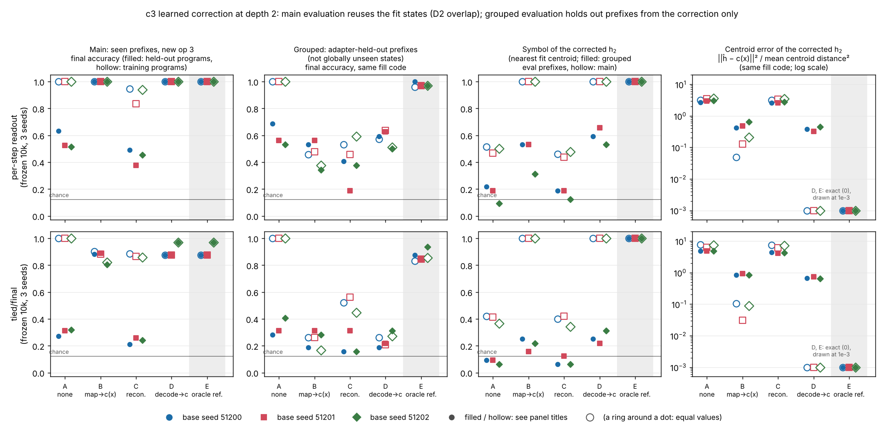
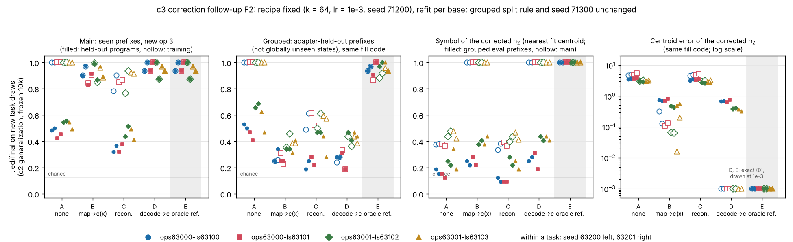

# c3 learned correction (first figure)

**Question.** Can a small correction that sees only the frozen model's depth-2 hidden state recover part of the oracle-centroid improvement on unseen programs? The design was committed before any result: [QUESTION.md](QUESTION.md) at 3e3f73d. Its calibrated map (k = 64, lr = 1e-3) is recorded in [ADAPTIVE.md](ADAPTIVE.md) and the QUESTION.md addendum, both committed before the evaluations ran.

**The overlap, first (D2).**
- **Main evaluation.** Every depth-2 state reached by a held-out program is a training state, and the correction is fit on all 128 of them. The main evaluation therefore tests new op-3 suffixes on seen states, not generalization to new hidden states.
- **Grouped evaluation.** Within each symbol, 8 prefixes are used to fit, 4 to validate and 4 to evaluate. The evaluated prefixes are held out from the correction only. The base network trained on them, so they are adapter-held-out prefixes, not globally unseen states.



Source rows: [figures/correction.csv](figures/correction.csv). Per-row tables: `runs/c3-corr-{main,grouped}-a1/{accuracy,states,fits}.csv`.

## Observations

All six bases are frozen ckpt-10000 runs: per-step readout and tied/final, seeds 51200–51202. Accuracies are final answers. "Held" means held-out-program rows; "train" means training-program rows.

**Checks.**
- All 18 published reproductions are exactly equal: A's held accuracy against c2 `c2-mech-eval-a1`, and E's held and train accuracy against c2's class-mean dose 0.
- Every base's parameter hash is unchanged after each fit and after evaluation.
- Every file SHA-256 matches c2 `recovered/RECOVERY.json`, and the r1 recipe check passed (`checks.json`).

**Main evaluation** (128 held rows; 384 train rows):

| base | A held | B held | C held | D held | E held | B train | C train | D = E train |
|---|---|---|---|---|---|---|---|---|
| per-step 51200 | 0.633 | 1.000 | 0.492 | 1.000 | 1.000 | 1.000 | 0.948 | 1.000 |
| per-step 51201 | 0.523 | 1.000 | 0.375 | 1.000 | 1.000 | 1.000 | 0.836 | 1.000 |
| per-step 51202 | 0.516 | 1.000 | 0.453 | 1.000 | 1.000 | 1.000 | 0.940 | 1.000 |
| tied/final 51200 | 0.273 | 0.883 | 0.211 | 0.875 | 0.875 | 0.904 | 0.885 | 0.875 |
| tied/final 51201 | 0.312 | 0.891 | 0.258 | 0.875 | 0.875 | 0.883 | 0.865 | 0.875 |
| tied/final 51202 | 0.320 | 0.805 | 0.242 | 0.969 | 0.969 | 0.823 | 0.859 | 0.969 |

- **D = E.** D equals E in every cell, because its decoder fits all 128 training states at 1.00.
- **B** recovers 100% of the E − A gain in per-step readout. In tied/final it recovers 101%, 103% and 75%, so B is above E in two bases.
- **C** is below A on held rows in all six bases: −10% to −38% of the gain. It also lowers train rows from 1.00 to 0.84–0.95.

**Grouped evaluation, eval prefixes** (32 held rows; 96 train rows). Here A's train rows are 1.00 in every base.

| base | A held | B held | C held | D held | E held | B train | C train | D train | E train | decoder acc |
|---|---|---|---|---|---|---|---|---|---|---|
| per-step 51200 | 0.688 | 0.531 | 0.406 | 0.594 | 1.000 | 0.458 | 0.531 | 0.573 | 0.958 | 0.59 |
| per-step 51201 | 0.562 | 0.562 | 0.188 | 0.625 | 0.969 | 0.479 | 0.458 | 0.635 | 0.969 | 0.66 |
| per-step 51202 | 0.531 | 0.344 | 0.375 | 0.500 | 0.969 | 0.375 | 0.594 | 0.510 | 0.969 | 0.53 |
| tied/final 51200 | 0.281 | 0.188 | 0.156 | 0.188 | 0.875 | 0.260 | 0.521 | 0.260 | 0.833 | 0.25 |
| tied/final 51201 | 0.312 | 0.312 | 0.312 | 0.219 | 0.844 | 0.260 | 0.562 | 0.208 | 0.844 | 0.22 |
| tied/final 51202 | 0.406 | 0.281 | 0.156 | 0.312 | 0.938 | 0.167 | 0.448 | 0.271 | 0.854 | 0.31 |

- **E.** E uses centroids from the 64 fit prefixes only. With the true symbol it stays at 0.83–1.00 on eval-prefix rows.
- **Learned arms against A on eval-prefix held rows.** Only one learned arm, in one base, is above A: D in per-step 51201, at 0.625 against 0.562 (2 of 32 rows). B is never above A. The gains, as a share of E − A, are:
  - B: −50% to 0%;
  - D: −30% to +15%;
  - C: −92% to 0%.
- **Train rows.** On eval-prefix train rows every learned arm falls from A's 1.00 to between 0.17 and 0.64.
- **Symbol readout.** The decoder reads the symbol of eval-prefix h_2 at 0.53–0.66 (per-step) and 0.22–0.31 (tied/final), against 1.00 on its fit prefixes.
- **The uncorrected state.** Its nearest fit centroid has the right symbol for 0.06–0.22 of eval prefixes (chance 0.125). It does so for 0.50–0.59 of grouped fit prefixes, and for 0.37–0.52 of all prefixes with the main centroids.
- **Fit and val prefixes.** On grouped fit prefixes, B and D behave as in the main evaluation. Val-prefix rows behave like eval-prefix rows (`accuracy.csv`).

**Map fits** (`fits.csv`):
- B's final training MSE is 0.005–0.08; C's is 0.13–0.35.
- Output units stuck at zero while their target is positive somewhere: 3–10 for B, 9–16 for C. This is a property of the declared zero-bias ReLU output.

**Compute.** Calibration 37 s; main and grouped 13 s concurrently. About 0.8 of the 10-minute initial budget is used.

## Predictions (QUESTION.md) against results

| # | prediction | result |
|---|---|---|
| 1 | Hashes unchanged; A and E reproduce r1/c2 | **held**, 18/18 equal |
| 2 | Main: D = E exactly | **held** |
| 2 | Main: B ≥ 80% (per-step), ≥ 60% (tied/final) | **held**: 100% ×3; 101%, 103%, 75% |
| 2 | Main: C ≤ 30% | **held**; C is below A (−10% to −38%) |
| 3 | Grouped: decoder ≥ 0.9 (per-step), 0.5–0.9 (tied/final) | **failed**: 0.53–0.66 and 0.22–0.31 |
| 3 | Grouped: B recovers 50–100% (per-step), 20–80% (tied/final) | **failed**: −50% to 0%, and −24% to 0% |
| 3 | Grouped train rows ≥ 0.9 under B and D (per-step); tied/final may fall below A | **failed** for per-step (0.38–0.64); tied/final fell (0.17–0.27) |
| 4 | B ≤ D + 0.05 in both evaluations | **held except** tied/final 51201 eval prefixes: held 0.312 vs 0.219, train 0.260 vs 0.208 |

## Interpretation (limited; QUESTION.md limits apply)

1. **Seen states.** On the states it was fit on, a supervised post-hoc correction using only h_2 reproduces the oracle-centroid gain in both weak arms. D does so exactly. B recovers 100% in per-step readout and 101%, 103% and 75% in tied/final. Because of the overlap, this shows only that the frozen h_2 of a *seen* prefix can be mapped to its centroid. It says nothing about new states.
2. **New prefixes.** On prefixes the correction did not fit, under this design, the correction recovers essentially none of the gain: at most +15% in one base, and ≤ 0 in the rest. It also breaks answers the base model already got right. F2 replicates this on eight tied/final bases from new task draws (below); there is no per-step-readout arm on those draws. B is not purely a decoder plus a centroid. On grouped eval prefixes, B is above D on held rows in 3 of 14 bases: original tied/final 51201, and F2 `ops63000-ls63100` s63201 and `ops63000-ls63101` s63201. The reviewer also finds that B answers 13–33% of the rows whose state it decodes to a wrong symbol correctly (c3 REVIEW §2). B still stays below A.
   - The design: 8 fit prefixes per symbol, a linear decoder, a 64-unit map, and 2,000 updates.
   - The failing step is reading the symbol from h_2 across prefixes. The decoder is at 0.22–0.66, while the oracle's centroid replacement with the same fit centroids still works (0.83–1.00).
   - This is a finite-data, small-module result. It does not show that h_2 lacks the symbol in a decodable form. Only 16 prefixes per symbol exist at depth 2, so no split can fit on much more.
3. **Not shown.** Nothing here shows that the base model selects centroids internally, that the history residual is uniformly harmful, or that the main-evaluation correction learned no new computation.

## Regenerate

```bash
export PATH=~/.local/bin:$PATH
uv sync --locked --group analysis
uv run --locked python -m unittest -v research/composition-c3/correction/test_corr.py
uv run --locked python research/regimes/common/run_jobs.py --plan research/composition-c3/correction/plan.json \
  --root runs/c3 --registry research/composition-c3/correction/registry.jsonl --session-label LABEL \
  --ids c3-corr-calib-s900200-a1 c3-corr-main-a1 c3-corr-grouped-a1 c3-corr-f2-main-a1 c3-corr-f2-grouped-a1 c3-corr-posthoc-v2-a1   # new IDs if rerun; never reuse
uv run --locked python research/composition-c3/correction/corr_collect.py --root runs/c3 RUN_ID ...
uv run --locked --group analysis python research/composition-c3/correction/corr_figure.py
```

| file | role |
|---|---|
| `corr_core.py` | bases (SHA-256 + recipe check, frozen), prefix sets, grouped split, centroids, map, arms |
| `corr_calib.py` | training-only calibration (grouped fit → val, seed 900200) |
| `corr_eval.py` | arms A–E for one split (`--bases f2` for the follow-up) |
| `corr_posthoc.py` | post-hoc reference: per-step bases' own V2 on grouped prefixes (no fitting) |
| `corr_figure.py` | first figure and the F2 figure, with their CSVs |
| `corr_collect.py` | copies run outputs here with a MANIFEST |
| `test_corr.py` | 8 checks (sets, split, centroid weighting, frozen identity, F2 base verification, map gradient, shared draw, h-only corrections) |

**Figure layout.** The figure has 4 columns rather than the planned 3, because symbol accuracy and centroid error are in separate panels. Its content is otherwise as declared.

## Follow-up F2: new task draws

The coordinator approved F2 at 05:37Z. The declaration and predictions were committed before running, at 95052f5 (QUESTION.md addendum).

- **Bases.** The eight c2 generalization tied/final `ckpt-10000` runs: tasks `ops63000-ls63100`, `ops63000-ls63101`, `ops63001-ls63102` and `ops63001-ls63103`, each with init seeds 63200 and 63201.
- **Recipe.** Fixed (k = 64, lr = 1e-3, 2,000 updates, map seed 71200, probe seed 71301) and refit per base.
- **Scope.** This replicates the tied/final arm only.
- **Split.** The same grouped rule and seed 71300, applied to each task's own prefixes.



Source rows: [figures/followup_f2.csv](figures/followup_f2.csv). Per-row tables: `runs/c3-corr-f2-{main,grouped}-a1/`.

**Observations.**
- **Checks.** A's held accuracy equals each run's logged step-10000 value (8/8). Hashes are unchanged.
- **Main** (seen states):
  - A held: 0.42–0.55.
  - D = E in all eight: 0.875–1.000.
  - B held: 0.83–0.99, recovering 79–100% of E − A.
  - C held: 0.32–0.52, below A in all eight (−12% to −36%).
  - Train rows: B 0.84–0.995, C 0.77–0.94.
- **Grouped eval prefixes** (32 held rows; 96 train rows):
  - A held: 0.41–0.69. E held: 0.91–1.00.
  - B held: 0.25–0.41 (−110% to −13% of the gain). D held: 0.19–0.47 (−90% to −7%). C held: 0.19–0.47 (−85% to −32%).
  - Every learned arm is below A on held rows in all eight bases.
  - Train rows fall from A's 1.00 to 0.23–0.46 (B), 0.19–0.44 (D) and 0.49–0.62 (C). E's train rows are 0.87–1.00.
  - The decoder reads eval-prefix symbols at 0.19–0.44, against 1.00 on its fit prefixes.
  - The uncorrected state's nearest fit centroid is right for 0.125–0.34 of eval prefixes.
- **Compute.** About 19 s with both runs concurrent, so about 0.3 of the 5-minute follow-up budget.

**F2 predictions.**

| # | prediction | result |
|---|---|---|
| 1 | A equals the logged value; hashes unchanged | **held** (8/8) |
| 2 | Main: D = E in all eight; B ≥ 60% in ≥ 6 of 8 | **held** (8/8; B 79–100%) |
| 3 | Grouped: E − A ≥ 0.1 in ≥ 6 of 8 | **held** (8/8) |
| 3 | Grouped: B and D each < 20% of the gain in ≥ 6 | **held** (8/8 each; all negative) |
| 3 | Grouped: decoder ≤ 0.5 in ≥ 6 of 8 | **held** (8/8; 0.19–0.44) |
| 3 | Grouped: B and D train rows < 0.9 in all 8 | **held** |

**Post-hoc reference** (`c3-corr-posthoc-v2-a1`; the coordinator's request; ADAPTIVE.md).
- The per-step bases' own step-2 readout V2 reads the symbol of h_2 at 1.00 on fit, val and eval prefixes alike, in all three seeds. No fitting is involved.
- V2 was trained on all 128 prefixes, and every one is a base training state (D2), so this is not a held-out decoder.
- It shows that one linear readout separates every prefix's frozen h_2 by symbol. It does not show that a readout fit on half the prefixes generalizes to the rest, which is exactly what failed above.

## Bound on the grouped result

Each grouped fit has 64 prefixes (8 per symbol) in a 128-dimensional state, with an unregularized linear decoder and map. The failure bounds this adapter under this exposure. It does not show whether the symbol is linearly available in h_2: the base's own V2 separates all 128 per-step states. At depth 2 there are only 16 prefixes per symbol, so no grouped split can fit on many more.
