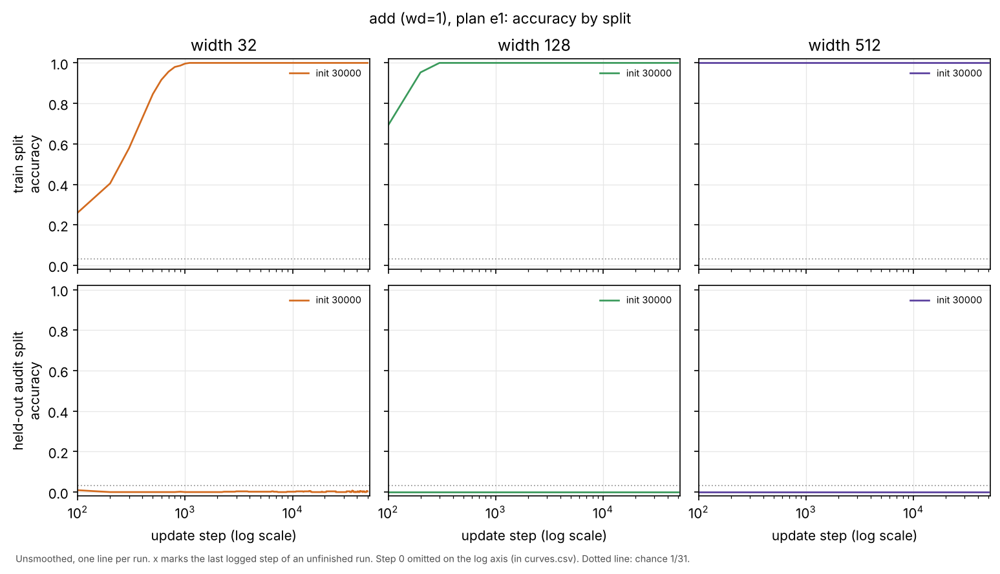
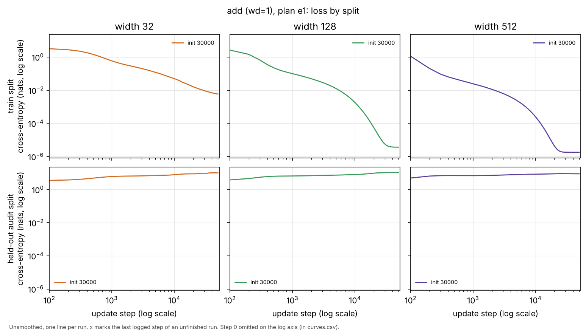
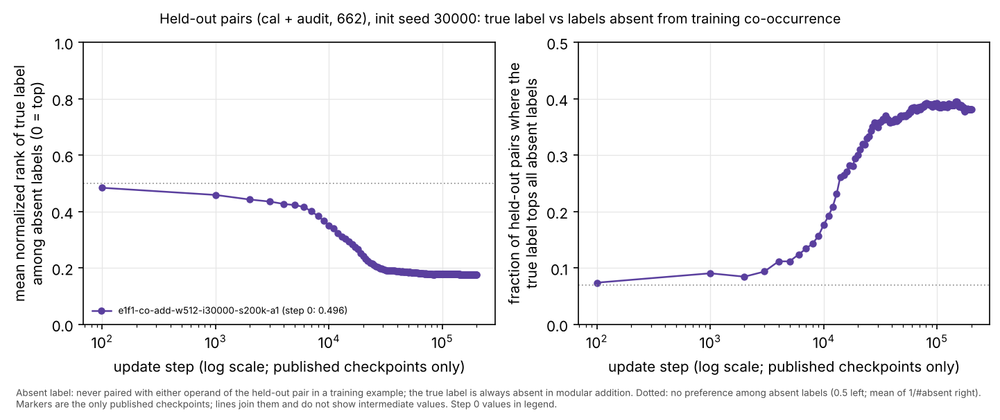
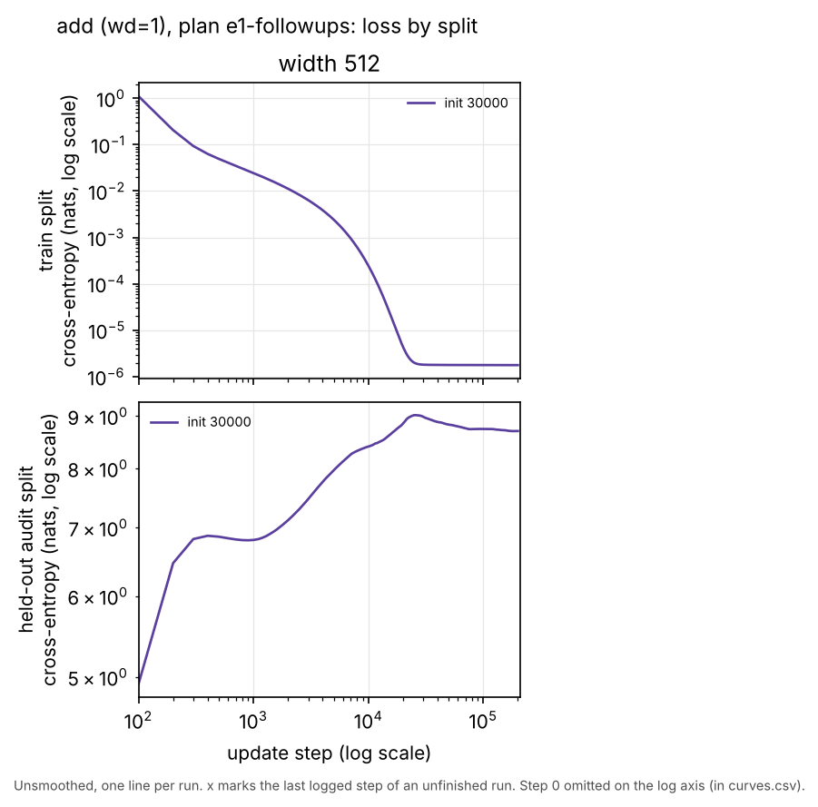

# e1 review index (figures first)

Interpretations are kept separately in [INTERPRETATION.md](INTERPRETATION.md). Audit status: preview 1 is audited in [research/audit/AUDIT.md](../audit/AUDIT.md) (17 software checks PASS; interpretation statuses there).

## Preview 1: one seed at widths 32, 128 and 512

Question: under the fixed recipe (p=31, one hidden ReLU layer, full-batch AdamW lr 1e-3, decay 1, 30% of grouped pairs for training), how do training and held-out accuracy and cross-entropy evolve over 50,000 updates at three widths?





(The loss figure was redrawn after the audit with a separate y scale per row; the data are unchanged.)

Look before reading: compare the train and held-out rows at each width. When does the training split fit, what does held-out accuracy do relative to the dotted chance line, and does held-out loss move with training loss?

Vector versions: [accuracy.svg](figures/preview-1/accuracy.svg), [loss.svg](figures/preview-1/loss.svg). Source data: [curves.csv](figures/preview-1/curves.csv) (every logged step, all three splits, cross-entropy and margins), [status.csv](figures/preview-1/status.csv).

### Status

| run ID | width | init seed | status | completed / planned steps | wall time | session |
|---|---|---|---|---|---|---|
| e1-co-add-w32-i30000-a1 | 32 | 30000 | complete | 50,000 / 50,000 | 27.7 s | co-cloud-1 |
| e1-co-add-w128-i30000-a1 | 128 | 30000 | complete | 50,000 / 50,000 | 71.8 s | co-cloud-1 |
| e1-co-add-w512-i30000-a1 | 512 | 30000 | complete | 50,000 / 50,000 | 264.0 s | co-cloud-1 |

No run in this preview failed or was capped. The other 21 runs of the map are assigned to the size/time lane (`research/plan.json`).

### Observations (descriptive)

| width | first logged step with train acc >= .99 (stays >= .99 after) | max held-out acc, steps >= 1000 | final train CE | final held-out CE | final train margin min / median | final held-out margin median | parameter norm, step 0 -> 50k |
|---|---|---|---|---|---|---|---|
| 32 | 1,000 | 0.0074 | 5.9e-3 | 10.08 | 5.21 / 6.32 | -9.56 | 10.6 -> 47.8 |
| 128 | 300 | 0.0000 | 3.7e-6 | 10.55 | 12.94 / 13.79 | -9.76 | 18.6 -> 60.3 |
| 512 | 100 | 0.0000 | 1.8e-6 | 8.83 | 13.84 / 14.63 | -8.29 | 36.0 -> 59.9 |

Held-out = the audit split (544 pairs); the calibration split (118 pairs) behaves the same (max .017 at width 32, 0 at 128 and 512 after step 1000). Chance is 1/31 = .032. Thresholds (.99) are for description only. Training cross-entropy at widths 128 and 512 flattens near 1e-6 after about 25k updates while the parameter norm levels off; this is the end of a 50k trace, not a convergence claim.

### Provenance

- Code: `ebd874e17028f2c2f04de5ecea9fe4b51b77e425` (each `config.json` records `git_commit` and SHA-256 of every `*.py`; `git_status` lists only untracked non-code files: the registry, and for width 32 also `research/coordinator/WORKER_PROMPTS.md`).
- Data: data seed 31000, `split_sha256` `aa8f7504bf7d925eb90c69183f10daf5778cce9aad8e460b2c907811526d1f24`, addition target `6f1576d4a05ce6f233fd0ffd2e66b637cbcba50724975fa5b05907b8337a2046`; checked before training by `--expect-split-sha256`.
- Environment: CPython 3.12.14, NumPy 2.3.5 (uv lock), OpenBLAS 0.3.30 Haswell kernel, one BLAS thread, Linux cloud container with 4 vCPUs (Intel Xeon 2.10 GHz), session label `co-cloud-1`, two concurrent processes.
- Published files: `research/coordinator/runs/<run_id>/` holds config, runtime, metrics, data and checkpoints at steps 0, 1k, 2k, 5k, 10k, 20k, 50k and the first-fit step; `manifest.json` lists SHA-256 for all 51-52 local checkpoints.
- Registry: `research/coordinator/registry.jsonl`.

Reproduce:

```bash
uv sync --locked --group analysis
uv run --locked python launch_runs.py --root runs/e1 --registry research/coordinator/registry.jsonl \
    --session-label co-cloud-1 --timeout 1500 --workers 2 \
    --ids e1-co-add-w512-i30000-a1 e1-co-add-w128-i30000-a1 e1-co-add-w32-i30000-a1
uv run --locked --group analysis python report_map.py --runs runs/e1 --registries research/coordinator/registry.jsonl \
    --ids e1-co-add-w32-i30000-a1 e1-co-add-w128-i30000-a1 e1-co-add-w512-i30000-a1 \
    --out research/coordinator/figures/preview-1
```

(A rerun must use new run IDs or a fresh registry/output root; the launcher refuses to reuse IDs. A rerun is a reproducibility check, not a new seed. The figures can be redrawn from the published runs with `--runs research/coordinator/runs`.)

## Follow-up 1: width 512, seed 30000, 200,000 updates

Question: at width 512, does the held-out preference found by the audit (the true label rising among labels never co-occurring with either operand in training) turn into held-out accuracy with four times the horizon? Reason and plan entry: `research/plan-followups.json`.





Look before reading: does either panel of the rank figure keep moving after 50,000 updates? Does held-out loss?

The rank figure is drawn with the audit's `heldout_rank.py` and `plot_heldout_rank.py` from all 201 local checkpoints (its footer says "published checkpoints only"; 11 are published). Source: [heldout-rank-all-checkpoints.jsonl](figures/followup-1/heldout-rank-all-checkpoints.jsonl), [curves.csv](figures/followup-1/curves.csv); accuracy figure [accuracy.png](figures/followup-1/accuracy.png).

Observations:

- Status: complete, 200,000 / 200,000 updates, 1,005 s wall including startup, session `co-cloud-1`, code `a096c82` (clean tree apart from the registry).
- Reproducibility check: all 52 checkpoints up to step 50,000 (and every logged metric) are bitwise identical to `e1-co-add-w512-i30000-a1`, run earlier on the same host. This is the same trajectory, not a new seed.
- Held-out (cal and audit) accuracy is 0 at every logged step from 1,000 to 200,000.
- Held-out audit cross-entropy peaks at 8.99 near step 27,000 and drifts down to 8.70 at 200,000. Train cross-entropy stays at 1.77-1.78e-6 and the parameter norm at 59.8-59.9 from about 50,000 on.
- The rank statistic (true label among never-co-occurring labels; 0.5 = no preference) goes 0.50 (step 0), 0.35 (10k), 0.24 (20k), 0.185 (50k), 0.178 (100k), 0.177 (200k). The fraction of held-out pairs where the true label tops those labels goes 0.065, 0.18, 0.30, 0.37, 0.39, 0.38 (no-preference level 0.070).

Published: `research/coordinator/runs/e1f1-co-add-w512-i30000-s200k-a1/` (checkpoints 0, 1k, 2k, 5k, 10k, 20k, 50k, 100k, 150k, 200k and first fit; hashes for all 202 in `manifest.json`).
