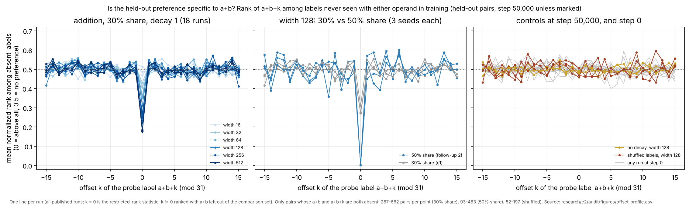
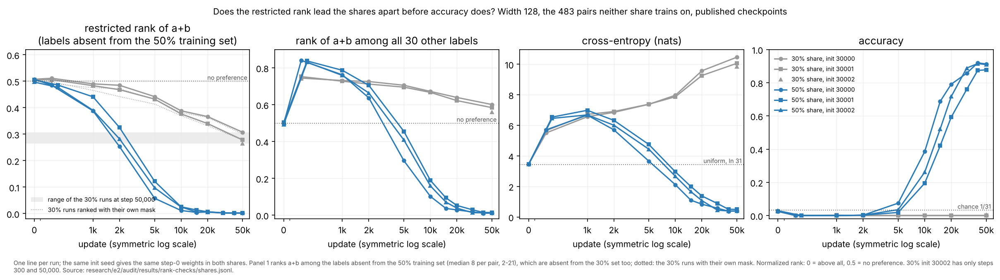

# e2 independent audit: the restricted rank, the common set and "the rank precedes accuracy"

Session `e2-au-cloud-1`, branch `claude/project-thread-id1tmm`, base `6aaa3a2` (dispatch `48ea420`, shared code `fe284a5`). Inputs are the published e1, follow-up 1 and follow-up 2 runs; no new training runs. The question was written down before the new comparisons were computed ([QUESTION.md](QUESTION.md), with one dated note added afterwards). Software checks are PASS / FAIL / NOT CHECKED; interpretations are SUPPORTED LOCALLY / AMBIGUOUS / CONTRADICTED. The audit pairs have guided exploration since e1, so everything here is exploratory evaluation, not a confirmatory holdout.

## Figure 1: is the held-out preference specific to a+b?



Look before reading: is there any dip or bump away from k = 0, and is it larger than the step-0 profiles in light gray?

For each held-out pair, the label a+b+k is ranked among the labels never seen with either operand in training (the restricted-rank mask), only on pairs where both a+b and a+b+k are absent. At k = 0 this is the restricted-rank statistic. At k ≠ 0, a+b is left out of the comparison set, because a highly ranked a+b sits above every other probe and would push them all above 0.5. Source: [offset-profile.csv](figures/offset-profile.csv), from [offset_profile.py](offset_profile.py).

- **30% share.** The dip at k = 0 deepens with width: 0.47–0.51 at width 16 and 0.18–0.19 at width 512. Away from k = 0 no offset differs from 0.5 by more than 0.09 in any run. The spread over k is 0.016–0.034, against 0.016–0.019 for the no-decay runs and 0.010–0.016 for the same split at step 0.
- **50% share.** The dip reaches 0.002–0.003. The off-zero profile is noisier (largest deviation 0.11–0.14, spread 0.043–0.061) because only 2–21 labels are absent per pair, against 0.027–0.033 at step 0.
- **Controls.** The no-decay and shuffled-label runs and every step-0 profile are flat at 0.5 within ±0.11.
- **Seed consistency.** Off-zero profiles correlate across seeds at 0.09–0.68 in decayed addition runs of width ≥ 64. The correlation is −0.13 to 0.26 for the controls and about 0 at step 0.
- **No ties or singletons.** No pair is left out for lack of a comparison label, and no logit ties occur.

## Figure 2: does the restricted rank lead the two shares apart before accuracy does?



Look before reading: at which checkpoint does each panel first separate blue from gray? Then compare the gray band in panel 1 with where the blue lines cross it.

All runs are width 128 and all values are on the 483 pairs that neither share trains on. Panel 1 ranks a+b among the labels absent from the 50% training set. Those labels are absent from the 30% training set too, so one mask serves both shares; the dotted lines use the 30% runs' own mask and track the solid ones within 0.03. The same init seed gives byte-identical step-0 weights in both shares (checked for 30000 and 30001). Source: `results/rank-checks/shares.jsonl`.

| step | restricted rank, 50% / 30% | rank among all labels, 50% / 30% | cross-entropy, 50% / 30% | accuracy, 50% / 30% |
|---|---|---|---|---|
| 1k | 0.39–0.44 / 0.48–0.49 | 0.76–0.79 / 0.73 | 6.67–6.98 / 6.56–6.72 | 0 / 0–0.002 |
| 2k | 0.25–0.33 / 0.47–0.48 | 0.64–0.71 / 0.71–0.73 | 5.71–6.33 / 6.85–6.90 | 0.002 / 0 |
| 5k | 0.06–0.12 / 0.43–0.44 | 0.30–0.46 / 0.70–0.71 | 3.65–4.74 / 7.38 | 0.019–0.075 / 0 |
| 50k | 0.0015–0.0025 / 0.26–0.31 | 0.011–0.015 / 0.56–0.60 | 0.38–0.49 / 9.86–10.46 | 0.878–0.913 / 0–0.004 |

The 30% values at 1k, 2k and 5k come from two seeds; init 30002 has only steps 300 and 50,000.

## Software checks

| # | Check | Result | Evidence |
|---|---|---|---|
| G1 | Restricted-rank mask uses training pairs only | PASS | All three implementations build it from the `train` indices alone: `research/audit/heldout_rank.py`, mechanisms `relational.py` and the loop in mechanisms `crosscheck.py` (read). In all 28 published runs the splits are disjoint, cover the 961 pairs and equal the frozen split files (`definition.jsonl`) |
| G2 | Operand positions and transposes | PASS | Every training set is transpose-closed. With addition targets, the position-specific and position-ignored masks are identical (0 entries differ), and a+b is absent for every held-out pair (662 of 662 and 483 of 483). With shuffled targets the two masks differ in 4,897 (pair, label) entries and change which of 154 pairs are usable, so the shuffled control depends on that choice; G6 removes the dependence. Note: (a, b) and (b, a) are two correlated observations. In the decayed addition runs their ranks correlate at 0.76–0.87 at widths 128–512 and at 0.95–1.0 at widths 16–64 and at 50%. The 662 pairs are 341 transpose groups (248 of the 483), so any interval that treats pairs as independent is too narrow by up to √2 |
| G3 | Ties, set sizes, empty and singleton sets, normalization, missing values | PASS for every published output | No ties occur at any final checkpoint of the 28 runs; counting ties against a+b gives the same mean. Absent labels per pair, a+b included: 6–27 (median 15) at 30%, 2–21 (median 8) at 50%, 5–21 (median 10) for shuffled targets under their own mask. There are no singletons, so no division by zero. Shuffled-target pairs whose a+b is present are left out and counted (197 of 662 remain), not silently. Latent edge case: `heldout_rank.py` and `relational.py` divide by zero if a+b is a pair's only absent label. That cannot happen in these splits but can at larger shares; minimal patch: drop and count rows with `absent_other.sum(1) == 0`, as `offset_profile.py` does |
| G4 | Chance references | PASS | Top-of-absent chance is the mean of 1/#absent over usable pairs: 0.0698 (30%), 0.1354 (50%), 0.1009 (shuffled, own mask). These match the 0.070 and 0.135 quoted in `research/coordinator/INDEX.md`, e1 AUDIT Part 4 and the mechanisms README. The rank mean has chance 0.5 in every split, so rank means compare across splits; top fractions compare only with their own split's reference |
| G5 | Like-for-like across shares | PASS | Nesting was checked from the frozen files: the 50% training set is the 30% training set plus 118 e1 calibration and 61 e1 audit pairs. On the 483 common pairs, a label absent under the 50% mask is absent under the 30% mask for every pair. At 50k the 30% runs rank 0.26–0.31 with the 50% mask (0.26–0.30 with their own) and the 50% runs 0.0015–0.0025. Top fractions: 0.29–0.37 against 0.99 (chance 0.135). All 30% widths share one split and mask, so the width comparison was like-for-like already |
| G6 | Nulls that keep the mask (width 128, three seeds, step 50,000) | PASS: the mask alone does not produce the signal | Trained rank: 0.27–0.31. Nulls: a random other absent label as the probe, same logits and mask, 0.500 (95% of 1,000 draws within 0.476–0.524); step 0, 0.499–0.504; the no-decay model, whose mask is identical (verified), 0.479–0.492; the shuffled-label model scored under the addition run's mask, pairs and probe, 0.498–0.504 (top fraction 0.057–0.070, chance 0.070). `nulls.jsonl` |
| G7 | `research/e2/coordinator/common_set.py` (uses `experiment.forward`) | PASS | Recomputed from the frozen split files with independent code. All 12 fields of `common_set.json` are equal, including the hash, class counts and "483 = 50% cal ∪ audit" (483 transpose-closed pairs, all inside the e1 audit split). The saved index is equal. All 51 rows of `common_set_scores.csv` match: accuracy identical, cross-entropy within 1.8e-15, median margin identical, no ties. At 50k: 30% runs 0 / 0 / 0.004, 50% runs 0.913 / 0.878 / 0.909. `results/common-set-check.json` |
| G8 | 50% runs: data, hashes, partition, recomputation, replay | PASS, by citation | e1 AUDIT Part 4 covers this: F10 (split rebuild, hash, 8 / 2 / 6 groups per residue), F11 (handoff, recipe, step-0 weights), F12 (all 11 checkpoints of all three seeds recomputed; CE within 4.1e-16), F13 (replays to 5k, all seeds, ≤ 9.5e-14), F14 (full replay of seed 30001; rounding only) and F15 (rank files). New here: G5 and G7 |
| G9 | Re-running every script in this directory reproduces every committed result file | PASS | Byte-identical, in 2.6 s total |

## Interpretations

| Claim | Verdict | Evidence and scope |
|---|---|---|
| The restricted-rank signal is specific to a+b: no other label at a fixed offset is preferred | SUPPORTED LOCALLY | Figure 1. Away from k = 0, deviations stay within 0.09 at 30% and 0.14 at 50%, comparable to the step-0 profiles (up to 0.10). This does not show that the readout is non-periodic: a readout spread evenly over many frequencies is itself a single sharp peak at a+b (dated note in QUESTION.md) |
| Decayed addition runs carry weak, seed-consistent structure at k ≠ 0 | AMBIGUOUS | Cross-seed correlations of 0.09–0.68 at width ≥ 64, against about 0 for controls and step 0. Each k uses a different subset of pairs, and the effect is a few hundredths of rank |
| The restricted rank reflects learned structure, not the mask | SUPPORTED LOCALLY | G6: four nulls that keep the mask all give 0.48–0.50 |
| In the 50% runs the restricted preference precedes held-out accuracy (e1 AUDIT Part 4; DISPATCH item 4) | SUPPORTED LOCALLY, partly by construction | The top-of-absent fraction is never below accuracy, by construction: if a+b is the argmax it tops the absent labels. This holds at all 51 checkpoints. The rank mean is not tied that way. On matched pairs and mask it separates the shares at 1k in all three 50% seeds against both 30% seeds with a 1k checkpoint, by 0.04–0.10. Cross-entropy and the unrestricted rank do not separate until 2k; at 1k both are slightly *worse* for 50%. Accuracy separates at 5k. Scope: 3 against 2 seeds, one nested split pair, checkpoints 1k apart |
| The restricted rank is an early signature of the eventual successful computation | CONTRADICTED as a level; AMBIGUOUS as a rate | The 50% runs pass 0.25–0.33 at 2k. The 30% runs reach the same 0.26–0.31 by 50k with accuracy 0–0.004 and cross-entropy near 10 nats, and the follow-up 1 run at width 512 plateaus at 0.177 to 200k without accuracy. A given value does not indicate eventual accuracy. What differs early is the rate, and that rests on the scope above |

I did not attack the mechanisms per-unit concentration reading this round. As the coordinator's DECISIONS.md already records, it is an observation on outputs not yet audited.

## Most consequential remaining uncertainty

Whether an early fall of the restricted rank predicts eventual generalization, rather than coinciding with it in one nested split pair. The two shares differ in which pairs are trained as well as how many (e1 AUDIT Part 4). The earliest separation is one published checkpoint (1k) on two 30% seeds, and the restricted rank only separates the shares earlier because it removes the labels seen with an operand: at 1k the 50% runs rank a+b *lower* among all labels than the 30% runs. A test would use a second 50% partition, or a 30% partition drawn from the 50% one, with checkpoints every 250 updates to 5k. Its prediction, fixed in advance, would be the restricted rank at 1–2k against accuracy at 50k.

## Reproduce

From this branch, with BLAS threads set to 1 and uv 0.12:

```bash
CO=research/coordinator/runs; ST=research/size-time/runs; E=research/e2/audit
uv run --locked python $E/offset_profile.py 50000 $CO/e1-co-* $CO/e1f2-* $ST/* > $E/results/offset-profile-50k.jsonl
uv run --locked python $E/offset_profile.py 0 $(for r in $CO/e1-co-* $ST/* $CO/e1f2-*; do [ -f $r/checkpoint_000000.npz ] && echo $r; done) > $E/results/offset-profile-step0.jsonl
uv run --locked python $E/rank_checks.py $E/results/rank-checks
uv run --locked python $E/check_common_set.py > $E/results/common-set-check.json
uv run --locked --group analysis python $E/plot_offset_profile.py $E/figures/offset-profile $E/results/offset-profile-50k.jsonl $E/results/offset-profile-step0.jsonl
uv run --locked --group analysis python $E/plot_precedes.py $E/figures/precedes $E/results/rank-checks/shares.jsonl
```

## Budget and accounting

- **Numerical time.** e2 used under one minute in total (2.6 s for a full regeneration), one process at a time, one BLAS thread, no paid compute. e1 usage (about 23 of 30 minutes) is reported separately in `research/audit/AUDIT.md`.
- **Runs and registry.** No training runs were launched, so there are no `plan.json` claims and `registry.jsonl` is not created.
- **Shared code.** No shared code was changed.
