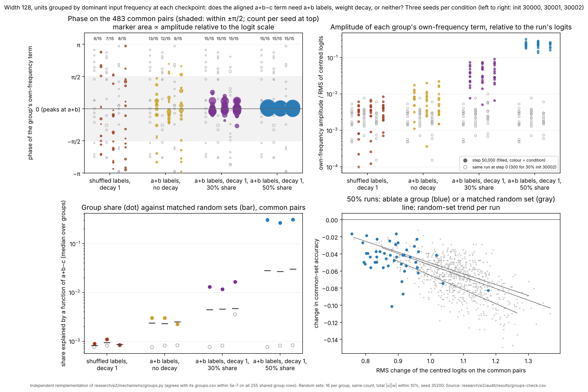
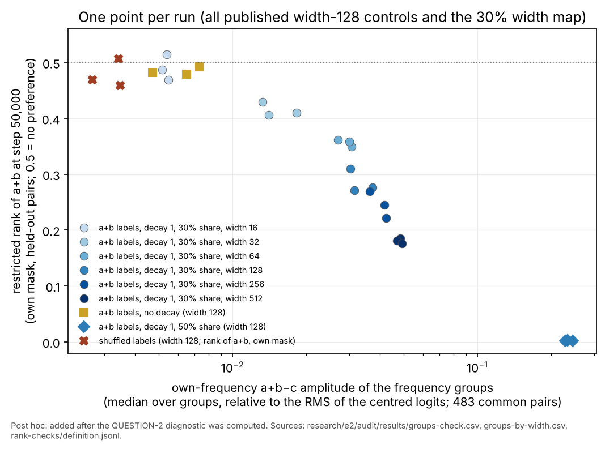
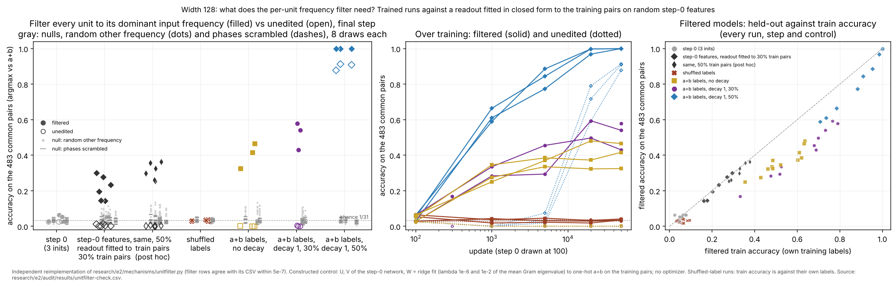
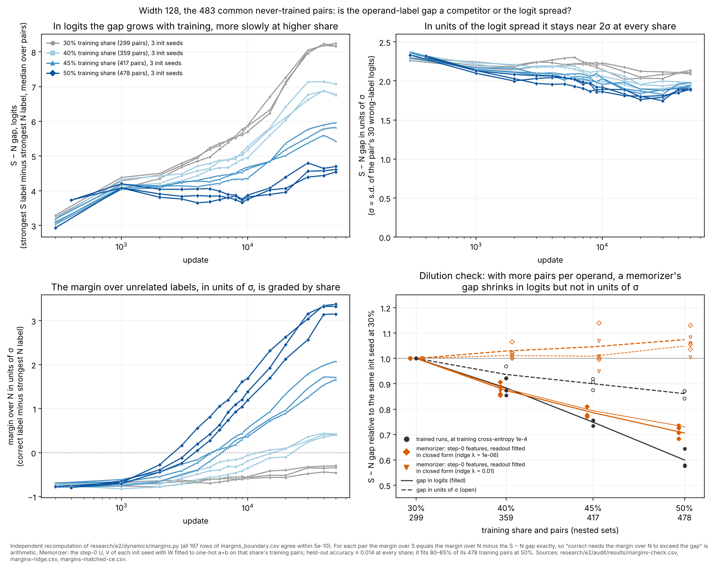

# e2 independent audit: the restricted rank, the common set and "the rank precedes accuracy"

Session `e2-au-cloud-1`, branch `claude/project-thread-id1tmm`, base `6aaa3a2` (dispatch `48ea420`, shared code `fe284a5`). Inputs are the published e1, follow-up 1 and follow-up 2 runs; no new training runs. The question was written down before the new comparisons were computed ([QUESTION.md](QUESTION.md), with one dated note added afterwards). Software checks are PASS / FAIL / NOT CHECKED; interpretations are SUPPORTED LOCALLY / AMBIGUOUS / CONTRADICTED. The audit pairs have guided exploration since e1, so everything here is exploratory evaluation, not a confirmatory holdout.

## Figure 1: is the held-out preference specific to a+b?


Look before reading: is there any dip or bump away from k = 0, and is it larger than the step-0 profiles in light gray?

For each held-out pair, the label a+b+k is ranked among the labels never seen with either operand in training (the restricted-rank mask), only on pairs where both a+b and a+b+k are absent. At k = 0 this is the restricted-rank statistic. At k ≠ 0, a+b is left out of the comparison set, because a highly ranked a+b sits above every other probe and would push them all above 0.5. Source: [offset-profile.csv](figures/offset-profile.csv), from [offset_profile.py](offset_profile.py).

- **30% share.** The dip at k = 0 deepens with width: 0.47–0.51 at width 16 and 0.18–0.19 at width 512. Away from k = 0 no offset differs from 0.5 by more than 0.09 in any run. The spread over k is 0.016–0.034, against 0.016–0.019 for the no-decay runs and 0.010–0.016 for the same split at step 0.
- **50% share.** The dip reaches 0.002–0.003. The off-zero profile is noisier (largest deviation 0.11–0.14, spread 0.043–0.061) because only 2–21 labels are absent per pair, against 0.027–0.033 at step 0.
- **Controls.** The no-decay and shuffled-label runs and every step-0 profile are flat at 0.5 within ±0.11.
- **Seed consistency.** Off-zero profiles correlate across seeds at 0.09–0.68 in decayed addition runs of width ≥ 64. The correlation is −0.13 to 0.26 for the controls and about 0 at step 0.
- **No ties or singletons.** No pair is left out for lack of a comparison label, and no logit ties occur.

## Figure 2: does the restricted rank lead the two shares apart before accuracy does?


Look before reading: at which checkpoint does each panel first separate blue from gray? Then compare the gray band in panel 1 with where the blue lines cross it.

All runs are width 128 and all values are on the 483 pairs that neither share trains on. Panel 1 ranks a+b among the labels absent from the 50% training set. Those labels are absent from the 30% training set too, so one mask serves both shares; the dotted lines use the 30% runs' own mask and track the solid ones within 0.03. The same init seed gives byte-identical step-0 weights in both shares (checked for 30000 and 30001). Source: `results/rank-checks/shares.jsonl`.

| step | restricted rank, 50% / 30% | rank among all labels, 50% / 30% | cross-entropy, 50% / 30% | accuracy, 50% / 30% |
|---|---|---|---|---|
| 1k | 0.39–0.44 / 0.48–0.49 | 0.76–0.79 / 0.73 | 6.67–6.98 / 6.56–6.72 | 0 / 0–0.002 |
| 2k | 0.25–0.33 / 0.47–0.48 | 0.64–0.71 / 0.71–0.73 | 5.71–6.33 / 6.85–6.90 | 0.002 / 0 |
| 5k | 0.06–0.12 / 0.43–0.44 | 0.30–0.46 / 0.70–0.71 | 3.65–4.74 / 7.38 | 0.019–0.075 / 0 |
| 50k | 0.0015–0.0025 / 0.26–0.31 | 0.011–0.015 / 0.56–0.60 | 0.38–0.49 / 9.86–10.46 | 0.878–0.913 / 0–0.004 |

The 30% values at 1k, 2k and 5k come from two seeds; init 30002 has only steps 300 and 50,000.

## Software checks

| # | Check | Result | Evidence |
|---|---|---|---|
| G1 | Restricted-rank mask uses training pairs only | PASS | All three implementations build it from the `train` indices alone: `research/audit/heldout_rank.py`, mechanisms `relational.py` and the loop in mechanisms `crosscheck.py` (read). In all 28 published runs the splits are disjoint, cover the 961 pairs and equal the frozen split files (`definition.jsonl`) |
| G2 | Operand positions and transposes | PASS | Every training set is transpose-closed. With addition targets, the position-specific and position-ignored masks are identical (0 entries differ), and a+b is absent for every held-out pair (662 of 662 and 483 of 483). With shuffled targets the two masks differ in 4,897 (pair, label) entries and change which of 154 pairs are usable, so the shuffled control depends on that choice; G6 removes the dependence. Note: (a, b) and (b, a) are two correlated observations. In the decayed addition runs their ranks correlate at 0.76–0.87 at widths 128–512 and at 0.95–1.0 at widths 16–64 and at 50%. The 662 pairs are 341 transpose groups (248 of the 483), so any interval that treats pairs as independent is too narrow by up to √2 |
| G3 | Ties, set sizes, empty and singleton sets, normalization, missing values | PASS for every published output | No ties occur at any final checkpoint of the 28 runs; counting ties against a+b gives the same mean. Absent labels per pair, a+b included: 6–27 (median 15) at 30%, 2–21 (median 8) at 50%, 5–21 (median 10) for shuffled targets under their own mask. There are no singletons, so no division by zero. Shuffled-target pairs whose a+b is present are left out and counted (197 of 662 remain), not silently. Latent edge case: `heldout_rank.py` and `relational.py` divide by zero if a+b is a pair's only absent label. That cannot happen in these splits but can at larger shares; minimal patch: drop and count rows with `absent_other.sum(1) == 0`, as `offset_profile.py` does |
| G4 | Chance references | PASS | Top-of-absent chance is the mean of 1/#absent over usable pairs: 0.0698 (30%), 0.1354 (50%), 0.1009 (shuffled, own mask). These match the 0.070 and 0.135 quoted in `research/coordinator/INDEX.md`, e1 AUDIT Part 4 and the mechanisms README. The rank mean has chance 0.5 in every split, so rank means compare across splits; top fractions compare only with their own split's reference |
| G5 | Like-for-like across shares | PASS | Nesting was checked from the frozen files: the 50% training set is the 30% training set plus 118 e1 calibration and 61 e1 audit pairs. On the 483 common pairs, a label absent under the 50% mask is absent under the 30% mask for every pair. At 50k the 30% runs rank 0.26–0.31 with the 50% mask (0.26–0.30 with their own) and the 50% runs 0.0015–0.0025. Top fractions: 0.29–0.37 against 0.99 (chance 0.135). All 30% widths share one split and mask, so the width comparison was like-for-like already |
| G6 | Nulls that keep the mask (width 128, three seeds, step 50,000) | PASS: the mask alone does not produce the signal | Trained rank: 0.27–0.31. Nulls: a random other absent label as the probe, same logits and mask, 0.500 (95% of 1,000 draws within 0.476–0.524); step 0, 0.499–0.504; the no-decay model, whose mask is identical (verified), 0.479–0.492; the shuffled-label model scored under the addition run's mask, pairs and probe, 0.498–0.504 (top fraction 0.057–0.070, chance 0.070). `nulls.jsonl` |
| G7 | `research/e2/coordinator/common_set.py` (uses `experiment.forward`) | PASS | Recomputed from the frozen split files with independent code. All 12 fields of `common_set.json` are equal, including the hash, class counts and "483 = 50% cal ∪ audit" (483 transpose-closed pairs, all inside the e1 audit split). The saved index is equal. All 51 rows of `common_set_scores.csv` match: accuracy identical, cross-entropy within 1.8e-15, median margin identical, no ties. At 50k: 30% runs 0 / 0 / 0.004, 50% runs 0.913 / 0.878 / 0.909. `results/common-set-check.json` |
| G8 | 50% runs: data, hashes, partition, recomputation, replay | PASS, by citation | e1 AUDIT Part 4 covers this: F10 (split rebuild, hash, 8 / 2 / 6 groups per residue), F11 (handoff, recipe, step-0 weights), F12 (all 11 checkpoints of all three seeds recomputed; CE within 4.1e-16), F13 (replays to 5k, all seeds, ≤ 9.5e-14), F14 (full replay of seed 30001; rounding only) and F15 (rank files). New here: G5 and G7 |
| G9 | Re-running every script in this directory reproduces every committed result file | PASS | Byte-identical, in 2.6 s total |

## Interpretations

| Claim | Verdict | Evidence and scope |
|---|---|---|
| The restricted-rank signal is specific to a+b: no other label at a fixed offset is preferred | SUPPORTED LOCALLY | Figure 1. Away from k = 0, deviations stay within 0.09 at 30% and 0.14 at 50%, comparable to the step-0 profiles (up to 0.10). This does not show that the readout is non-periodic: a readout spread evenly over many frequencies is itself a single sharp peak at a+b (dated note in QUESTION.md) |
| Decayed addition runs carry weak, seed-consistent structure at k ≠ 0 | AMBIGUOUS | Cross-seed correlations of 0.09–0.68 at width ≥ 64, against about 0 for controls and step 0. Each k uses a different subset of pairs, and the effect is a few hundredths of rank |
| The restricted rank reflects learned structure, not the mask | SUPPORTED LOCALLY | G6: four nulls that keep the mask all give 0.48–0.50 |
| In the 50% runs the restricted preference precedes held-out accuracy (e1 AUDIT Part 4; DISPATCH item 4) | SUPPORTED LOCALLY, partly by construction | The top-of-absent fraction is never below accuracy, by construction: if a+b is the argmax it tops the absent labels. This holds at all 51 checkpoints. The rank mean is not tied that way. On matched pairs and mask it separates the shares at 1k in all three 50% seeds against both 30% seeds with a 1k checkpoint, by 0.04–0.10. Cross-entropy and the unrestricted rank do not separate until 2k; at 1k both are slightly *worse* for 50%. Accuracy separates at 5k. Scope: 3 against 2 seeds, one nested split pair, checkpoints 1k apart |
| The restricted rank is an early signature of the eventual successful computation | CONTRADICTED as a level; AMBIGUOUS as a rate | The 50% runs pass 0.25–0.33 at 2k. The 30% runs reach the same 0.26–0.31 by 50k with accuracy 0–0.004 and cross-entropy near 10 nats, and the follow-up 1 run at width 512 plateaus at 0.177 to 200k without accuracy. A given value does not indicate eventual accuracy. What differs early is the rate, and that rests on the scope above |

I did not attack the mechanisms per-unit concentration reading this round. As the coordinator's DECISIONS.md already records, it is an observation on outputs not yet audited.

## Most consequential remaining uncertainty

Whether an early fall of the restricted rank predicts eventual generalization, rather than coinciding with it in one nested split pair. The two shares differ in which pairs are trained as well as how many (e1 AUDIT Part 4). The earliest separation is one published checkpoint (1k) on two 30% seeds, and the restricted rank only separates the shares earlier because it removes the labels seen with an operand: at 1k the 50% runs rank a+b *lower* among all labels than the 30% runs. A test would use a second 50% partition, or a 30% partition drawn from the 50% one, with checkpoints every 250 updates to 5k. Its prediction, fixed in advance, would be the restricted rank at 1–2k against accuracy at 50k.

## Reproduce

From this branch, with BLAS threads set to 1 and uv 0.12:

```bash
CO=research/coordinator/runs; ST=research/size-time/runs; E=research/e2/audit
uv run --locked python $E/offset_profile.py 50000 $CO/e1-co-* $CO/e1f2-* $ST/* > $E/results/offset-profile-50k.jsonl
uv run --locked python $E/offset_profile.py 0 $(for r in $CO/e1-co-* $ST/* $CO/e1f2-*; do [ -f $r/checkpoint_000000.npz ] && echo $r; done) > $E/results/offset-profile-step0.jsonl
uv run --locked python $E/rank_checks.py $E/results/rank-checks
uv run --locked python $E/check_common_set.py > $E/results/common-set-check.json
uv run --locked --group analysis python $E/plot_offset_profile.py $E/figures/offset-profile $E/results/offset-profile-50k.jsonl $E/results/offset-profile-step0.jsonl
uv run --locked --group analysis python $E/plot_precedes.py $E/figures/precedes $E/results/rank-checks/shares.jsonl
```

## Budget and accounting

- **Numerical time.** e2 used under one minute in total (2.6 s for a full regeneration), one process at a time, one BLAS thread, no paid compute. e1 usage (about 23 of 30 minutes) is reported separately in `research/audit/AUDIT.md`.
- **Runs and registry.** No training runs were launched, so there are no `plan.json` claims and `registry.jsonl` is not created.
- **Shared code.** No shared code was changed.

---

# Cycle 2: mechanisms packet 1 and the onset checkpoints

Base `8b11c2c`. The question and the decision rule were written down before computing: [QUESTION-2.md](QUESTION-2.md), committed at `145b29e`. The target is mechanisms packet 1 (`research/e2/mechanisms/`, PR #15). Its claim: units grouped by dominant input frequency carry an own-frequency a+b−c term aligned with the correct label in both shares, and removing a group does no more damage than removing a matched random set. Its own strongest alternative is that the aligned terms come from fitting labels equal to a+b.

## Figure 3: does the aligned term need a+b labels, weight decay, or neither?



Look before reading: in the top left, which conditions fill the shaded band (phase within ±π/2), and with what marker sizes? In the top right, how far does each colour sit above the open gray step-0 markers of the same runs?

Independent reimplementation (`groups_check.py`) at step 50,000, three seeds per condition, width 128, on the 483 common pairs. Step 0 has only three distinct networks, because every condition with the same init seed starts from the same weights.

| condition | input concentration | groups within ±π/2 (per seed) | within 0.5 rad | own-frequency amplitude, logits (median per seed) | amplitude / RMS of centred logits | share: groups / random sets | random sets within ±π/2 at the group's k | restricted rank |
|---|---|---|---|---|---|---|---|---|
| step 0 (3 networks) | 0.17 | 21/45 (7, 6, 8) | 11/45 | 0.0003–0.0005 | 0.0018–0.0027 | 0.0008 / 0.0008 | 0.50–0.57 | 0.50 |
| shuffled labels, decay 1 | 0.17 | 21/45 (6, 7, 8) | 10/45 | 0.012–0.016 | 0.0027–0.0035 | 0.0008–0.0011 / 0.0008–0.0009 | 0.53–0.63 | 0.50 under the addition mask |
| a+b labels, no decay | 0.22–0.23 | 34/45 (13, 12, 9) | 20/45 | 0.041–0.061 | 0.0047–0.0074 | 0.0023–0.0030 / 0.0023–0.0025 | 0.10–0.11 | 0.48–0.49 |
| a+b labels, decay 1, 30% | 0.40–0.44 | 45/45 | 40/45 | 0.12–0.15 | 0.030–0.037 | 0.012–0.017 / 0.0044–0.0047 | 0.25–0.28 | 0.26–0.31 |
| a+b labels, decay 1, 50% | 0.83–0.85 | 45/45 | 45/45 | 0.66–0.70 | 0.23–0.25 | 0.26–0.31 / 0.027–0.030 | 0.40–0.45 | 0.002–0.003 |

- **Shuffled labels.** The groups sit at the step-0 level on alignment, relative amplitude and share, so the readout does not make any trained network look aligned.
- **No decay.** The groups are aligned more often than at step 0 (34/45 against 21/45). Their amplitude relative to the logits is 2–3× the step-0 level and about one fifth of the decayed 30% runs'. Their share is no higher than that of random sets.
- **The background.** Random sets in the no-decay runs are mostly *anti*-aligned at the same k (10–11% within ±π/2). That fits a dip at d = 0 from the operand-associated labels, which the packet also saw.

## Figure 4 (post hoc): amplitude of the aligned term against the restricted rank



Added after the diagnostic above was computed. It covers all 18 runs of the 30% width map at 50k (`groups-by-width.csv`), plus the width-128 controls and the 50% runs.

- **30% width map.** The groups' relative amplitude orders the restricted rank across the map: Spearman −0.99 over 18 runs. Most of that ordering is between widths, so it is confounded with width.
- **Fixed width 128.** At width 128 the three a+b conditions follow the same order: no decay 0.005–0.007 (rank 0.48–0.49), 30% 0.030–0.037 (0.26–0.31), 50% 0.23–0.25 (0.002).
- **Width 16.** The decayed runs at width 16 have the same amplitude as the no-decay runs (0.005) and the same null rank.

## Figure 5: the share separation with three seeds per share at 1k spacing


The figure adds the D9 checkpoints (3k, 4k, 6k–9k of all runs, and 1k–10k of 30% init 30002).

| readout | first checkpoint where the 50% runs separate from the 30% runs (three seeds each) |
|---|---|
| restricted rank | 1k: 0.39–0.44 against 0.48–0.49 |
| rank among all labels | 2k: 0.64–0.71 against 0.71–0.73. At 1k the 50% runs are worse (0.76–0.79 against 0.73) |
| cross-entropy | 2k: 5.71–6.33 against 6.85–6.90. At 1k they overlap (6.67–6.98 against 6.56–6.72) |
| accuracy | 2k: 1 of 483 pairs in each 50% run. Above chance (1/31) in two seeds at 5k and in all three at 6k |

The 50% runs pass the 30% runs' final level (0.26–0.31) between 2k and 3k: 0.25–0.33 at 2k, 0.14–0.25 at 3k.

## Software checks, cycle 2

| # | Check | Result | Evidence |
|---|---|---|---|
| G10 | Group readout reimplemented from the packet's written definitions | PASS | On all 255 group rows shared with `groups.csv` (six runs, 0 / 5k / 50k), group sizes are identical. Share, phase, amplitude, common-set accuracy after ablation and RMS logit change agree within 5e-7, the rounding of the audit CSV |
| G11 | Grouping uses only the analysed checkpoint | PASS | `groups.py` takes dominant frequencies from `unit_shares(w)` of the checkpoint it loads. The audit recomputes groups from each checkpoint alone and gets the same group sizes at every shared step. The over-training panel reads groups at each checkpoint, so no future grouping is used |
| G12 | Random sets matched as claimed | PASS, with a note | **Count and norm:** all 16 draws were found for every group at every checkpoint (240 per run and step). **Gates:** ablating hidden units cannot change another unit's gate in a one-layer network, and the audit's ablation, base logits minus the group's contribution, reproduces the packet's accuracies. **Logit change:** groups move the logits less than their random sets (RMS over all pairs 0.92–0.96 against 1.09–1.10; over the common pairs 0.86–0.92 against 1.07–1.08), so count-and-norm matching does not match functional size. Against the random-set trend at equal RMS change over all pairs, group residuals average −0.000 to +0.005 (random-set scatter 0.014–0.018), with 5–7 of 15 groups below the trend. Measured on the common pairs only, groups fall slightly below the trend: −0.002 to −0.007, with 8–11 of 15 below. "No worse than a matched random set" holds either way, within the scatter |
| G13 | Step-0 reference | Statement correction | The packet's "34 of 75 groups at step 0" counts byte-identical networks twice: the 30% and 50% runs with init seeds 30000 and 30001 start from the same weights. The three distinct step-0 networks give 21/45 |
| G14 | D9 extra checkpoints | PASS | All 50 files match the SHA-256 and byte count in their run's e1 manifest. The step stored inside each equals its name, and none duplicates a file in the run directory. `results/rank-checks/extra-checkpoints.json` |
| — | 30% runs: group against random-set ablation on the restricted rank | NOT CHECKED | The packet's figures are cited, not recomputed |

## Interpretations, cycle 2

| Claim | Verdict | Evidence and scope |
|---|---|---|
| The aligned terms are produced by the readout, for any trained network | CONTRADICTED | The shuffled-label groups match step 0 on alignment (21/45), relative amplitude and share |
| The aligned terms are a side effect of fitting labels equal to a+b (packet's strongest alternative) | AMBIGUOUS: partly | Fitting a+b labels without decay produces a weak aligned term: 34/45 groups aligned, about one fifth of the decayed 30% relative amplitude, with no group-specific share and a null restricted rank. With decay the term is about five times larger relative to the logits, group-specific (share 3× random sets) and aligned in 45/45 groups. So label fitting alone accounts for a small part of the term |
| The failed 30% runs build the same kind of term as the successful 50% runs, about five times weaker (packet INTERPRETATION) | SUPPORTED LOCALLY, with a qualification | Reproduced exactly (G10). The qualification: a weaker version of the same term is present in no-decay runs that show no restricted preference. Its presence and sign do not by themselves mark progress towards the 50% computation; its amplitude orders the restricted rank (Figure 4), which is an association only |
| Removing a group is no worse than removing a matched random set (50% runs) | SUPPORTED LOCALLY | G12, under either logit-change measure. Matching on count and norm alone would favour the groups, because they change the logits less |
| The packet's proposed decisive test 1: project the logits onto the a+b−c-structured part and see whether accuracy appears | Not informative as stated | A function of d alone whose largest value is at d = 0 predicts a+b for every pair, so the test is decided by the phase signs already measured |
| The restricted rank separates the shares before cross-entropy, the unrestricted rank and accuracy (cycle 1) | SUPPORTED LOCALLY, now three seeds per share | Figure 5. The first separation is at the first checkpoint after 300/400 updates, so the onset itself is not resolved |

## Most consequential remaining uncertainty, cycle 2

Whether the amplitude of the aligned term, relative to the rest of the logits, is what the restricted rank and eventual accuracy depend on, or only grows with them. All the evidence is observational: one split pair, and across widths a confound with width. The cheapest causal test is to scale only the groups' aligned own-frequency component in a 30% checkpoint. That means changing the output weights of each group along its own-frequency direction, not removing units, and asking whether the restricted rank, and then accuracy, follow. The sham would scale the same groups' non-aligned components by the same RMS logit change.

## Reproduce, cycle 2

```bash
C=research/coordinator/runs; S=research/size-time/runs; E=research/e2/audit
uv run --locked python $E/groups_check.py $E/results/groups-check.csv \
  $C/e1f2-co-add-w128-i30000-tf50-a1:0,5000,50000 $C/e1f2-co-add-w128-i30001-tf50-a1:0,5000,50000 $C/e1f2-co-add-w128-i30002-tf50-a1:0,5000,50000 \
  $C/e1-co-add-w128-i30000-a1:0,5000,50000 $S/e1-st-add-w128-i30001-a1:0,5000,50000 $S/e1-st-add-w128-i30002-a1:300,50000 \
  $S/e1-st-add0-w128-i30000-a1:0,5000,50000 $S/e1-st-add0-w128-i30001-a1:0,5000,50000 $S/e1-st-add0-w128-i30002-a1:0,5000,50000 \
  $S/e1-st-shuf-w128-i30000-a1:0,5000,50000 $S/e1-st-shuf-w128-i30001-a1:0,5000,50000 $S/e1-st-shuf-w128-i30002-a1:0,5000,50000
uv run --locked python $E/groups_check.py $E/results/groups-by-width.csv $(for r in $C/e1-co-add-w* $S/e1-st-add-w*; do echo $r:50000; done)
uv run --locked python $E/shares_dense.py $E/results/rank-checks
uv run --locked --group analysis python $E/plot_groups_check.py $E/figures/groups-check $E/results/groups-check.csv
uv run --locked --group analysis python $E/plot_amplitude_rank.py $E/figures/amplitude-vs-rank $E/results/rank-checks/definition.jsonl $E/results/groups-check.csv $E/results/groups-by-width.csv
uv run --locked --group analysis python $E/plot_precedes.py $E/figures/precedes-dense $E/results/rank-checks/shares-dense.jsonl
uv run --locked --group analysis python $E/plot_precedes.py $E/figures/precedes $E/results/rank-checks/shares.jsonl
```

The last command redraws the cycle-1 figure with the footnote now generated from the data. The numbers are unchanged.

## Budget, cycle 2

About 12 s of numerical execution, one process at a time, one BLAS thread. The e2 total is still under one minute. No runs were launched and no shared code was changed.

---

# Cycle 3: the per-unit frequency filter (mechanisms packet 2) and the no-decay counterexample

Base `3b94f0f`. The question, the suspected mechanism and the decision rule were written down before computing: [QUESTION-3.md](QUESTION-3.md), committed at `84fa5be` (`5da4216` before the rebase onto `7ea2f72`). The target is mechanisms packet 2 (`research/e2/mechanisms/unitfilter.py`, PR #17). Its claim: projecting every unit's U and V columns and W row onto the unit's own dominant input frequency, a weights-only edit, takes the failed 30% runs from 0.000–0.004 to 0.43–0.58 common-set accuracy. The coordinator's spot check (D10) found 0.47 / 0.33 / 0.42 for the no-decay runs.

## Figure 6: what does the filter need?



Look before reading: in the left panel, how high do the black diamonds sit compared with the gray nulls and with the gold and purple points? These are networks whose inputs are untrained random features. In the right panel, which points lie on the diagonal?

Independent reimplementation (`unitfilter_check.py`) with cos/sin projections and its own null seeds. The constructed control keeps the step-0 U and V of each init seed and fits W in closed form (ridge) to one-hot a+b on the training pairs. It has no optimizer and no learned input structure. Common-set accuracy on the 483 pairs at the final step:

| network | unedited | filtered (per seed) | filtered train | nulls: random other frequency, median (max) / phases scrambled, median (max) |
|---|---|---|---|---|
| step 0, three inits | 0.025–0.029 | 0.064 / 0.029 / 0.054 | 0.02–0.08 | 0.024–0.038 (0.060) / 0.022–0.036 (0.060) |
| step-0 features, readout fitted to the 299 training pairs (30%), λ 1e-6 / 1e-2 | 0.000–0.014 (train 0.98–0.99) | 0.195 / 0.143 / 0.277 and 0.234 / 0.145 / 0.300 | 0.16–0.29 | 0.058–0.073 (0.114) / 0.027–0.035 (0.062) |
| same, 478 training pairs (50%), post hoc | 0.000–0.006 (train 0.80–0.85) | 0.298 / 0.255 / 0.356 and 0.325 / 0.261 / 0.362 | 0.28–0.38 | up to 0.135 / up to 0.068 |
| shuffled labels, decay 1 | 0.029–0.035 | 0.041 / 0.035 / 0.035 | 0.04–0.09 | 0.028–0.034 (0.050) / 0.032–0.036 (0.054) |
| a+b labels, no decay (D10) | 0.000–0.002 | **0.466 / 0.325 / 0.416** | 0.49–0.63 | 0.085–0.090 (0.133) / 0.026–0.039 (0.056) |
| a+b labels, decay 1, 30% | 0.000–0.004 | 0.431 / 0.540 / 0.580 | 0.69–0.79 | 0.056–0.087 (0.108) / 0.026–0.033 (0.052) |
| a+b labels, decay 1, 50% | 0.878–0.913 | 1.000 / 1.000 / 1.000 | 1.00 | 0.020–0.034 (0.058) / 0.026–0.034 (0.052) |

**Over training.** Filtered common accuracy for the no-decay runs is 0.25–0.35 at 1k, 0.33–0.39 at 5k, 0.32–0.48 at 20k and 0.33–0.47 at 50k. For the decayed 30% runs it is 0.28–0.34, 0.29–0.46, 0.50–0.59 and 0.43–0.58. The two are indistinguishable at 1k and 5k. The decayed runs lead by about 0.1 from 20k on, with overlapping ranges.

**Held-out against train (right panel).** Every filtered model scores about as well on held-out pairs as it does on training pairs, or a little worse. The random-feature controls lie on the diagonal. The no-decay and decayed 30% runs fall on one shared band below it.

## Software checks, cycle 3

| # | Check | Result | Evidence |
|---|---|---|---|
| G15 | Filter reimplemented from the packet's definitions | PASS | 126 rows ("none", the filter, and the input-DC-removed variant at every run and step of the packet) agree with `unitfilter.csv` within 5e-7, the rounding of the audit CSV. The audit's own null draws match the packet's in distribution (medians within 0.01, maxima within 0.02) |
| G16 | D10 no-decay numbers | PASS | Reproduced exactly: 0.466 / 0.325 / 0.416, train 0.632 / 0.485 / 0.609. With the packet's two weight-level nulls added, the filter is above every null draw in every no-decay run (null maxima 0.056 scrambled, 0.133 other frequency) |
| G17 | The edit is label-free | PASS in code; see the interpretation for what it measures | k_j comes from U and V alone, and no label, pair set or a+b−c enters the edit (read, and reimplemented from weights only). W's projection acts after the ReLU, so it cannot change a gate. The input projection does: it flips 28–35% of (pair, unit) gates in the 30%, no-decay, shuffled and step-0 networks, and 16% in the 50% runs, even with the input DC kept. The filtered network is a different network, not a part of the original one switched off |

## Interpretations, cycle 3

| Claim | Verdict | Evidence and scope |
|---|---|---|
| Fit-induced interpolation: a readout fitted to a+b on the training pairs, plus the projection's prior, accounts for the filtered accuracy (QUESTION-3 F) | SUPPORTED LOCALLY, by the pre-stated rule in two of three seeds | Random step-0 features with a readout fitted in closed form reach 0.23 and 0.30 filtered (seeds 30000 and 30002, threshold 0.2), above every null draw. Seed 30001 gives 0.145: above its nulls but below the threshold. H's prediction, at most 0.064, fails in all three seeds. Fitting the 50% training pairs instead gives 0.26–0.36 |
| The filtered 0.43–0.58 shows that the failed 30% runs hold a generalizing computation, built by weight decay and hidden by the rest of the network (packet 2's first reading, since revised by the lane) | CONTRADICTED for most of the effect; AMBIGUOUS for the remainder | The no-decay runs, with a null restricted rank and concentration 0.22, filter to 0.33–0.47, and a network with untrained inputs to 0.14–0.30. The decayed runs exceed the no-decay runs by about 0.1 from 20k on, inside overlapping ranges, and not at 1k–5k. Filtered accuracy does not follow cycle 2's aligned-term amplitude, which is 5× larger with decay; the restricted rank does follow it |
| The packet's nulls show that the filtered accuracy needs the learned frequency structure | AMBIGUOUS | The random-other-frequency, phase-scrambled, step-0 and shuffled-label nulls all destroy or lack the per-unit phase relation between input and output. Any readout fitted to a+b creates that relation, so these nulls do not separate "learned by decay" from "set by fitting the labels". The informative nulls are fitted networks without decay, or with untrained inputs |
| Packet 2's own alternative, "fit-induced interpolation, the projection supplies the prior" (D10) | SUPPORTED LOCALLY | As in the first row. The held-out against train panel shows every filtered model generalizes about as well as it fits, as a function of a+b−c would |
| The lane's revised reading (PR #19, `7ea2f72`, read after these results were computed): the filter's held-out accuracy in the failed runs is mostly what any a+b fit gives under this projection, and "its result depends on learned phases" | SUPPORTED LOCALLY, with one refinement | The no-decay figures agree with G16. Refinement: the phase relation the filter needs does not have to be learned in the inputs. A readout fitted to the training labels on untrained random features creates it (first row), so "phases set by fitting the readout" is more exact than "learned phases". Its claim that decay makes each half of the filter work on its own (0.13–0.21 against 0.03–0.08) is NOT CHECKED here |

## Most consequential remaining uncertainty, cycle 3

The closed-form readout shows that label fitting is sufficient for most of the filtered accuracy. It does not show how much of the gradient-trained runs' filtered accuracy arose that way. The roughly 0.1 by which the decayed runs exceed the no-decay runs after 20k is the only part that could reflect decay-built structure. It rests on three seeds per condition at one width and one split, and the ranges overlap. Scoring filtered accuracy against the restricted rank across the published 30% width map (16–512) would show whether the increment tracks the decay-dependent quantities (aligned amplitude, restricted rank) or only the training fit. It needs no new runs.

## Reproduce, cycle 3

```bash
C=research/coordinator/runs; S=research/size-time/runs; E=research/e2/audit; T=0,1000,5000,20000,50000
uv run --locked python $E/unitfilter_check.py $E/results/unitfilter-check.csv \
  $C/e1f2-co-add-w128-i30000-tf50-a1:$T $C/e1f2-co-add-w128-i30001-tf50-a1:$T $C/e1f2-co-add-w128-i30002-tf50-a1:$T \
  $C/e1-co-add-w128-i30000-a1:$T $S/e1-st-add-w128-i30001-a1:$T $S/e1-st-add-w128-i30002-a1:300,50000 \
  $S/e1-st-shuf-w128-i30000-a1:$T $S/e1-st-shuf-w128-i30001-a1:$T $S/e1-st-shuf-w128-i30002-a1:$T \
  $S/e1-st-add0-w128-i30000-a1:$T $S/e1-st-add0-w128-i30001-a1:$T $S/e1-st-add0-w128-i30002-a1:$T \
  ridge:$S/e1-st-add0-w128-i30000-a1 ridge:$S/e1-st-add0-w128-i30001-a1 ridge:$S/e1-st-add0-w128-i30002-a1 \
  ridge50:$S/e1-st-add0-w128-i30000-a1 ridge50:$S/e1-st-add0-w128-i30001-a1 ridge50:$S/e1-st-add0-w128-i30002-a1
uv run --locked --group analysis python $E/plot_unitfilter_check.py $E/figures/unitfilter-check $E/results/unitfilter-check.csv
```

The step-0 weights of the no-decay runs are byte-identical to those of the addition runs with the same init seed (checked for 30000 and 30001), so they serve as the step-0 features for all three seeds.

## Budget, cycle 3

About 3 s of numerical execution, one process, one BLAS thread. The e2 total is still under one minute. No training runs were launched. The constructed control is a closed-form least-squares readout on frozen step-0 features: no optimizer, no checkpoints, no run ID.

---

# Cycle 4: the nested-share runs at 40% and 45% (dynamics packet 2) and the "race"

Base `dfc9577` (swarm/exploration after the e2 index and synthesis). The questions and decision rules were written down before computing: [QUESTION-4.md](QUESTION-4.md), committed at `235416f`. The target is dynamics packet 2 (`research/e2/dynamics/`, merged at `7f4490b`): six width-128 runs at 40% and 45% training share, nested between the e1 30% and e1f2 50% runs, scored on the 483 common pairs, and INTERPRETATIONS.md 2. That entry reads the steep accuracy change between 40% and 50% as a race between two graded quantities, the margin of a+b over unrelated labels (N) and the lead of operand-associated labels (S) over N, with a dilution alternative.

## Figure 7: is the operand-label gap a competitor, or the logit spread?



Look before reading: compare the two top panels. The left one is the S − N gap in logits, the right one the same gap divided by the spread of each pair's wrong-label logits. Then in the bottom right, compare the filled and open orange markers (a memorizer with no held-out answers) with the black ones (the trained runs).

Every number here comes from `margins_check.py`, written from the README's definitions. σ is the standard deviation of a pair's 30 wrong-label logits (pre-stated). σ_w, added post hoc, is the pooled spread of the wrong-label logits around their own set's mean (S, D and N each centred). It was added because σ itself contains the S − N offset. Ranges over three init seeds, medians over the 483 pairs; each cell is "at training cross-entropy 1e-4 / at 50k", interpolated in log cross-entropy between checkpoints as the lane did:

| share (pairs) | accuracy at 50k | σ, logits | S − N gap, logits | gap / σ | gap / σ_w (post hoc) | margin over N / σ | margin over S / σ |
|---|---|---|---|---|---|---|---|
| 30% (299) | 0.000–0.004 | 3.27–3.32 / 3.89–3.98 | 6.82–7.07 / 8.16–8.25 | 2.03–2.14 / 2.09–2.13 | 2.90–3.12 / 3.03–3.15 | −0.56 to −0.40 / −0.46 to −0.30 | −2.58 to −2.52 / −2.46 to −2.35 |
| 40% (359) | 0.023–0.025 | 3.09–3.21 / 3.49–3.57 | 5.95–6.30 / 6.75–7.07 | 1.91–1.97 / 1.90–1.98 | 2.43–2.47 / 2.42–2.51 | −0.10 to 0.09 / 0.40 to 0.42 | −2.12 to −1.87 / −1.56 to −1.44 |
| 45% (417) | 0.34–0.54 | 2.65–2.84 / 2.87–3.03 | 5.00–5.34 / 5.43–5.96 | 1.84–1.90 / 1.92–1.98 | 2.20–2.30 / 2.35–2.40 | 0.88 to 1.30 / 1.66 to 2.08 | −0.97 to −0.58 / −0.33 to 0.13 |
| 50% (478) | 0.88–0.91 | 2.28–2.39 / 2.41–2.50 | 3.95–4.39 / 4.54–4.70 | 1.77–1.80 / 1.89–1.90 | 2.06–2.20 / 2.26–2.38 | 2.12 to 2.61 / 3.15 to 3.37 | 0.32 to 0.93 / 1.25 to 1.53 |

**Over training.** At 30% the gap goes from 4.06–4.38 logits at 1k to 8.16–8.25 at 50k, while σ goes from 1.86–1.93 to 3.89–3.98. In units of σ the gap goes from 2.17–2.25 to 2.09–2.13; in σ_w from 3.26–3.47 to 3.03–3.15. Every share behaves the same way: in either unit the gap is flat or falls by up to 16% from 1k to 50k (50%: 2.10–2.13σ to 1.89–1.90σ). The gap expected from set sizes alone, with the pair's wrong-label logits assigned to S, D and N at random, is 0.32–0.46σ at every share and step, so most of the 2σ is a real preference for operand-associated labels.

**Where the share effect sits.** From 30% to 50%, the change in the median margin over S splits into a rise of the margin over N and a fall of the gap. The margin over N carries 72% of it in logits, 80% in σ_w and 91% in σ at cross-entropy 1e-4 (73%, 85% and 94% at 50k).

**A memorizer at the same shares.** The step-0 U and V of each init seed, with W fitted in closed form (ridge) to one-hot a+b on each share's training pairs. Means over three seeds, λ = 1e-6 / 1e-2:

| share | train accuracy | common accuracy | σ, logits | gap, logits | gap / σ | gap / σ_w (post hoc) |
|---|---|---|---|---|---|---|
| 30% | 0.99 / 0.99 | 0.006 / 0.005 | 0.149 / 0.128 | 0.199 / 0.187 | 1.33 / 1.47 | 1.43 / 1.62 |
| 40% | 0.96 / 0.95 | 0.003 / 0.002 | 0.126 / 0.110 | 0.173 / 0.165 | 1.37 / 1.49 | 1.45 / 1.60 |
| 45% | 0.90 / 0.91 | 0.003 / 0.002 | 0.111 / 0.098 | 0.156 / 0.149 | 1.39 / 1.49 | 1.46 / 1.61 |
| 50% | 0.82 / 0.82 | 0.003 / 0.001 | 0.099 / 0.089 | 0.140 / 0.137 | 1.43 / 1.54 | 1.50 / 1.65 |

From 30% to 50% the memorizer's gap falls to 0.70 / 0.73 of its 30% value in logits, and rises to 1.07 / 1.05 in σ units (1.05 / 1.02 in σ_w). The trained runs at cross-entropy 1e-4 fall to 0.60 in logits, 0.86 in σ and 0.70 in σ_w. The memorizer answers no held-out pairs at any share (at most 0.014).

## Software checks, cycle 4

| # | Check | Result | Evidence |
|---|---|---|---|
| G18 | Claims and launch | PASS | All six IDs are in `research/e2/plan.json` at the launch commit `dbfcf21`. Each registry has `running` then `complete`, matching `runtime.json`. Seeds, recipe, train fraction and split hash in every config match the claim. Every run records commit `dbfcf21`, and its shared-code and environment hashes equal that commit's files, which are identical to `fe284a5`. The manifests' `producing_tree_dirty: true` is an untracked `launch.log` (`git_status: ?? launch.log`); no tracked file was modified. One BLAS thread, Python 3.12.14, NumPy 2.3.5. `results/runs-check/tf40-early.json`, `tf45-early.json` |
| G19 | Splits, nesting, common set | PASS | Splits at 30, 40, 45 and 50% were regenerated from the written rule with the e1 audit's `independent.py`. 30% and 50% equal the frozen files, and the 40% and 45% hashes equal the claims. The training sets nest, 299 ⊂ 359 ⊂ 417 ⊂ 478, with 5 / 6 / 7 / 8 groups per class. The 40% and 45% sets add 60 and 118 e1 calibration pairs and no e1 audit pairs. The 483 common pairs are untrained at every share. At 40% the audit split equals the common set; at 45% the common set is the audit split plus 58 pairs (31 groups) of its calibration split. Each run's `data.npz` equals the regenerated split, and a+b never co-occurs with an operand in training. `results/runs-check/splits.json` |
| G20 | Handoff and recomputation | PASS | All 20 published files per run match their manifest hashes, the flags match, and the checkpoint schedule is complete. At all 16 published checkpoints of all six runs, logged accuracies are identical, cross-entropy and margins agree within 4.0e-16 relative and norms within 2.1e-16. No ties; all arrays finite float64 |
| G21 | Replays, early and late | PASS (late: rounding) | Step 0 is not published, so each early replay starts from an independent draw and runs through first fit (300) to 5,000: state within 2.6e-13 relative, logged accuracies identical, cross-entropy within 1.6e-15, margins within 8.9e-15. From the published 40k checkpoint to 50k: every logged accuracy within 1 example, cross-entropy within 1.1e-3 relative, margins within 1.1e-2. The weights at 50k differ by 0.3–5.4% relative, the rounding divergence of e1 AUDIT F11. `results/runs-check/tf40-late.json`, `tf45-late.json` |
| G22 | Packet 2 numbers | PASS | All 197 rows of `margins_boundary.csv` agree within 5e-10 (the audit CSV's rounding), and all 185 rows of `margins_boundary_transitions.csv` agree exactly. Set sizes match `sizes.json` (S 4–25, mean 16.0; D 1–13; N 1–20). Every value in the packet-2 table and bullets matches. That includes the absence of seed overlap at 10k and 50k, the first crossings, the 58–61% partial state at 40%, the values at matched cross-entropy, and the 83–100% / 94–98% of new correct pairs that had beaten every label outside the run's own set. `results/margins-check.csv`, `margins-transitions.csv` |
| G23 | "Correct needs the margin over N to exceed the gap" | Arithmetic, not evidence | For each pair, margin over S = margin over N − gap S − N. This holds to 3.6e-15 at every row. A pair is correct only if it beats every S label, so the threshold holds by definition |

## Interpretations, cycle 4

| Claim | Verdict | Evidence and scope |
|---|---|---|
| Along the nested ladder the margins change gradually with share, with no seed overlap and no split (packet 2, E3 over E4) | SUPPORTED LOCALLY | G22. In logits there is no seed overlap from 4k updates on for the margin over N (from 3k for the gap). At 2k only "beats every N" separates the shares, as the README says. In units of σ the margin over N is ordered without overlap from 4k on; the gap overlaps at every checkpoint except 20k and 30k (next rows). One data seed, one order of added pairs |
| At higher share the correct label rises faster above the unrelated labels | SUPPORTED LOCALLY | Pre-stated rule met at 50k and at cross-entropy 1e-4, in σ units (ordered, no overlap). The same holds in logits and in σ_w |
| The operand-label preference grows during training; at 30% the gap doubles (packet 1; INTERPRETATIONS 1–2) | CONTRADICTED as growth of a preference | The doubling is the logit spread doubling. Relative to σ or σ_w the gap is flat or falls slightly from 1k to 50k at every share. The README's own limitation, compare margins within a step, applies; across shares at one step the spread also differs (σ 3.9 at 30% against 2.5 at 50%) |
| The gap grows more slowly at higher share (INTERPRETATIONS 2; QUESTION-4 rule C) | AMBIGUOUS by the pre-stated rule | At cross-entropy 1e-4 the σ-unit gap is ordered without overlap (2.03–2.14, 1.91–1.97, 1.84–1.90, 1.77–1.80). At 50k the 40%, 45% and 50% ranges overlap (1.89–1.98). From 30% to 50% the gap falls 14% in σ, 30% in σ_w (post hoc) and 40% in logits |
| "A race between two graded quantities, with a threshold on top" (INTERPRETATIONS 2) | The threshold: arithmetic (G23). The race as two-sided: AMBIGUOUS, mostly one-sided | Of the 30%→50% change in the margin over S, the margin over N carries 72% in logits and 80–94% in units of the logit spread. The data read more simply as INTERPRETATIONS 1's "outgrow, not remove". Operand-associated labels keep a lead of about 2σ that changes little with share or training. Share mainly sets how fast the correct label climbs past it. Accuracy is steep because one graded margin has to cross zero pair by pair |
| Dilution: the slower gap growth is what a memorizer does with more pairs per operand (INTERPRETATIONS 2, alternative 2; QUESTION-4 rule D) | CONTRADICTED for this memorizer as a change of preference; the same memorizer reproduces the slowing in logits (post hoc reading) | In σ units the memorizer's gap rises 5–7% from 30% to 50%, while the trained runs' falls 14% at matched fit. In σ_w the memorizer rises 1–5% against the trained runs' 30% fall. In logits the memorizer's gap falls 27–30%, near the trained runs' 40%, because all its logits shrink (σ 0.149 to 0.099). More pairs per operand give smaller logits, not a weaker preference. Scope: a closed-form readout on random features, which fits only 82% of its training pairs at 50%; not a trained network with decay |

## Does the synthesis overstate the audit?

Read against `research/e2/coordinator/SYNTHESIS.md` and the claim table in `INDEX.md` at `dfc9577`:

| Synthesis text | Audit verdict | Suggested wording |
|---|---|---|
| §2 "At 40% and 45% the runs sit between 30% and 50% on every margin, with no seed overlap" | Holds in logits from 4k updates on. Not at 1k–3k (margin over N overlaps), and not for the gap at most checkpoints once logit scale is removed | "…on the margin over unrelated labels, without seed overlap from 4k updates on" |
| Open question 2 (is the slower gap growth part of finding the answer, or dilution? test with shuffled-label runs) | The slower growth in logits is mostly logit spread. A memorizer with no answers reproduces it, and relative to the spread the gap does not grow at all | Ask instead whether the residual share effect on the gap after removing scale (14–30% at matched fit) belongs to answer-finding. Score any shuffled-label test in units of logit spread |
| INDEX row "a race between two graded quantities": not audited | G23 and the race row above | "threshold: arithmetic; mostly one-sided (72–94% from the margin over N); the gap's growth is logit spread" |
| §4 "The filter mostly measures what fitting a+b leaves behind, not a computation the failed runs built" | Cycle 3: CONTRADICTED for most of the effect, AMBIGUOUS for about 0.1 after 20k | "…; whether decay adds a small part (about 0.1 after 20k, ranges overlapping) is open" |
| "Strongest contrary evidence": "any network that fits a+b on these pairs leaves phase relations…" | Tested on three kinds of network; the constructed control met the pre-stated threshold in two of three seeds | "networks fitted to a+b on these pairs, with or without decay, and a readout fitted on untrained inputs, leave…" |
| §1, §3, and the restricted-rank and filter rows of the INDEX table | Consistent with cycles 1–3 | — |

## Most consequential remaining uncertainty, cycle 4

The choice of scale. σ contains the S − N offset, which shrinks the apparent share effect. σ_w excludes the set means, but at 40% and 45% the D set mixes labels the run has and has not seen with an operand. The two scales agree that the gap does not grow during training and that the margin over N carries most of the share effect. They disagree on how much share dependence of the gap remains: 14% or 30% at matched fit. A rank-based measure is free of both scale and set size. The fraction of (S label, N label) pairs in which the S label has the higher logit, per pair, would settle this from the published checkpoints with no new runs. Such a measure is the operand-label analogue of the restricted rank of cycle 1.

## Reproduce, cycle 4

From the repository root:

```bash
E=research/e2/audit; R=$E/results
uv run --locked python $E/runs_check.py $R/runs-check splits
uv run --locked python $E/runs_check.py $R/runs-check early 0.4 & uv run --locked python $E/runs_check.py $R/runs-check early 0.45 & wait
uv run --locked python $E/runs_check.py $R/runs-check late 0.4 & uv run --locked python $E/runs_check.py $R/runs-check late 0.45 & wait
uv run --locked python $E/margins_check.py $R/margins-check.csv $R/margins-transitions.csv
uv run --locked python $E/margins_check.py --ridge $R/margins-ridge.csv
uv run --locked --group analysis python $E/plot_margins_check.py $E/figures/margins-check $R/margins-check.csv $R/margins-ridge.csv $R/margins-matched-ce.csv
```

The last four commands and `splits` regenerate their outputs byte-identically, including the PNG. The replay reports record wall time, so they are not byte-identical.

## Budget, cycle 4

About 3 minutes elapsed and 7 minutes of process time, at most two processes. Contents: replays (5,000 updates from an independent initialization and 10,000 from 40k for each of six runs, plus one rerun of the early checks), margins at 197 checkpoints, and closed-form memorizers. One process ran without the single-thread setting: the first 45% early check, 47 s with 2 min 42 s of CPU across threads. Its output was discarded and rerun with one BLAS thread. No training runs were launched. The e2 audit total is about 4 minutes of the 30.
