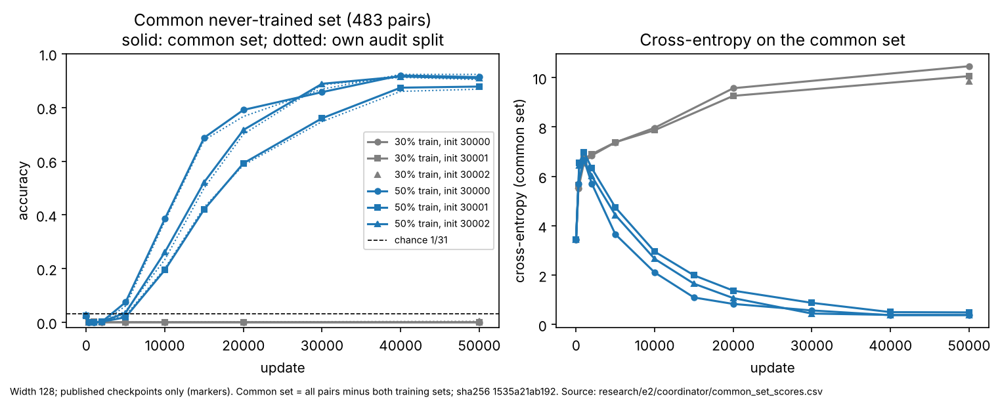
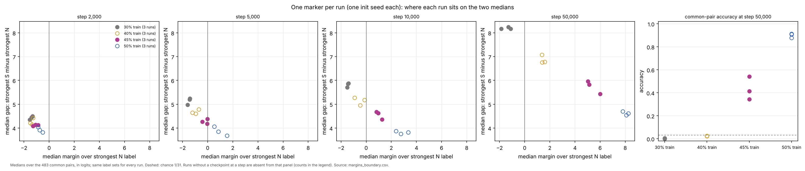
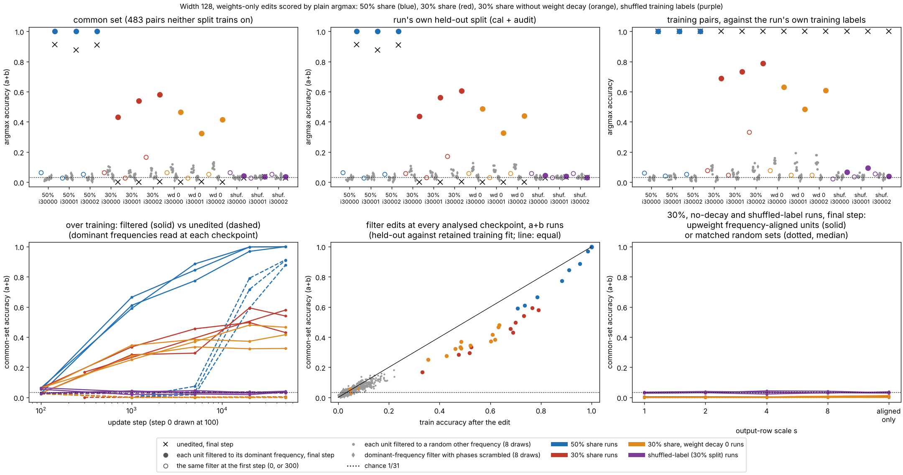
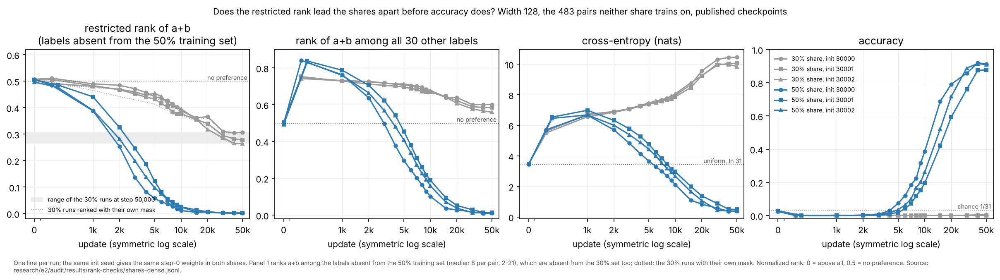

# e2 review index (figures first)

Round e2 is open-question exploration under the [charter](charter/README.md); assignments and the run-ID procedure are in [DECISIONS.md](DECISIONS.md). e1 is complete and archived at [research/coordinator/INDEX.md](../../coordinator/INDEX.md). Short synthesis and open questions: [SYNTHESIS.md](SYNTHESIS.md).

e2 base for workers: `6aaa3a2b6898abd0b317aa775cd7939e7530abdd`. Shared code identity: `fe284a5d90f741aab8c1273a55b11e5352ec38c5` (unchanged through e2). All runs are p = 31, one hidden ReLU layer, AdamW lr 1e-3, full batch, data seed 31000; "common pairs" are the 483 pairs that no training set in this round contains.

## 1. Both training shares on the pairs neither trained on

Question: the 30% (e1) and 50% (follow-up 2) width-128 runs were each evaluated on their own held-out split. Scored on the same pairs, do they still differ, and when?

Look before reading: compare the solid and dotted line of each blue run, and where the grey runs sit relative to the chance line.

Vector version: [common-set.svg](figures/common-set.svg). Source: [common_set_scores.csv](common_set_scores.csv), [common_set.json](common_set.json).

- The training sets nest: 30% train (299 pairs) ⊂ 50% train (478 pairs); the 179 added pairs are all 118 e1 calibration pairs and 61 e1 audit pairs.
- Never trained by either: 483 pairs, 248 unordered groups, transpose-closed, 15–16 pairs per class; exactly the 50% split's cal ∪ audit, inside the e1 audit split (`research/e2/data/common-never-trained-30-50.npz`, SHA-256 `1535a21a…4d3`).
- At 50,000 updates on these pairs: 30% runs 0.000 / 0.000 / 0.004; 50% runs 0.913 / 0.878 / 0.909 (own audit split 0.923 / 0.868 / 0.904).

Status: recomputed with independent code (e2 audit G7 PASS); 50% runs' software checks PASS (e1 audit Part 4 F10–F15). Reproduce: `uv run --locked --group analysis python research/e2/coordinator/common_set.py`.

## 2. A nested share ladder: 30%, 40%, 45%, 50% (dynamics lane, packet 2)

Question: with the four training sets nested and the 483 common pairs untrained at every share, are the shares graded or two regimes?

Look before reading: do the 40% and 45% runs sit between the 30% and 50% runs, or next to one of them? Compare the left four panels (two medians) with the accuracy panel.

Source: [margins_boundary.csv](../dynamics/figures/boundary/margins_boundary.csv); full trajectories [margins_boundary.png](../dynamics/figures/boundary/margins_boundary.png); against training cross-entropy [margins_boundary_fit.png](../dynamics/figures/boundary/margins_boundary_fit.png). Method and regeneration: [research/e2/dynamics/README.md](../dynamics/README.md) packet 2. "N" labels are wrong labels never seen with either operand in training, "S" labels are seen with an operand in the 30% training set.

| share (train pairs) | common-pair accuracy at 50k | median margin of a+b over strongest N label | median gap: strongest S minus strongest N |
|---|---|---|---|
| 30% (299) | 0.000–0.004 | −1.9 to −1.1 | 8.2 |
| 40% (359) | 0.023–0.025 | 1.4 to 1.6 | 6.8–7.1 |
| 45% (417) | 0.34–0.54, still rising | 5.0 to 6.0 | 5.4–6.0 |
| 50% (478) | 0.88–0.91 | 7.8 to 8.3 | 4.5–4.7 |

- New runs: `e2-dy-add-w128-i3000{0,1,2}-tf40-a1` and `-tf45-a1`, all complete, none failed or capped ([registry](../dynamics/registry.jsonl), claims D8, launched at `dbfcf21`). The 40% and 45% sets add e1 calibration pairs only.
- At 10k and 50k every column is ordered by share with no seed overlap between neighbouring shares; no share splits by seed. The ordering holds at matched training cross-entropy.
- Coordinator check: 50k common-pair accuracy of all six new runs recomputed from the published checkpoints matches the lane. Otherwise unaudited.

## 3. A label-free edit lifts failed runs, and also runs without weight decay (mechanisms lane, packet 2 and close)

Question: if every hidden unit is reduced to its own dominant frequency (weights only, no labels), do the failed 30% runs answer held-out pairs, and is that specific to the structure weight decay builds?

Look before reading: in the top left, compare filled red (30%, decay) with filled orange (30%, no decay) and with the grey nulls. In the bottom middle, do red and orange lie on one band?

Source: [unitfilter.csv](../mechanisms/figures/unitfilter/unitfilter.csv); method, nulls and regeneration in [research/e2/mechanisms/README.md](../mechanisms/README.md).

- Filtered common-pair accuracy at 50k: 50% runs 1.000 (unedited 0.88–0.91); 30% runs 0.43–0.58 (unedited 0–0.004); 30% runs **without decay** 0.33–0.47 (unedited 0–0.002); shuffled-label runs 0.035–0.041. Nulls (random other frequency, scrambled phases, step 0) stay at or below 0.15.
- Held-out accuracy as a fraction of the filtered train accuracy: 0.57–0.78 (decay) and 0.62–0.76 (no decay), one band.
- Coordinator spot check with separate code (`spot_unitfilter.py`, D10) reproduces the 30%, 50%, step-0 and no-decay values.
- Audit cycle 3 ([AUDIT.md](../audit/AUDIT.md), [unitfilter-check.png](../audit/figures/unitfilter-check.png)): the filter reimplemented (G15 PASS), no-decay values reproduced above every null (G16 PASS), label-free in code but the input projection flips 28–35% of gates (G17). A network with untrained step-0 inputs and a readout fitted to a+b in closed form on the 299 training pairs filters to 0.14–0.30 (unedited 0.00–0.01).

## 4. The restricted rank: when the shares separate, and what it does not predict (audit)

Look before reading: at which checkpoint does each panel first separate blue from grey?

Source: `research/e2/audit/results/rank-checks/shares-dense.jsonl`; definition checks, nulls and offset profile in [research/e2/audit/AUDIT.md](../audit/AUDIT.md) (figures [offset-profile.png](../audit/figures/offset-profile.png), [groups-check.png](../audit/figures/groups-check.png), [amplitude-vs-rank.png](../audit/figures/amplitude-vs-rank.png)).

- With three seeds per share at 1k spacing: the restricted rank separates the shares at 1k, cross-entropy and the rank among all labels at 2k, accuracy rises above chance at 5–6k.
- The 30% runs reach, by 50k, the restricted-rank level the 50% runs pass between 2k and 3k, and never answer.

## Claims, classified

Observation = measured, with the stated scope. Candidate explanation = an account of observations that is not tested. Counterexample = an observation against a claim. Not checked = no e2 evidence either way. Audit status is separate and given in the last column.

| claim | class | evidence | audit |
|---|---|---|---|
| On the 483 common pairs the 50% runs answer 0.88–0.91 and the 30% runs 0–0.004 (width 128, 3 seeds each, one data seed) | observation | §1 | PASS (G7; Part 4 F10–F15) |
| Between 30% and 50% the margins change gradually with share while accuracy changes steeply (0.00 / 0.02 / 0.34–0.54 / 0.88–0.91) | observation | §2 | not audited; 50k accuracy recomputed by the coordinator |
| The difference is caused by the amount of training data | not checked | one seeded order of added pairs; 40%/45% add only e1 calibration pairs; amount and identity move together (D6, D8) | AMBIGUOUS (Part 4) |
| Accuracy needs the a+b margin over unrelated labels to outgrow the operand-label gap ("a race between two graded quantities") | candidate explanation | [dynamics INTERPRETATIONS.md](../dynamics/INTERPRETATIONS.md) 1–2; alternative: the slower gap growth is dilution over more labels per operand | not audited |
| The restricted-rank signal is learned and specific to a+b, not produced by the mask | observation | audit G6 nulls 0.48–0.50 vs 0.27–0.31; offset profile flat away from k = 0 | SUPPORTED LOCALLY |
| The restricted rank separates the shares before cross-entropy and accuracy | observation (partly by construction) | §4 | SUPPORTED LOCALLY |
| A given restricted-rank level is an early signature of eventual success | counterexample | 30% runs reach the 50% runs' 2k level by 50k without answers; e1f1 width 512 plateaus at 0.177 to 200k | CONTRADICTED as a level; AMBIGUOUS as a rate |
| Failed and successful runs build the same kind of per-unit a+b−c term, about five times weaker at 30% | observation | [mechanisms packet 1](../mechanisms/figures/groups/groups.png) | SUPPORTED LOCALLY, with qualification (G10–G13): a weaker aligned term also appears without decay, with a null restricted rank |
| Frequency groups are privileged units of function | counterexample | removing a group is no worse than a matched random set at equal logit change (50% runs) | SUPPORTED LOCALLY (G12) |
| The failed 30% runs hold a hidden generalizing computation that the per-unit filter exposes | counterexample | §3: no-decay runs give 0.33–0.47 under the same filter, on the same held-out/train band; untrained inputs with a fitted readout give 0.14–0.30 | CONTRADICTED for most of the effect; AMBIGUOUS for the remainder (decay adds about 0.1 after 20k, ranges overlap) |
| Any a+b fit on these pairs leaves phase relations that a one-frequency-per-unit projection turns into partial held-out accuracy | candidate explanation, tested once | §3 (fit-induced interpolation; the projection supplies the prior); the relation does not need learned inputs | SUPPORTED LOCALLY (cycle 3; pre-stated rule met in 2 of 3 seeds) |
| Function-preserving rescaling changes codec size about twofold (e1) | not checked in e2 | no e2 codec or norm comparisons were made | — |

## Interpretations that changed in e2

| earlier reading | change | evidence |
|---|---|---|
| 30% and 50% are "a different partition" (e1 INDEX/INTERPRETATION) | the training sets nest; the gap persists on common pairs | §1, D6, D7 |
| "the training share separates the two regimes" (e1 follow-up 2) | graded in margins along a nested ladder, steep only in accuracy; amount vs identity still open | §2 |
| the restricted rank as an early marker of success (e1 follow-up 2, size/time) | a level does not predict success; only the rate differs, on one split pair | §4, audit cycle 1 |
| "the packet-1 alternative is confirmed in its first half" (e1 mechanisms) | per-unit structure is an observation; its role is a candidate explanation | D7 |
| the filter shows hidden computation in failed runs (mechanisms packet 2, first reading) | revised by the lane to the fit-induced reading after the no-decay comparison | §3, D10 |

## Budget and accounting

- Runs in e2: six (dynamics, D8), all complete. No failed or capped runs; no shared-code changes.
- Numerical execution in e2: coordinator under 2 minutes (common-set scoring, split checks, spot checks, tests); dynamics about 9.5 minutes (7 min 22 s of runs with two workers); mechanisms about 5 minutes; audit under 1 minute. No paid compute.
- Extra e1 checkpoints published under [e1-checkpoints/](e1-checkpoints/) and `research/e2/dynamics/e1-checkpoints/`, each matching its e1 manifest (D9; audit G14 PASS).
