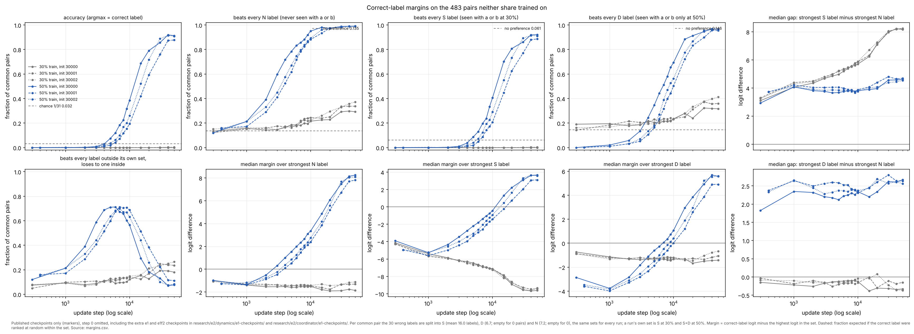
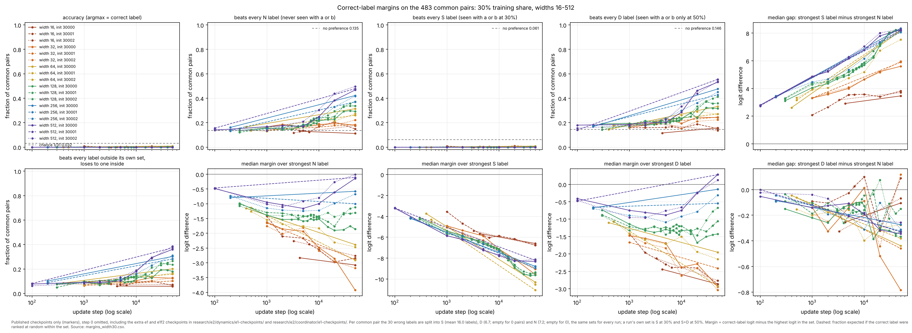
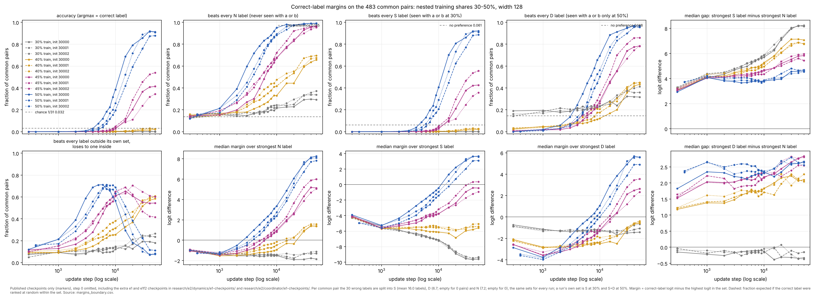

# e2 dynamics lane

Session `e2-dy-cloud-1` ("Width and training-time map" thread), branch `claude/project-thread-j8mgkm`, base `48ea420` on `swarm/exploration` (contains the e2 base `6aaa3a2`; shared code `fe284a5` unchanged). Question log: [QUESTION.md](QUESTION.md). Interpretations, kept separate: [INTERPRETATIONS.md](INTERPRETATIONS.md).

Execution budget (D3): e1 usage stays as recorded in [research/size-time/README.md](../../size-time/README.md) (21 runs, 22 min 57 s wall with two workers). e2: about 9.5 minutes elapsed of the 30: the six cycle-2 runs took 7 min 22 s with two workers (14 min 9 s of process time; 137-151 s per run), and all analysis together about 2 minutes. Cycles used: 2 of 2.

Audit status: nothing in this directory has been audited. The numbers come from this lane's own forward pass (`margins.py`), which checks every consumed checkpoint against its e1 manifest hash, every checkpoint's own-split audit accuracy against the run's logged value, and 51 common-set accuracies against the coordinator's `common_set_scores.csv` (all agree to 1e-12).

## Packet 1: where the correct label stands on pairs neither share trained on

Question: on the 483 pairs that neither the 30% nor the 50% training set contains, how does the correct label's logit compare with the strongest wrong label, separately for labels seen with an operand of the pair in training and labels never seen with either operand, and when do the two shares start to differ?



Look before reading: compare the grey and blue lines in "beats every N label" and in the S-minus-N gap panel, and find the step where they separate.

Label sets, identical for every run because the training sets nest (30% ⊂ 50%): for a common pair (a, b), S = labels of 30% training pairs (a, b') or (a', b) (mean 16.0 labels, 4-25); D = labels of such pairs that only the 50% set contains (mean 6.7, 1-13); N = the remaining wrong labels, never seen with a or b (mean 7.2, 1-20). No set is empty for any pair, and the correct label is in none (for addition it cannot be; asserted). A run's own operand-associated set is S at 30% and S ∪ D at 50%, so D is the only place the two masks differ. "Beats X" = no label in X has a higher logit; the dashed no-preference line is the mean of 1/(|X|+1). For the 50% runs, "beats every N label" is the audit's restricted-rank "top among absent" statistic on the same pairs (no-preference value 0.135 in both).

Observations, width 128, three init seeds per share (ranges over seeds):

| step | share | accuracy | beats every N | beats every S | margin over N | margin over S | gap S − N | gap D − N |
|---:|---|---|---|---|---|---|---|---|
| 1,000 | 30% | 0.000 | 0.15-0.16 | 0.00 | −1.39 to −1.30 | −5.69 to −5.39 | 4.06-4.38 | −0.22 to −0.10 |
| 1,000 | 50% | 0.000 | 0.17-0.21 | 0.00 | −1.38 to −1.17 | −5.60 to −5.24 | 4.08-4.20 | 2.35-2.66 |
| 2,000 | 30% | 0.000 | 0.14-0.16 | 0.00 | −1.53 to −1.32 | −5.96 to −5.86 | 4.35-4.50 | −0.26 to −0.11 |
| 2,000 | 50% | 0.002 | 0.29-0.39 | 0.00 | −0.87 to −0.52 | −4.97 to −4.34 | 3.81-4.04 | 2.32-2.50 |
| 5,000 | 30% | 0.000 | 0.16-0.19 | 0.00 | −1.59 to −1.41 | −6.67 to −6.48 | 4.97-5.24 | −0.21 to −0.12 |
| 5,000 | 50% | 0.02-0.07 | 0.62-0.78 | 0.02-0.09 | 0.53-1.53 | −3.34 to −2.21 | 3.68-4.06 | 2.12-2.59 |
| 10,000 | 30% | 0.000 | 0.22-0.24 | 0.00 | −1.51 to −1.42 | −7.24 to −7.14 | 5.70-5.88 | −0.16 to −0.05 |
| 10,000 | 50% | 0.19-0.39 | 0.88-0.95 | 0.21-0.41 | 2.38-3.34 | −1.43 to −0.44 | 3.75-3.88 | 2.31-2.37 |
| 50,000 | 30% | 0.000-0.004 | 0.29-0.37 | 0.00 | −1.86 to −1.11 | −9.62 to −9.35 | 8.16-8.25 | −0.37 to −0.15 |
| 50,000 | 50% | 0.88-0.91 | 0.99 | 0.89-0.92 | 7.81-8.25 | 3.10-3.66 | 4.54-4.70 | 2.56-2.67 |

Margins and gaps are medians over the 483 pairs, in logits; "gap S − N" is the strongest S label's logit minus the strongest N label's.

- Up to 1,000 updates the two shares are indistinguishable on every column except D, which the 50% runs already treat as operand-associated (gap D − N 2.4-2.7, against −0.2 to −0.1 at 30%).
- Between 1,000 and 2,000 updates they separate, before any 50% run answers held-out pairs: the 50% runs' margin over N rises by 0.4-0.8 logits and their "beats every N" fraction goes from 0.17-0.21 to 0.29-0.39, while the 30% runs' stay flat.
- At 50% the S − N gap stays between 3.7 and 4.8 from 1,000 to 50,000 updates, and the margin over S follows the margin over N about 4 logits behind. At 30% the gap roughly doubles (4.1-4.4 to 8.2) while the margin over N stays between −1.9 and −1.1.
- At 50%, 51-71% of common pairs between 4,000 and 10,000 updates beat every label outside the run's own set but lose to one inside it (lower-left panel). Pair by pair this state comes first: of the wrong pairs that become correct between consecutive checkpoints (every 1,000 updates to 10,000, then 15,000, 20,000, 30,000, 40,000, 50,000), 97-99% were in it at the earlier checkpoint. Pooled over those intervals, a wrong pair in that state becomes correct by the next checkpoint with frequency 0.17-0.18, any other wrong pair with 0.005-0.009 ([margins_transitions.csv](figures/share/margins_transitions.csv)).
- Against each run's own training cross-entropy instead of steps ([margins_fit.png](figures/share/margins_fit.png)), the three 30% seeds lie on one curve: the S − N gap rises from 4.1-4.4 at a training cross-entropy near 0.1 to 8.2 at 4e-6. The 50% runs reach the same training cross-entropy (5e-6 at 50,000 updates) with the gap at 4.5-4.7; at 1e-4 the gap is about 7 at 30% and about 4 at 50%. The shares part near a training cross-entropy of 0.1, which is 1,000 updates at 30% and 1,000-2,000 at 50%.
- Control within the 30% runs: D and N are both outside their own set, and they are treated alike (gap D − N between −0.4 and 0.1 throughout; "beats every D" tracks "beats every N" against their no-preference values).

Width comparison at the 30% share, same pairs and label sets (S is each run's own set; D and N are both outside it):



| width | beats every N at 50k | margin over N at 50k | margin over S at 50k | gap S − N at 50k |
|---:|---|---|---|---|
| 16 | 0.11-0.18 | −3.07 to −2.76 | −6.77 to −6.60 | 3.46-3.82 |
| 32 | 0.18-0.22 | −3.92 to −2.89 | −9.57 to −9.04 | 5.60-5.96 |
| 64 | 0.26-0.31 | −2.91 to −2.38 | −11.06 to −10.31 | 7.53-8.21 |
| 128 | 0.29-0.37 | −1.86 to −1.11 | −9.62 to −9.35 | 8.16-8.25 |
| 256 | 0.37-0.42 | −1.00 to −0.58 | −8.96 to −8.77 | 8.07-8.35 |
| 512 | 0.47-0.50 | −0.14 to −0.01 | −8.32 to −8.13 | 8.20-8.30 |

- At 30%, "beats every N" at 50,000 rises with width from about the no-preference value (0.135) at width 16 to 0.47-0.50 at width 512, and the margin over N from about −3 to about 0. After step 0, no run beats every S label on more than 1.1% of pairs.
- The S − N gap grows during training at every width and reaches about 8 logits for widths 64-512 (3.5-3.8 at width 16, 5.6-6.0 at width 32). Width 512 at 30% ends at the "beats every N" level that the 50% width-128 runs pass between 2,000 and 5,000 updates, with an S − N gap twice theirs.

Checkpoints: published checkpoints only. The e1 width-128 runs `e1-st-add-w128-i30001-a1` and `-i30002-a1` (this session's) gained 9 and 14 checkpoints in [e1-checkpoints/](e1-checkpoints/), copied from this session's local run directories after checking each SHA-256 against the run's e1 manifest (`publish_e1_checkpoints.py`; `supplement.json` records the manifest hash). The coordinator did the same for `e1-co-add-w128-i30000-a1` and the three 50% runs ([../coordinator/e1-checkpoints/](../coordinator/e1-checkpoints/), DECISIONS.md D9), so every width-128 run here has checkpoints every 1,000 updates from 1,000 to 10,000 and at 15,000, 20,000, 30,000, 40,000 and 50,000. The other widths have the e1 publication steps. Source tables: [share/margins.csv](figures/share/margins.csv), [width30/margins_width30.csv](figures/width30/margins_width30.csv), set sizes in `sizes.json`. Vector versions: `margins.svg`, `margins_width30.svg`; against training fit: `margins_fit.svg`.

Runs: 30% width 128 `e1-co-add-w128-i30000-a1`, `e1-st-add-w128-i30001-a1`, `e1-st-add-w128-i30002-a1`; 50% width 128 `e1f2-co-add-w128-i3000{0,1,2}-tf50-a1`; width comparison: all 18 e1 `add` runs at widths 16-512 (`research/coordinator/runs/`, `research/size-time/runs/`).

Regenerate:

```
C=research/coordinator/runs; P=research/size-time/runs
uv run --locked --group analysis python research/e2/dynamics/margins.py \
  --group "30% train" $C/e1-co-add-w128-i30000-a1 $P/e1-st-add-w128-i30001-a1 $P/e1-st-add-w128-i30002-a1 \
  --group "50% train" $C/e1f2-co-add-w128-i3000{0,1,2}-tf50-a1 --out research/e2/dynamics/figures/share
run() { for s in 30000 30001 30002; do for x in $C/e1-co-add-w$1-i$s-a1 $P/e1-st-add-w$1-i$s-a1; do [ -d "$x" ] && echo $x; done; done; }
args=(); for w in 16 32 64 128 256 512; do args+=(--group "width $w" $(run $w)); done
uv run --locked --group analysis python research/e2/dynamics/margins.py "${args[@]}" --name margins_width30 \
  --title 'Correct-label margins on the 483 common pairs: 30% training share, widths 16-512' --out research/e2/dynamics/figures/width30
```

Limitations: one split and one data seed; checkpoints 1,000 updates apart at best; medians summarize per-pair distributions; logit scale grows with training, so margin sizes are compared within a step, not across steps.

## Packet 2: a nested training-share boundary (cycle 2)

Question: with the same data seed, each class's 16 unordered pairs are shuffled once and the training set takes the first 5 (30%), 6 (40%), 7 (45%) or 8 (50%), so the four training sets nest and the 483 common pairs stay untrained at every share. On those pairs and the same S, D, N label sets as packet 1, how do the margins, the S − N gap and accuracy change from one share to the next? Predictions were written before the runs (QUESTION.md Q2).




Look before reading: in the summary figure, do the 40% and 45% runs sit between the 30% and 50% runs, or next to one of them?

New runs (all complete, none failed or capped; [registry.jsonl](registry.jsonl)): `e2-dy-add-w128-i3000{0,1,2}-tf40-a1` (359 training pairs: the 30% set plus 60 e1 calibration pairs; split `5c843bb8…e5a9`) and `e2-dy-add-w128-i3000{0,1,2}-tf45-a1` (417: plus 118 e1 calibration pairs; split `44e5774e…33c7aa`), width 128, init seeds 30000-30002, every other setting as the e1 and e1f2 runs (claimed in `research/e2/plan.json`, DECISIONS.md D8; launched at `dbfcf21` from a clean worktree, shared code `fe284a5`; host `vm`, 137-151 s each). Published in [runs/](runs/) with checkpoints every 1,000 updates to 10,000 and at 15,000, 20,000, 30,000, 40,000, 50,000. A run's own operand-associated set at 40% or 45% is S plus the part of D its own training pairs carry.

| share (train pairs) | step | accuracy | beats every N | margin over N | gap S − N | margin over S |
|---|---:|---|---|---|---|---|
| 30% (299) | 2,000 | 0.000 | 0.14-0.16 | −1.53 to −1.32 | 4.35-4.50 | −5.96 to −5.86 |
| 40% (359) | 2,000 | 0.000 | 0.18-0.19 | −1.51 to −1.28 | 4.15-4.43 | −5.69 to −5.48 |
| 45% (417) | 2,000 | 0.000 | 0.20-0.27 | −1.28 to −0.88 | 4.08-4.14 | −5.33 to −5.10 |
| 50% (478) | 2,000 | 0.002 | 0.29-0.39 | −0.87 to −0.52 | 3.81-4.04 | −4.97 to −4.34 |
| 30% | 10,000 | 0.000 | 0.22-0.24 | −1.51 to −1.42 | 5.70-5.88 | −7.24 to −7.14 |
| 40% | 10,000 | 0.000-0.006 | 0.33-0.47 | −0.93 to −0.14 | 4.95-5.27 | −6.12 to −5.47 |
| 45% | 10,000 | 0.027-0.048 | 0.67-0.72 | 0.82 to 1.26 | 4.36-4.68 | −3.76 to −3.16 |
| 50% | 10,000 | 0.20-0.39 | 0.88-0.95 | 2.38 to 3.34 | 3.75-3.88 | −1.43 to −0.44 |
| 30% | 50,000 | 0.000-0.004 | 0.29-0.37 | −1.86 to −1.11 | 8.16-8.25 | −9.62 to −9.35 |
| 40% | 50,000 | 0.023-0.025 | 0.66-0.70 | 1.37 to 1.58 | 6.75-7.07 | −5.59 to −5.06 |
| 45% | 50,000 | 0.34-0.54 | 0.95-0.97 | 5.04 to 6.00 | 5.43-5.96 | −0.92 to 0.36 |
| 50% | 50,000 | 0.88-0.91 | 0.99 | 7.81 to 8.25 | 4.54-4.70 | 3.10 to 3.66 |

Ranges over three init seeds; margins and gaps are medians over the 483 pairs, in logits.

- At 10,000 and 50,000 updates every column is ordered by share, and the three seeds of each share do not overlap with the neighboring share on the margin over N or the gap (nor on accuracy at 50,000). No share splits by seed.
- At 2,000 updates the shares are already ordered on "beats every N" without overlap (0.14-0.16, 0.18-0.19, 0.20-0.27, 0.29-0.39), while the margin over N still overlaps between 30% and 40% and between 40% and 45%.
- First checkpoint with a positive median margin over N: 30% none; 40% 15,000, 20,000, 30,000 (by seed); 45% 6,000-7,000; 50% 3,000-4,000. First checkpoint with common-set accuracy of at least 0.1: 30% and 40% none; 45% 15,000-20,000; 50% 6,000-8,000.
- 40%: the margin over N rises from about −1.4 to 1.4-1.6 while the S − N gap grows from 4.1-4.4 to 6.8-7.1, so the margin over S stays between −6.9 and −5.1 from 1,000 updates on. At 50,000, 58-61% of common pairs beat every label outside the run's own set and lose to one inside; accuracy is 0.023-0.025 (chance 0.032; 30% runs 0-0.004) and changed by less than 0.02 from 30,000.
- 45%: the gap also grows (4.1 to 5.4-6.0) but the margin over N grows faster; the margin over S reaches −0.9 to 0.4 at 50,000. Accuracy is still rising at 50,000 (+0.006, +0.016, +0.025 from 40,000 by seed).
- Against training cross-entropy ([margins_boundary_fit.png](figures/boundary/margins_boundary_fit.png)), interpolated between checkpoints at training cross-entropies of 0.01, 0.001 and 0.0001, the gap and the margin over N are ordered by share with no overlap between neighboring shares (at 0.0001: gap 6.8-7.1, 6.0-6.3, 5.0-5.3, 4.0-4.4; margin over N −1.9 to −1.4, −0.4 to 0.3, 2.5 to 3.5, 5.2 to 6.0). The ordering is not a matter of how far each run has fitted its own training set.
- Pair by pair, the packet-1 ordering holds at both new shares: of the wrong pairs that become correct between consecutive checkpoints, 94-98% at 45% and 83-100% at 40% (18-24 pairs per run) beat every label outside the run's own set at the earlier checkpoint ([margins_boundary_transitions.csv](figures/boundary/margins_boundary_transitions.csv)).

Against the Q2 predictions: E3 (graded) fits the margins and gap; E4 (two patterns) does not, since no run sits near either packet-1 cluster at 10,000 and no share splits. The 40% runs are the case Q2 said would fit neither: the margin over N rises while the gap still grows. Accuracy at 50,000 is far less graded than the margins (0.02, 0.4, 0.9 at 40%, 45%, 50%) because it needs the margin over S, a difference of the two, to cross zero.

Status: unaudited. `margins.py` checked every checkpoint's hash against its manifest and every own-split audit accuracy against the logged value. Three seeds per share, one data seed and one ordering of the added pairs: the 40% and 45% sets add only e1 calibration pairs, so amount and identity of data still move together along this one ladder.

Regenerate:

```
C=research/coordinator/runs; P=research/size-time/runs; E=research/e2/dynamics/runs
uv run --locked --group analysis python research/e2/dynamics/margins.py \
  --group "30% train" $C/e1-co-add-w128-i30000-a1 $P/e1-st-add-w128-i30001-a1 $P/e1-st-add-w128-i30002-a1 \
  --group "40% train" $E/e2-dy-add-w128-i3000{0,1,2}-tf40-a1 --group "45% train" $E/e2-dy-add-w128-i3000{0,1,2}-tf45-a1 \
  --group "50% train" $C/e1f2-co-add-w128-i3000{0,1,2}-tf50-a1 --name margins_boundary --summary-steps 2000,5000,10000,50000 \
  --title 'Correct-label margins on the 483 common pairs: nested training shares 30-50%, width 128' \
  --out research/e2/dynamics/figures/boundary
```

Runs were launched with the command in [REQUEST.md](REQUEST.md) and published with `publish_run.py RUN_DIR research/e2/dynamics/runs --steps 1000,2000,3000,4000,5000,6000,7000,8000,9000,10000,15000,20000,30000,40000,50000`.

## Handoff

- Code: `margins.py` (margins over the S, D, N label sets, per-pair transitions, figures; asserts nesting, the label partition, manifest hashes, logged accuracy and the coordinator's common-set scores) and `publish_e1_checkpoints.py` (publishes unpublished e1 checkpoints after checking them against the e1 manifest). No shared-code change.
- Checks run: every consumed checkpoint's SHA-256 against its manifest; own-split audit accuracy recomputed at every checkpoint against `metrics.jsonl` (to 1e-12); common-set accuracy against `research/e2/coordinator/common_set_scores.csv` at the 51 checkpoints it covers; for the 50% runs, the no-preference value of "beats every N" (0.135) equals the audit's `heldout_rank.py` "chance_top_among_absent" on the same pairs. Not independent: one analysis script by the lane that made the claims.
- Unresolved: amount versus identity of added pairs (one seeded order); dilution as an explanation of the slower gap growth (INTERPRETATIONS.md 2); 45% runs still changing at 50,000; medians over pairs.
- Best next question: at the same nested shares, does a shuffled-label network's operand-label preference also stop growing as the share rises (INTERPRETATIONS.md 2)?
