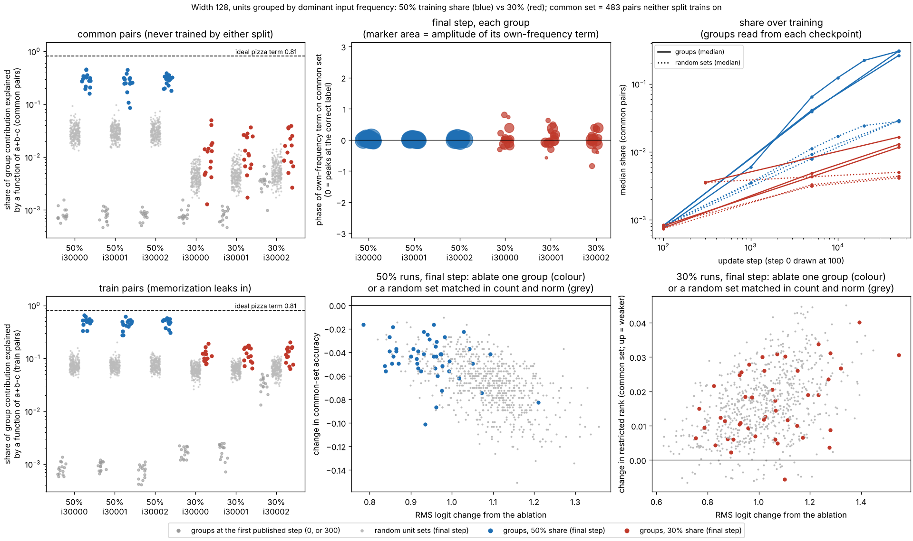

# e2 mechanisms: figures first

Question and predictions, written before these measurements: [QUESTION.md](QUESTION.md). Interpretation is kept separately in [INTERPRETATION.md](INTERPRETATION.md). Session `e2-me-cloud-1`, branch `claude/project-thread-psralm`, base `9e56faf` (e2 base `6aaa3a2`), shared code `fe284a5`. No runs were launched, so there are no registry entries. Nothing here is audited.

## Packet 1. Unit groups by dominant frequency, in failed (30%) and successful (50%) runs



Vector version: [groups.svg](figures/groups/groups.svg). Look before reading:
- Top left: where do the red groups sit relative to their own random sets and to their first-step points?
- Top middle: which way do the red phases point?
- Bottom: do the coloured points separate from the grey cloud at equal logit change?

Definitions (`groups.py`):
- A group is the set of live units whose dominant input frequency is k at the analysed checkpoint (checkpoint-local).
- Its contribution is relu(U[a]+V[b]) W restricted to those units, centred over labels for each pair.
- The *share* is the fraction of that contribution's variance, on a set of pairs, explained by a function of d = a + b − c mod p.
- The *own-frequency term* is the cos(2πkd/p + phase) component of that function. Phase 0 means it peaks at the correct label.
- The ideal "pizza" term |cos(πk(a−b)/p)| cos(2πkd/p), the form expected for this architecture (QUESTION.md), has share 0.81 on these pairs.
- Random sets: 16 per group, drawn from the live units with the same count and a total ‖u_j‖‖w_j‖ within 10% of the group's (seed 35000).
- The common set is the 483 pairs neither split trains on (`research/e2/data/common-never-trained-30-50.npz`, verified by SHA-256 in the summary).

Source table, final step (50k) of each run. Group and random-set columns are medians over the 15 groups and 240 random sets.

| run | accuracy, common / own held-out | restricted rank (common) | whole-model share | group share (range) | random-set share | group share, own held-out | own-frequency amplitude (logits) | groups with phase within ±π/2 | ablation Δ common acc, group / random | ablation Δ rank, group / random | RMS logit change, group / random |
|---|---|---|---|---|---|---|---|---|---|---|---|
| e1f2-co-add-w128-i30000-tf50-a1 | 0.913 / 0.913 | 0.002 | 0.266 | 0.305 (0.162–0.459) | 0.028 | 0.305 | 0.66 | 15/15 | −0.041 / −0.062 | +0.0005 / +0.0011 | 0.94 / 1.09 |
| e1f2-co-add-w128-i30001-tf50-a1 | 0.878 / 0.878 | 0.002 | 0.241 | 0.264 (0.087–0.452) | 0.029 | 0.264 | 0.67 | 15/15 | −0.054 / −0.079 | +0.0006 / +0.0013 | 0.96 / 1.09 |
| e1f2-co-add-w128-i30002-tf50-a1 | 0.909 / 0.909 | 0.002 | 0.266 | 0.306 (0.182–0.386) | 0.029 | 0.306 | 0.70 | 15/15 | −0.039 / −0.058 | +0.0006 / +0.0014 | 0.92 / 1.10 |
| e1-co-add-w128-i30000-a1 | 0.000 / 0.000 | 0.300 | 0.009 | 0.013 (0.001–0.051) | 0.004 | 0.011 | 0.12 | 15/15 | 0.000 / 0.000 | +0.0126 / +0.0136 | 1.07 / 1.04 |
| e1-st-add-w128-i30001-a1 | 0.000 / 0.000 | 0.277 | 0.009 | 0.012 (0.002–0.037) | 0.004 | 0.015 | 0.12 | 15/15 | 0.000 / 0.000 | +0.0173 / +0.0194 | 1.01 / 1.03 |
| e1-st-add-w128-i30002-a1 | 0.004 / 0.003 | 0.258 | 0.011 | 0.017 (0.003–0.039) | 0.005 | 0.015 | 0.15 | 15/15 | 0.000 / 0.000 | +0.0149 / +0.0132 | 0.99 / 1.01 |

For the 50% runs the own held-out split is the common set. For the 30% runs it has 662 pairs: the common set plus the 179 pairs the 50% share trains on.

Observations:

- **50% runs.**
  - Each group's held-out contribution is mostly a single cosine of a+b−c at the group's own frequency. Share 0.09–0.46, about 10× the matched random sets, and almost all of it at frequency k.
  - All 45 own-frequency terms peak at the correct label (|phase| < 0.5 rad), with amplitude 0.39–0.91 logits.
  - The whole model's share is 0.24–0.27, against 0.81 for the ideal pizza term. Most of the held-out logit variance is not a function of a+b−c.
- **30% runs.**
  - Group shares are 0.012–0.017 (median by run), 3× their random sets (0.004–0.005) and about 15× step 0 (0.001), but 20× below the 50% runs.
  - All 45 own-frequency terms point at the correct label: |phase| < π/2 for 45/45 and < 0.5 rad for 40/45.
  - Their amplitude, 0.02–0.36 logits (median 0.12–0.15), is about one fifth of the 50% runs'.
  - The null reference: groups at step 0 point within ±π/2 in 34/75 cases, with amplitude about 0.0004.
- **Over training** (top right; groups read at each checkpoint).
  - The 30% runs' group share rises from 0.001 at step 0 to 0.005 at 5k and 0.012–0.017 at 50k. At 5k, 27/30 phases are aligned, with amplitude 0.03.
  - The 50% runs reach that amplitude by step 1k (0.04, 15/15 aligned) and 0.18 by 5k, while common-set accuracy is still 0.02–0.07.
- **Ablation, 50% runs.**
  - Removing one group costs 0.02–0.10 common-set accuracy; a matched random set costs 0.01–0.15.
  - Groups change the logits less (RMS 0.92–0.96 against 1.09–1.10). At equal logit change, group and random-set ablations fall on the same trend (bottom middle).
  - Train accuracy stays 1.000 throughout.
- **Ablation, 30% runs.** Group and random-set ablations are indistinguishable on the restricted rank (+0.013 to +0.017 against +0.013 to +0.019) and on logit change. Accuracy stays 0.
- **Training pairs.** Every share is higher here (bottom left: 0.08–0.20 for 30% groups, 0.3–0.6 for 50% groups). Training labels equal a+b, so memorization contributes to this share; only held-out shares bear on the question.

Revision made after seeing data: `peak_d0` (does the group's function of d peak at d = 0) was the planned readout. On held-out pairs no single group peaks at d = 0, in either share, while 237/240 random sets in the 50% runs do. Each group's profile has a dip at d = 0, below its cosine. The label at d = 0 is always absent from both operands' training pairs, so the profile mixes the present/absent contrast into the cosine. I added the phase of the own-frequency component (`k_phase`, `k_amplitude`) as the readout for "peaks at the correct label". `peak_d0` stays in the CSV.

Checks:
- Tests (`test_groups.py`, 4 OK): a pure clock term has share 1 and phase 0, and a shifted one moves its phase by 2πk/p. The pizza reference matches the derived 8/π². Noise share is below 0.01. Group contributions add up to the centred logits.
- Every checkpoint read passes the manifest hash, split hash (each run against its planned split) and logged-metric replay (`groups_summary.json`).
- The figure was inspected and regenerated from a clean commit; the CSV is byte-identical across reruns.

Budget: e2 numerical execution so far is about 4 minutes, in one process with one BLAS thread. e1 usage was about 14 minutes, recorded separately.

Reproduce:

```bash
C=research/coordinator/runs; S=research/size-time/runs
uv run --locked --group analysis python research/e2/mechanisms/groups.py --source-commit 9e56faf7 --out research/e2/mechanisms/figures/groups \
    --runs $C/e1f2-co-add-w128-i30000-tf50-a1:0,1000,5000,10000,20000,50000 $C/e1f2-co-add-w128-i30001-tf50-a1:0,5000,50000 \
    $C/e1f2-co-add-w128-i30002-tf50-a1:0,5000,50000 $C/e1-co-add-w128-i30000-a1:0,5000,50000 \
    $S/e1-st-add-w128-i30001-a1:0,5000,50000 $S/e1-st-add-w128-i30002-a1:300,50000
uv run --locked --group analysis python -m unittest discover -s research/e2/mechanisms -v
```

e1-st-add-w128-i30002-a1 publishes only steps 300 and 50,000, so its first point is step 300.
