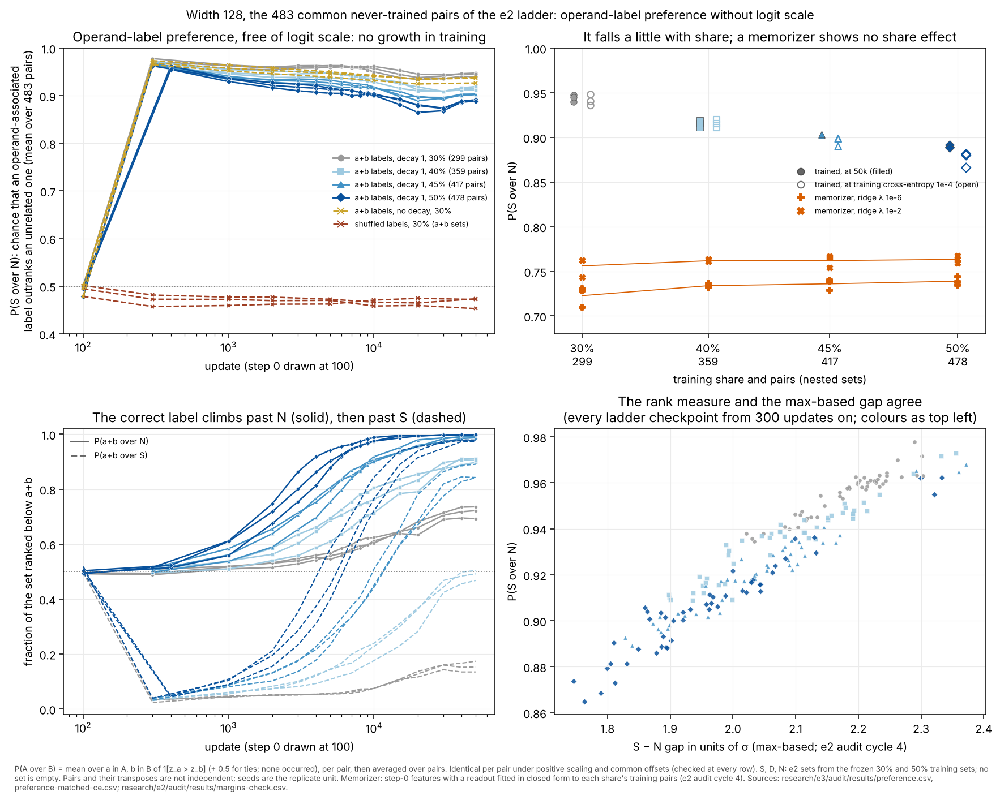
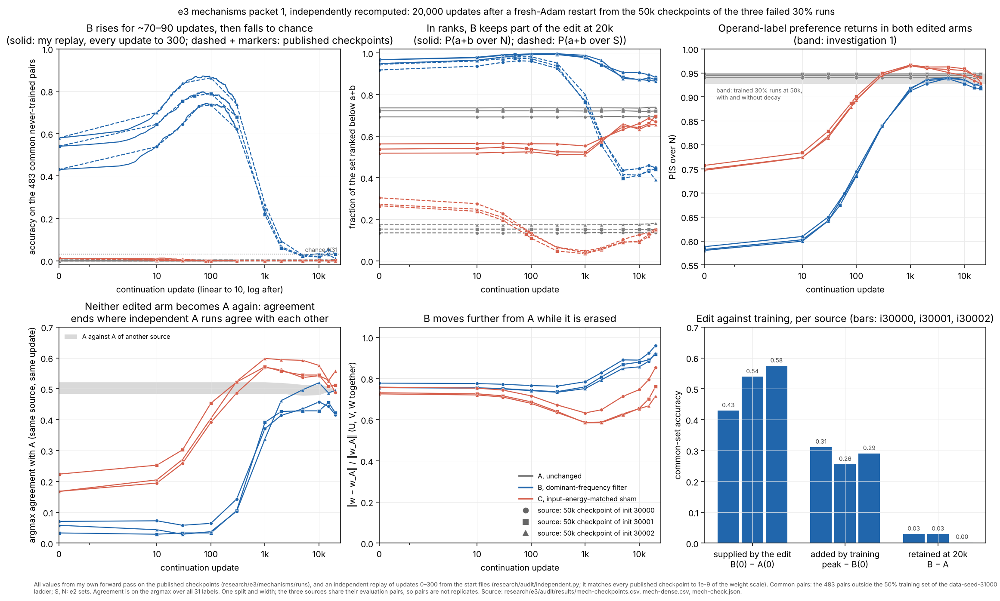

# e3 independent audit

Session label `e3-au-cloud-1` (DECISIONS D2; investigation 1 was recorded as `e2-au-cloud-1` before that label existed), branch `claude/project-thread-id1tmm`. Software checks are PASS / FAIL / NOT CHECKED. Interpretations are SUPPORTED LOCALLY / AMBIGUOUS / CONTRADICTED. Everything is exploratory: the e2 ladder pairs have guided analysis since e1.

# Investigation 1: operand-label preference without logit scale (existing artifacts)

Base `4783a47` (close of e2). The question, decision rules and expectations were committed before computing: [QUESTION.md](QUESTION.md), `af9c01e`. No training runs.

## Figure 1



Look before reading: in the top left, does any trained curve rise after its first few hundred updates? In the top right, do the filled markers step down from 30% to 50%, and do the orange ones?

## Definitions (for reuse by the e3 lanes; `pairwise.py`)

For a held-out pair with logits z and disjoint label sets A, B: **P(A over B)** = mean over a in A, b in B of 1[z_a > z_b] + 0.5 · 1[z_a = z_b]. It is undefined, and dropped and counted, when A or B is empty. The run summary averages per-pair values with equal weight per pair. S, D and N come from `ladder_sets(a, b, smallest_train, largest_train, eval_pairs, p)`:

- S: labels seen with an operand in the ladder's smallest training set.
- D: labels seen only in the largest.
- N: the other wrong labels.

The evaluation pairs are those excluded from the largest training set. The e2 sets are reproduced exactly (asserted). Three quantities:

- **P(S over N)** measures operand-label preference.
- **P(a+b over N)** is the fraction of N below the correct label, the rank analogue of the margin over N and the e2 restricted rank's complement.
- **P(a+b over S)** is the rank analogue of the margin over S.

P(S over N) reflects the bulk of the labels, not the strongest competitor, so the max-based diagnostics of e2 audit cycle 4 stay alongside (bottom right).

## Results (width 128, 483 common pairs, ranges over three init seeds)

| share | P(S over N) at first fit (300 or 400) | at 1k | at 10k | at 50k | at train CE 1e-4 | change 1k→50k by seed | P(a+b over N) at 50k | P(a+b over S) at 50k |
|---|---|---|---|---|---|---|---|---|
| 30% | 0.970–0.978 | 0.956–0.964 | 0.950–0.961 | 0.940–0.948 | 0.936–0.948 | −0.016, −0.017, −0.018 | 0.69–0.74 | 0.14–0.17 |
| 40% | 0.964–0.973 | 0.946–0.955 | 0.929–0.936 | 0.911–0.919 | 0.911–0.920 | −0.032, −0.034, −0.036 | 0.90–0.91 | 0.47–0.50 |
| 45% | 0.965–0.968 | 0.934–0.941 | 0.915–0.918 | 0.902–0.903 | 0.890–0.899 | −0.031, −0.039, −0.034 | 0.99 | 0.84–0.89 |
| 50% | 0.955–0.962 | 0.930–0.936 | 0.900–0.904 | 0.888–0.891 | 0.866–0.881 | −0.047, −0.045, −0.041 | 0.998 | 0.97–0.98 |

**Controls.**
- Step 0: 0.479–0.501.
- Shuffled-label 30% runs, scored with the a+b sets: 0.453–0.474 at 50k.
- No-decay 30% runs: 0.952–0.964 at 1k and 0.927–0.938 at 50k, with P(a+b over N) 0.50–0.52.
- Closed-form memorizer (e2 cycle 4): 0.71–0.73 at 30% and 0.735–0.744 at 50% (λ 1e-6); 0.74–0.76 and 0.76–0.77 (λ 1e-2).
- P(D over N) is 0.47–0.49 in the 30% runs, where D and N are both outside the run's own set. It rises with share as D becomes the run's own: 0.62, 0.74–0.75, 0.84–0.85.

**Robustness.** The pooled (|S|·|N|-weighted), transpose-group and median summaries give the same ordering and the same conclusions (at 50k: pooled 0.938–0.947 at 30% to 0.888–0.893 at 50%; median 0.953–0.958 to 0.900–0.904). Across all 185 ladder checkpoints from 300 updates on, P(S over N) correlates at 0.96 with cycle 4's σ-unit S − N gap.

## Software checks

| # | Check | Result | Evidence |
|---|---|---|---|
| E1 | Invariance to scale and offset | PASS | At all 269 rows, every per-pair value is identical after multiplying the logits by 0.37 or 1000, adding 5, or adding a random offset per pair |
| E2 | Ties, empty sets | PASS | No tied comparison in any set pair at any row; S, D and N are nonempty for all 483 pairs (no pair dropped) |
| E3 | Label sets | PASS | `ladder_sets` reproduces e2's S, D, N exactly; a+b is in none (asserted) |
| E4 | Regeneration | PASS | `preference.csv`, `preference-matched-ce.csv` and the PNG regenerate byte-identically |

## Interpretations

| Claim | Verdict | Evidence and scope |
|---|---|---|
| The operand-label preference grows during training (raw-logit reading, e2) | CONTRADICTED | Pre-stated rule 1: flat at 30% (all seeds within ±0.02) and falling at 40%, 45% and 50% (−0.03 to −0.05 in every seed). It is highest at first fit (0.955–0.978) |
| The preference is smaller at larger training share | SUPPORTED LOCALLY | Pre-stated rule 2: ordered 30 > 40 > 45 > 50 without overlap at 50k and at matched fit. This settles e2 cycle 4's AMBIGUOUS σ-unit result: the effect is real but small. An operand label beats an unrelated one 94% of the time at 30% and 89% at 50%. One data seed |
| The preference comes from fitting the training labels, not from weight decay | SUPPORTED LOCALLY | The no-decay runs, which never rank a+b above N (0.50–0.52), prefer S over N as strongly as the decayed 30% runs (0.93–0.94 at 50k) |
| The share effect is generic memorizer dilution (e2 INTERPRETATIONS 2, alternative 2) | CONTRADICTED for the closed-form memorizer | Its P(S over N) does not fall with share; it rises by 0.007–0.016. Untested for gradient-trained memorizers |
| Share mainly acts on the correct label, not on the preference (e2 cycle 4) | SUPPORTED LOCALLY, now in ranks | From 30% to 50% at 50k, P(a+b over S) goes from 0.14–0.17 to 0.97–0.98 and P(a+b over N) from 0.69–0.74 to 0.998, while P(S over N) moves by 0.055 |

**Expectation missed.** I expected the shuffled-label runs within 0.02 of 0.5. They sit 0.03–0.05 below it, a slight avoidance of the a+b-associated labels. Their preference for their own shuffled training labels was not measured.

**Strongest surviving alternative.** The small share effect, and the slow fall of the preference during training at 40–50%, may be a generic property of gradient-trained networks fitting more pairs per operand. The no-decay runs fall during training too (−0.020 to −0.027 from 1k to 50k), without ever ranking a+b high. If so, the effect is not tied to finding the answer. The closed-form memorizer cannot speak to this, because it has no training dynamics.

**Cheapest next discriminating check.** First, score the e3 dynamics ladders (three new data seeds) with these three quantities: does the fall of P(S over N) with share travel across data seeds? That costs nothing extra. If it travels, shuffled-label runs at two nested shares, scored with their own label sets, would separate trained-network dilution from answer-finding.

## Reproduce

From the repository root:

```bash
E=research/e3/audit
uv run --locked python $E/preference_check.py $E/results/preference.csv
uv run --locked --group analysis python $E/plot_preference.py $E/figures/preference $E/results/preference.csv \
  research/e2/audit/results/margins-check.csv $E/results/preference-matched-ce.csv
```

## Budget

About 25 s of numerical execution, one process and one BLAS thread. No training runs. The e3 numerical budget has not been set yet, so this count stands on its own.

# Investigation 2: checks of the two e3 experiments

Base `bd4a97c`; shared code at the e3 pin `9041a48`. The checks and their pass rules were committed before running any of them: [QUESTION-2.md](QUESTION-2.md), `ae9dd64`. The mechanisms start files are those at the lane's `42ca626`.

## Mechanisms gate (blocking the nine continuations): PASS

| # | Check | Result | Evidence |
|---|---|---|---|
| C1 | Weights, moments, update count | PASS | A 300-update arm-A continuation run at the pin from the real `e1-co-add-w128-i30000-a1` step-50,000 checkpoint. Its step-0 checkpoint equals the source exactly and its moments are zero. An independent replay (own forward, gradient and AdamW in `research/audit/independent.py`, zero moments, t = 1, 2, …) matches the checkpoints at 10, 30, 100 and 300 updates within 3.6e-11 (largest weight 0.85; tolerance 8.5e-10). Moments at 300 agree within 2.3e-17 |
| C2 | Not a silent resume | PASS | The same replay with the source's moments and t = 50,001, … differs from the run by 1.5e-3 after 10 updates, against a run displacement of 1.7e-3 |
| C3 | Post-edit row | PASS, with my tolerance mis-set | The step-0 metrics row is bitwise equal to e1's step-50,000 row (accuracies, cross-entropies, norm). My own forward gives the same accuracies and cross-entropies, except the 3.65e-6 train cross-entropy, which differs by 1.4e-16 (3.8e-11 relative, above my pre-stated 1e-12). That quantity is a mean of logsumexp minus a correct logit of about 18.8, whose rounding unit is 3.6e-15, so the difference is a twenty-fifth of one rounding unit. The criterion was too strict for a cancellation-limited number; this is not a code defect |
| C4 | Data, objective, schedule | PASS | Continuation and source agree on task, width, p, lr, wd, data seed, and split and target hashes. The e1 config predates `--train-fraction`; the split hash covers it. The code has no learning-rate schedule. `config.json` records `init_age` 50,000, the start file's hash and the reset rule |
| C5 | Tests and launcher | PASS | 13 shared tests OK and `--selftest` passes at the pin. For all nine reserved entries, `launch_runs.command` passes the start file, `--expect-init-sha256`, `--init-age 50000`, `--checkpoint-steps 10,30,100,300`, `--steps 20000`, `--log-every 10`, data seed 31000 and the source split hash. A reserved ID is refused |
| C6 | Sources | PASS | All three plan source hashes equal the files; each file holds step 50,000; three arms point to each |
| M1 | Format | PASS | Nine files: keys U, V, W only, float64, shapes (31, 128), (31, 128), (128, 31); SHA-256 equal to `update0.csv` |
| M2 | Arm A | PASS | Byte-identical arrays |
| M3 | Arm B | PASS | Exactly e2 `filter_units(w, dominant(w)[0])`. My own projection (orthonormal cos/sin basis, own dominant rule) agrees within 1.2e-14. Accuracies equal e2's published `unitfilter.csv`: common 0.431, 0.540, 0.580; train 0.689, 0.732, 0.789 |
| M4 | Arm C | PASS | `edits.sham` reads weights only (code reading). Rebuilt with no data, from the written rule, with exact plateaus of the kept energy in λ in place of bisection: agreement within 8.5e-15, and the dominant frequency is never kept. The lane's λ (1.780, 2.065, 2.088) lies in my plateaus. Kept input energy is 1.0001–1.0006 times B's. Seeds 37000–37002 are in the plan at `9041a48`, before the files existed. The lane's own function reproduces the files exactly |
| M5 | Update-0 report | PASS | Present for all nine with every listed field; my displacement, kept energy, gate flips, train loss and accuracy, common and own held-out accuracy agree within 3.4e-16 |
| M6 | Matching limits visible | PASS | The lane README calls C "input-energy-matched" and reports W displacement (C 0.71–0.75, B 0.78–0.80), logit change, immediate damage (train accuracy C 0.42–0.48, B 0.69–0.79) and the 37–47 units that cannot be matched |

**Notes for reading the continuations.**
- The optimizer reset alone barely moves arm A: train cross-entropy goes from 3.651e-6 to 3.655e-6 after 10 updates and 3.649e-6 after 300, with train accuracy 1 throughout (my 300-update check run).
- B and C start from different damage: C's train accuracy is 0.42–0.48 against B's 0.69–0.79. Any difference in how they recover can come from that and not from which frequencies were kept.
- `init_weights` is a relative path, so the launcher must run from the repository root, as the D5 command does. A wrong path fails before training.
- For continuations, `first_interpolation` in `runtime.json` is 0 for A and the first refit for B and C, not a time from initialization.

## Dynamics splits and design: PASS (runs not yet checked)

| # | Check | Result | Evidence |
|---|---|---|---|
| Y1 | Splits | PASS | The independent rewrite of the split rule, at data seeds 31000 and 41001–41003 and shares .3, .4, .45 and .5, gives every plan `split_sha256` and `train_pairs` and every `ladders.json` hash. Training sets nest; every split is transpose-closed; train, cal and audit partition the 961 pairs. Each `eval-d<seed>.npz` equals the complement of that ladder's 50% training set: 483, 479, 480 and 481 pairs, 248 unordered groups each, 15–16 pairs per class |
| Y1 | Label sets | PASS | With `ladder_sets`: S has at least 4–6 labels; N is never empty and has 2 singleton pairs in each of 31000 and 41001; D is empty for 3 pairs of 41001, which P(D over ·) must drop and count (D6) |
| Y2 | Design | PASS (plan); landed runs NOT CHECKED | 24 entries, exactly 3 data seeds × 2 init seeds × 4 shares, IDs consistent with their fields, one recipe, queue positions 1–24. `experiment.init` equals the independent init rule for 30000 and 30001, and takes no data seed. The eight reference-ladder runs (31000) have the matching split hash, data seed and init seed |
| Y3–Y6 | Provenance, replay, predictions, separation | NOT CHECKED | Runs had not landed when this was written |

## Reproduce (investigation 2)

From the repository root, with a scratch directory `$S` and the lane's start files and `edits.py` extracted from `42ca626`:

```bash
E=research/e3/audit
uv run --locked python $E/continuation_check.py $S/cont $E/results/continuation-check.json
uv run --locked python $E/start_check.py $S/starts $E/results/start-check.json $S/lanecode
uv run --locked python $E/dynamics_check.py splits $E/results/dynamics-splits.json
```

Budget so far: investigation 1 about 25 s; investigation 2 about 13 s, including two 300-update check runs, a failed first attempt of the continuation check (a key missing from the e1 config, after its run) and the shared tests. Total about 0.7 of 30 min.

# Investigation 3: the mechanisms continuations (packet 1)

Base `4b47de1` (packet 1 integrated at `d0a0657`). The checks and decision rules were committed before running any of them: [QUESTION-3.md](QUESTION-3.md), `62946cb`. Before writing it I knew the coordinator's headline and had listed the published files; I read the lane's README and INTERPRETATION only after computing.

## Figure 3



Look before reading: in the top left, does every blue curve rise and then fall? In the top middle, where do the blue dashed lines end relative to the grey ones? In the bottom left, do the blue lines climb back to 1?

## Software checks: PASS

| # | Check | Result | Evidence |
|---|---|---|---|
| K1 | Provenance and accounting | PASS | One running and one complete event per ID; 20,000 updates each; `config.json` records the start file's SHA-256 (equal to the plan's), `init_age` 50,000 and the D5 recipe; every step-0 checkpoint is the start file with zero moments; every published file matches its manifest hash. The manifests say the producing tree (`59c822e`) was dirty. Its shared code is identical to the pin, and every run reproduces below, so this does not affect the runs |
| K2 | Checkpoint predictions | PASS | My forward pass on all 104 published checkpoints gives the logged train, cal and audit accuracies exactly. Cross-entropies agree within 0.05 of the tolerance (1e-10 relative plus 1e-14) |
| K3 | Dense replay | PASS | Updates 1–300 of all nine runs, replayed independently from the start files, match the published checkpoints at 10, 30, (50 or 60), 100 and 300 within 4.6e-11 for A and 5.7e-15 for B and C |
| K4 | Rounding sensitivity of the fall | PASS | Updates 1,000 → 2,000 of each B run, replayed from the published checkpoint at 1,000, agree with the checkpoint at 2,000 within 7.6e-15. Common-set accuracy is identical |

## Results against the pre-stated rules (common pairs, 483)

**1. The rise is robust.**
- In every B run my replay's peak exceeds update 0 by 0.26–0.31: from 0.431 to 0.743 (update 87), from 0.540 to 0.797 (68) and from 0.580 to 0.872 (70).
- The published checkpoint at 100 (0.735, 0.789, 0.863) underestimates the peak by 0.008–0.009.
- The metrics file has 4–5 rows within 20 updates of each peak. They carry own held-out accuracy (cal ∪ audit), which tracks the common set within 0.02 throughout.
- The peak comes 18–37 updates after train accuracy first reaches 1 (updates 69, 45, 33).

**2. The fall is robust.**
- At 2,000 updates B is at 0.060–0.093, at 5,000 at 0.021–0.027, and at 20,000 at 0.010–0.031. All of these are below 0.065, and K4 passes.
- B ends at chance (1/31 = 0.032), not at A's level. A stays at 0.000–0.006, below chance.

**3. Edit against training.**

| per source (i30000, i30001, i30002) | accuracy | P(a+b over S) | P(a+b over N) |
|---|---|---|---|
| A at update 0 | 0.000, 0.000, 0.004 | 0.135, 0.153, 0.174 | 0.693, 0.722, 0.736 |
| B at update 0: supplied by the edit | 0.431, 0.540, 0.580 | 0.918, 0.945, 0.949 | 0.949, 0.967, 0.968 |
| B at its peak: added by training | 0.743, 0.797, 0.872 (+0.31, +0.26, +0.29) | 0.963, 0.973, 0.982 (checkpoint at 100) | 0.994, 0.993, 0.996 |
| B at 20,000 | 0.031, 0.031, 0.010 | 0.448, 0.440, 0.391 | 0.884, 0.873, 0.865 |
| A at 20,000 | 0.000, 0.000, 0.006 | 0.137, 0.150, 0.181 | 0.693, 0.721, 0.739 |
| C at 20,000 | 0.000, 0.002, 0.000 | 0.154, 0.146, 0.150 | 0.670, 0.697, 0.655 |

- In accuracy, B retains 0.004–0.031 over A. My rule's "nothing retained" (at most 0.02 in all three) misses narrowly: two sources sit at exactly 15/483, which is chance.
- In ranks, B retains a lot more. Its correct label still outranks 39–45% of the operand labels, against 14–18% for A and 15% for C. It outranks 87–88% of the unrelated labels, against 69–74% and 66–70%.
- B's P(a+b over S) has been flat since 5,000 updates (0.40–0.44 at 5k, 0.39–0.45 at 20k). So the edit leaves a trace that training has not removed after 20,000 updates. It is just not large enough to win the argmax against the strongest operand label.

**4. What erasure returns to: a different network of the same kind, not A.**

| at 20,000 updates | i30000 | i30001 | i30002 |
|---|---|---|---|
| argmax agreement of B with A | 0.416 | 0.422 | 0.495 |
| argmax agreement of C with A | 0.489 | 0.511 | 0.557 |
| A against the A of another source (three pairs) | 0.489–0.495 | | |
| ‖B − A‖ / ‖A‖, update 0 → 20,000 | 0.777 → 0.960 | 0.757 → 0.917 | 0.755 → 0.924 |
| ‖C − A‖ / ‖A‖, update 0 → 20,000 | 0.758 → 0.854 | 0.731 → 0.761 | 0.725 → 0.715 |
| P(S over N): B, C (A and no-decay band 0.927–0.948) | 0.923, 0.928 | 0.917, 0.941 | 0.928, 0.931 |

- B agrees with A no more than independent A runs agree with each other.
- B moves further from A in weights while it is erased: the distance grows from 0.76–0.78 to 0.92–0.96. This meets the pre-stated "different network of the same kind".
- Independent A runs agree on half of their wrong answers. The training set, not the initialization, largely decides which wrong label wins.
- P(S over N) returns from 0.58 to 0.92–0.93 in B. Under my rule this is AMBIGUOUS for B: one source is inside the fitted-network band and two are 0.004–0.010 below it. In C, which overshoots to 0.96–0.97 at 1,000 updates, it is SUPPORTED: all three are inside the band.
- All edited values are far above the closed-form memorizer's 0.71–0.77 (investigation 1).

## Interpretations

| Claim | Verdict | Evidence and scope |
|---|---|---|
| B rises after the edit, then falls (packet 1) | SUPPORTED LOCALLY | Robust under both pre-stated rules; reproduced at one-update resolution and by an independent replay. Three sources, one split, one width |
| Training adds 0.25–0.30 to what the edit gave | SUPPORTED LOCALLY | +0.26 to +0.31 at the true peak (updates 68–87), slightly above the checkpoint values |
| Training erases what the edit supplied | SUPPORTED LOCALLY in accuracy; CONTRADICTED in ranks | B is at chance after 5,000 updates. But at 20,000 its correct label still beats 39–45% of operand labels, against 14–18% for A and C, and this has not moved since 5,000 |
| Erasure is a return toward the operand-label memorizer | CONTRADICTED as a return to the source network; SUPPORTED LOCALLY as becoming again a fitted, operand-label-preferring network | Agreement with A ends at the level of independent A runs, and weight distance from A grows. P(S over N) climbs back to 0.92–0.93, at or just below the fitted-network band, far above the closed-form memorizer. "The memorizer" should not name a particular network |
| The rise is specific to keeping the dominant frequency (not sham-equivalent) | SUPPORTED LOCALLY, with the gate's caveat | C never rises. But C starts more damaged (train accuracy 0.42–0.48 against 0.69–0.79) and with no held-out accuracy at all. It shows that removing the dominant frequency at matched input energy gives nothing to build on; it does not isolate why B rises |
| Stopping at the first update with train accuracy 1 lands near the peak (lane, untested) | SUPPORTED LOCALLY, post hoc | Added after seeing the dense replay, not pre-stated. At updates 69, 45 and 33 the common-set accuracy is 0.735, 0.778 and 0.839, within 0.008–0.033 of the peaks. Three runs; not a tested procedure |
| A hidden algorithm or recovered computation | Not established | No intervention here isolates a computation. The lane's text does not claim one, and the e2 random-feature result still applies |

**Strongest surviving alternative.** The rise may be what fitting the 299 training pairs does when the features are frequency-concentrated, which the filter made them. Repairing the edit's training errors through one frequency per unit extends to held-out pairs, as fitted readouts on filtered random features did in e2. Continuing the same objective then grows the training margins and re-memorizes. On this reading, the source network's computation plays no part beyond supplying concentrated features. A second, narrower alternative concerns the restart itself. Fresh Adam takes steps of about ±lr per coordinate whatever the gradient's size, and the rise happens in exactly those first updates. A barely moves under the same reset, but it starts at a loss of 3.6e-6, so it cannot show whether large early steps matter from a damaged starting point.

**Cheapest next discriminating checks.**
1. The approved weight-decay-0 follow-up (D11) separates decay from the cross-entropy drive in the fall. I will check its runs the same way.
2. For the rise, replay B's first few hundred updates with a ten-times smaller learning rate, and with plain gradient descent, from the same start files. Each is a few seconds of computation. If the held-out gain appears at the same point of training-fit recovery, it is a property of the objective from the edited point. If it does not, it is tied to the restart's step size.

## Reproduce (investigation 3)

```bash
E=research/e3/audit
uv run --locked python $E/mech_check.py $E/results
uv run --locked --group analysis python $E/plot_mech.py $E/figures/mechanisms $E/results
```

Budget: investigation 3 took about 26 s, including a first attempt of `mech_check.py` that stopped on a missing checkpoint partner after 2 s, and three renders of the figure. The audit total is about 1.1 of 30 min.
