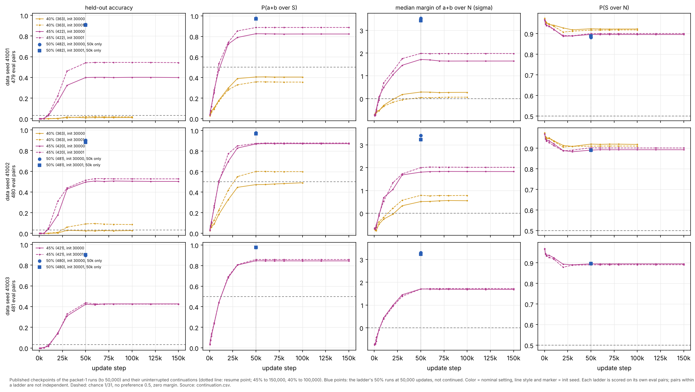
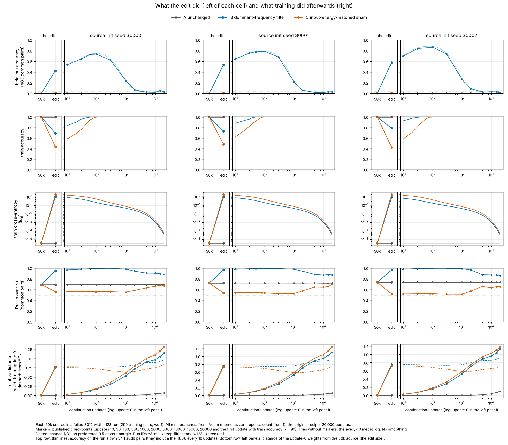
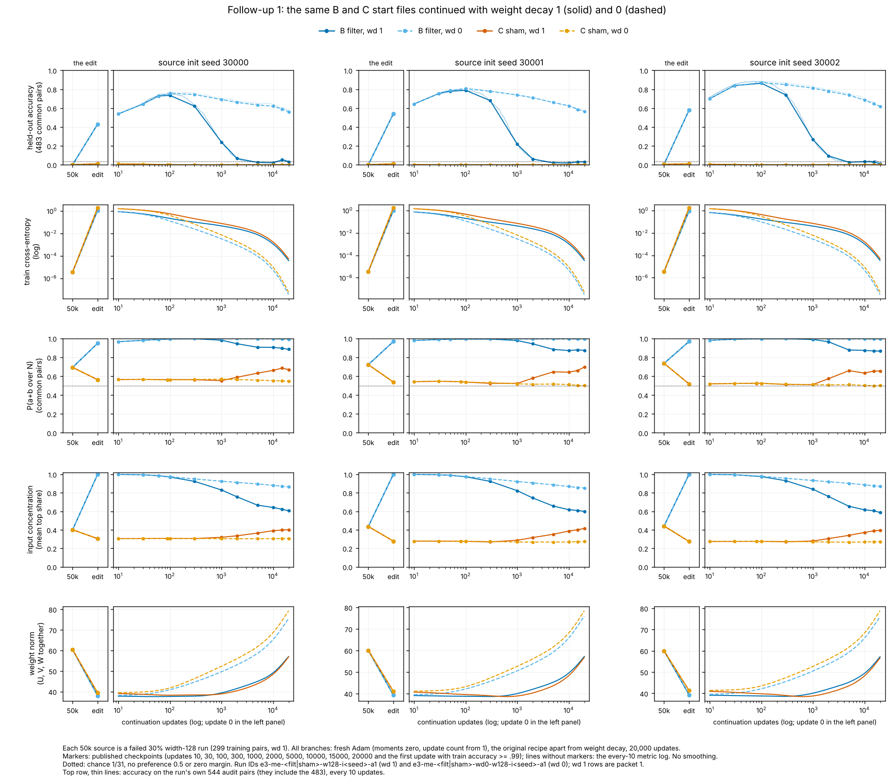

# e3 review index (figures first)

**e3 is complete** (2026-10-22, [DECISIONS.md](DECISIONS.md) D17). *Pointer, 2026-10-22:* round e4 starts from e3's filtered start files and runs; see [../../e4/coordinator/INDEX.md](../../e4/coordinator/INDEX.md). Round e3 ran under the [charter](charter/README.md). Assignments, seeds, budgets and the claim procedure are in [DECISIONS.md](DECISIONS.md) (D1–D15). Claims are in [../plan.json](../plan.json), run accounting in [RUNS.md](RUNS.md), and the short synthesis in [SYNTHESIS.md](SYNTHESIS.md). e1 and e2 are complete and unchanged: [../../coordinator/INDEX.md](../../coordinator/INDEX.md) and [../../e2/coordinator/INDEX.md](../../e2/coordinator/INDEX.md).

e3 base for workers: `9041a4839ceef0926015160f312c641f02615241`. Shared code was re-pinned once, at `72cfb5d0b4599c9e96cb3b9203980bc64b9b8d7a`, to add `--resume` for the dynamics follow-up (D15). All runs: p = 31, one hidden ReLU layer of width 128, full-batch AdamW, lr 1e-3, float64. Measures: [`research/e3/audit/pairwise.py`](../audit/pairwise.py) (D6). P(A over B) is the chance that a label in A outranks one in B for the same pair, ties counted ½. S = labels seen with an operand in the smallest training set; N = labels never seen with either operand.

Status labels: **observation** (measured), **explanation** (a reading of observations, untested unless stated), **intervention** (an edit or changed training condition and its measured effect).

## 1. Does the data-size ladder survive changing the training examples? (dynamics)

One panel per data seed. Each panel is a nested ladder of training sets at the nominal 30/40/45/50% settings, with two init seeds, scored at 50,000 updates on that ladder's own never-trained pairs (479–483). The right panel is the e2 ladder (data seed 31000), which was seen before e3. Trajectories: [ladders_trajectories.png](../dynamics/figures/ladders_trajectories.png). Normalized measures: [ladders_measures.png](../dynamics/figures/ladders_measures.png). Packet: [../dynamics/README.md](../dynamics/README.md).

- **Observation.** In all 8 ladder × init sequences, accuracy and every normalized measure improve with each larger nested set. The bands match e2:

  | setting | accuracy |
  |---|---|
  | 30% | 0.000–0.004 |
  | 40% | 0.010–0.092 |
  | 45% | 0.40–0.54 |
  | 50% | 0.88–0.91 |

  Interpolated 0.5-accuracy crossings fall at 417–434 training pairs.
- **Observation.** At 45%, the spread between ladders (0.076) is smaller than the largest init difference inside a ladder (0.142). The one graded hint of a ladder effect is 41002 at 40% on the σ-margin, and it does not show in accuracy.
- **Correction (packet 2).** Packet 1 said the 45% runs were "still rising" at 50,000 updates, which was wrong. On every logged update they stay within 0.01 of their 50k value from 37,100–48,300 updates on (audit investigation 6, P3, which corrected the lane's 1,000-update-grid ranges).

- **Observation (follow-up, D15).** The intermediate runs were resumed from their exact optimizer state.
  - All six 45% runs, 50k → 150k: accuracy changes by −0.013 to +0.012 and stays at 0.40–0.55, far below the 50% runs' 0.88–0.91.
  - The 41001 init gap persists (0.142 → 0.144).
  - The 40% runs on 41002 and 41001, 50k → 100k: no change in accuracy, and the σ-margin moves by at most 0.04.
  - Train cross-entropy and weight norms are stationary.
- **Explanation (lane).** At this recipe the ladder's location at 50k is where runs settle, not where they were stopped. Init changes the settled 45% outcome, not only its timing.
- **Audit (investigation 5).**
  - Software checks PASS.
  - The ordering and the P(S over N) fall are SUPPORTED LOCALLY.
  - "41002 leads at 40% because of its training set" is CONTRADICTED by the pre-stated rule: the lead is within init chance and not stable to which pairs are scored.
  - Much of the "init spread" is an init × training-set interaction: the leading init flips between ladders at 40%, while init 30001 leads at 45% in all four ladders.

## 2. What does training do after the frequency-filter edit? (mechanisms)

Three failed 30% checkpoints at 50k, three arms each: A unchanged; B the e2 per-unit dominant-frequency filter; C an input-energy-matched non-dominant-frequency sham. All arms continue for 20k updates with fresh Adam state on the original 299 pairs. In each cell the left panel shows the edit and the right panel shows training afterwards. Packet: [../mechanisms/README.md](../mechanisms/README.md). Audit: investigations 3–4 in [../audit/AUDIT.md](../audit/AUDIT.md).

- **Intervention (edit).** On the 483 common pairs, B lifts held-out accuracy from 0.000–0.004 to 0.43–0.58. C stays at 0.010, with more immediate damage to training accuracy.
- **Observation (training after the edit).**
  - B rises further, to 0.74–0.87, peaking 18–37 updates after train accuracy returns to 1.
  - B then loses the gain: 0.22–0.27 at 1k, chance by 5k.
  - The rank trace stays: at 20k, P(a+b over S) is 0.39–0.45 for B against 0.14–0.18 for A and C.
  - A does not move under the reset. C stays at chance.
  - Audited: all software checks PASS, and the rise and fall are robust at one-update resolution.
- **Observation (audit).** The erased B is not A again. Its argmax agreement with A (0.42–0.50) is the level of independent A runs, and its distance from the source grows. It is a different fitted network that prefers operand labels again (P(S over N) 0.92–0.93).

- **Intervention (weight decay 0, same start files).**
  - B keeps 0.69–0.81 at 1k and 0.56–0.62 at 20k, against 0.01–0.03 with decay.
  - The early rise is the same, and C stays at chance.
  - Audited W1–W3 PASS; readings SUPPORTED LOCALLY.
- **Intervention (audit probe, D13).** Replaying B's first updates with Adam at lr 1e-4, or with step-matched gradient descent, gives the same rise: +0.22 to +0.28 at first train accuracy 1. The rise is a property of fitting from the edited point, not of fresh Adam's first steps ([probe.png](../audit/figures/probe.png)).

## 3. Operand-label preference without logit scale (audit, existing e2 artifacts)

- **Observation.**
  - P(S over N) does not grow during training. It is highest at first fit and flat or slowly falling after.
  - It is ordered by training share without seed overlap: about 0.94 at 30% down to 0.89 at 50%.
  - It is the same without weight decay.
  - A closed-form memorizer shows no share effect.
- **Observation (e3 ladders).** The 0.05–0.06 fall of P(S over N) from 30% to 50% holds in every new ladder and init.
- Share acts mostly on the correct label: from 30% to 50%, P(a+b over S) goes from 0.14–0.17 to 0.97–0.98.

## Claims and audit status

| claim | kind | status |
|---|---|---|
| The nested-ladder ordering and accuracy bands reproduce on three new data seeds | observation | SUPPORTED LOCALLY (investigation 5) |
| Ladder-to-ladder spread at 45% is within init spread (two inits) | observation | SUPPORTED LOCALLY; the spread is largely init × training-set interaction |
| 41002's 40% margin lead is a training-set effect | explanation | CONTRADICTED (pre-stated rule, investigation 5) |
| The 45% and 40% runs are settled by 50k; 100k more updates change nothing | observation | SUPPORTED LOCALLY (investigation 6: resume provenance, replay past the resume and Table 4 PASS; settling ranges corrected) |
| The 45% runs were "still rising" at 50k (packet 1; audit inv 5 rule 3) | observation | withdrawn; CONTRADICTED by every-100-update metrics |
| The filter edit raises held-out accuracy of failed runs to 0.43–0.58; the sham does not | intervention | PASS (gate and investigation 3) |
| Training after the edit first raises then erases B's held-out accuracy (with decay) | observation | SUPPORTED LOCALLY |
| The erasure is in accuracy, not ranks; B does not return to A | observation | SUPPORTED LOCALLY (audit) |
| Without decay B keeps most of the gain over 20k updates | intervention | SUPPORTED LOCALLY |
| The post-edit rise is not an artefact of fresh Adam's step size | intervention (probe) | SUPPORTED LOCALLY (pre-stated threshold) |
| Under decay at this share the operand-label memorizer is the cheaper solution | explanation | untested (norms consistent; equal-fit comparison needed) |
| The filter exposes an algorithm the failed runs already contained | explanation | not supported. The e2 no-decay and random-feature controls give similar edit gains, and training under the original objective removes the gain |
| P(S over N) does not grow in training; it falls slightly with share | observation | SUPPORTED LOCALLY (e2 ladder); the share fall reproduces on the e3 ladders |

## Budget (elapsed numerical execution, D7)

| session | budget | used |
|---|---|---|
| dynamics | 70 min | about 49 min (28.0 initial, 19.1 follow-up, 2 analysis) |
| mechanisms | 25 min | about 5.5 min (3.5 initial, 2 follow-up) |
| auditor | 30 min | about 15.2 min (six investigations) |
| coordinator | 15 min | about 2 min (calibration, smoke checks, spot checks) |

No paid compute was used.
