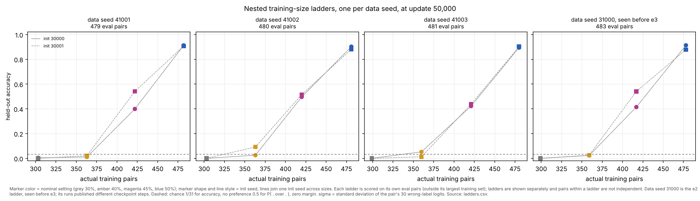
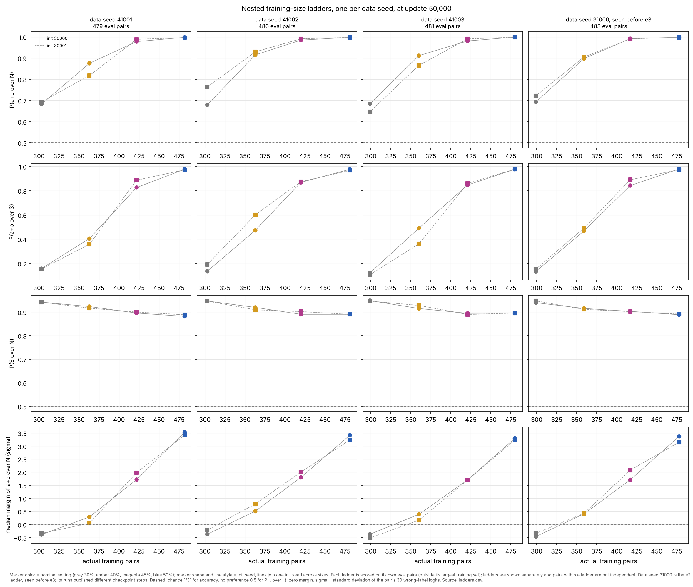
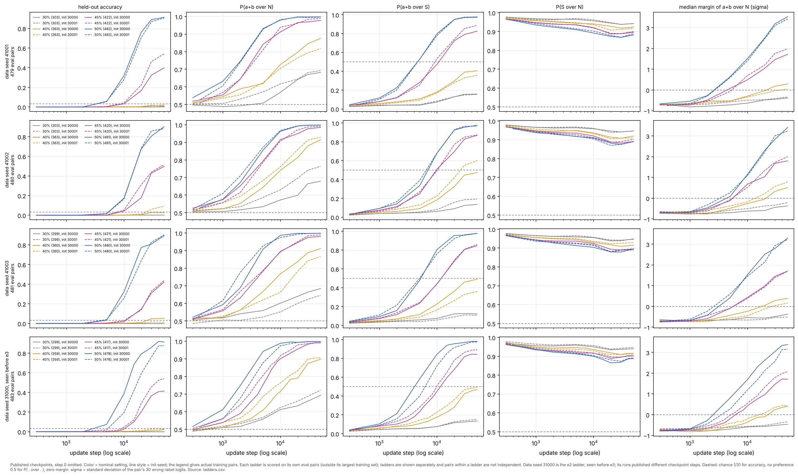

# e3 dynamics: the data-size ladder across data seeds (packet 1, first figure)

Status: initial experiment complete; **not audited**; submitted for coordinator review. No follow-up has been proposed or run yet (D8: propose only after review). Question and expectations were written before any e3 computation: [QUESTION.md](QUESTION.md) (`b800339`).

Session label `e3-dy-cloud-1`, branch `claude/project-thread-j8mgkm`. Measures are the shared e3 definitions (DECISIONS D6, `research/e3/audit/pairwise.py`).

## Question

Three new data seeds (41001, 41002, 41003) each give a nested ladder of training sets at the nominal settings 30%, 40%, 45% and 50%, trained from the same two init seeds (30000, 30001); width 128, 50,000 updates, the original recipe. Does the ordering seen on the e2 ladder (data seed 31000) appear in each new ladder, does the transition move, and in this sample does the data seed move results more than the init seed?

## Figure 1: accuracy against actual training pairs



One panel per data seed, held-out accuracy at update 50,000 on that ladder's own eval pairs (the pairs outside its 50% training set: 479, 480, 481 and 483 pairs). Marker colour is the nominal setting and marker shape and line style the init seed. The right panel is the e2 ladder, seen before e3, assembled from earlier runs (listed below). Panels are not pooled: eval pairs differ between ladders, and pairs within a ladder share operands and labels.

## Figure 2: normalized measures at 50,000 updates



Rows: P(a+b over N), P(a+b over S), P(S over N) and the median margin of a+b over N in units of the pair's wrong-label logit spread σ. S = labels seen with an operand in the ladder's 30% training set, N = wrong labels never seen with an operand even at 50% (D6).

## Figure 3: trajectories



Rows are ladders, columns are accuracy and the four measures over training (log update axis). e3 runs are shown at their published checkpoints: update 300 (the first-interpolation checkpoint), 1k, 2k, 5k, 10k, 20k, 30k and 50k. The 31000 runs are shown at whatever their earlier lanes published.

## Observations

All 24 runs completed 50,000 updates. No failures, caps or retries.

**Table 1.** At update 50,000, on each ladder's own eval pairs. Each cell is init 30000 / init 30001. The rank column is the mean normalized rank of a+b among wrong labels outside the run's own operand-label sets (0 = top, 0.5 = chance).

| data seed | nominal | train pairs | accuracy | P(a+b over N) | P(a+b over S) | P(S over N) | margin over N (σ) | rank among own-absent |
|---|---|---|---|---|---|---|---|---|
| 41001 | 30% | 303 | 0.004 / 0.000 | 0.682 / 0.693 | 0.157 / 0.154 | 0.942 / 0.942 | -0.39 / -0.34 | 0.309 / 0.293 |
| 41001 | 40% | 363 | 0.010 / 0.021 | 0.875 / 0.817 | 0.406 / 0.358 | 0.923 / 0.917 | 0.29 / 0.05 | 0.122 / 0.180 |
| 41001 | 45% | 422 | 0.399 / 0.541 | 0.978 / 0.989 | 0.826 / 0.887 | 0.896 / 0.900 | 1.72 / 1.98 | 0.023 / 0.011 |
| 41001 | 50% | 482 | 0.912 / 0.906 | 0.998 / 0.996 | 0.977 / 0.972 | 0.882 / 0.888 | 3.53 / 3.42 | 0.002 / 0.004 |
| 41002 | 30% | 303 | 0.000 / 0.000 | 0.679 / 0.764 | 0.136 / 0.191 | 0.947 / 0.947 | -0.37 / -0.21 | 0.317 / 0.242 |
| 41002 | 40% | 363 | 0.025 / 0.092 | 0.915 / 0.930 | 0.473 / 0.601 | 0.920 / 0.910 | 0.51 / 0.78 | 0.085 / 0.065 |
| 41002 | 45% | 420 | 0.496 / 0.515 | 0.985 / 0.991 | 0.869 / 0.874 | 0.891 / 0.902 | 1.80 / 2.00 | 0.015 / 0.009 |
| 41002 | 50% | 481 | 0.902 / 0.881 | 0.998 / 0.998 | 0.976 / 0.967 | 0.891 / 0.890 | 3.41 / 3.24 | 0.002 / 0.002 |
| 41003 | 30% | 299 | 0.000 / 0.000 | 0.684 / 0.646 | 0.122 / 0.108 | 0.949 / 0.947 | -0.37 / -0.51 | 0.329 / 0.357 |
| 41003 | 40% | 360 | 0.052 / 0.012 | 0.911 / 0.866 | 0.490 / 0.361 | 0.915 / 0.928 | 0.39 / 0.16 | 0.094 / 0.140 |
| 41003 | 45% | 421 | 0.422 / 0.437 | 0.981 / 0.990 | 0.847 / 0.860 | 0.895 / 0.890 | 1.71 / 1.70 | 0.019 / 0.009 |
| 41003 | 50% | 480 | 0.894 / 0.902 | 0.999 / 0.999 | 0.977 / 0.978 | 0.896 / 0.896 | 3.30 / 3.23 | 0.001 / 0.001 |
| 31000 (e2) | 30% | 299 | 0.000 / 0.000 | 0.693 / 0.722 | 0.135 / 0.153 | 0.940 / 0.948 | -0.46 / -0.34 | 0.300 / 0.277 |
| 31000 (e2) | 40% | 359 | 0.023 / 0.025 | 0.898 / 0.905 | 0.468 / 0.492 | 0.916 / 0.911 | 0.40 / 0.42 | 0.096 / 0.095 |
| 31000 (e2) | 45% | 417 | 0.414 / 0.540 | 0.992 / 0.991 | 0.843 / 0.891 | 0.903 / 0.902 | 1.71 / 2.08 | 0.008 / 0.009 |
| 31000 (e2) | 50% | 478 | 0.913 / 0.878 | 0.998 / 0.998 | 0.979 / 0.973 | 0.889 / 0.891 | 3.37 / 3.15 | 0.002 / 0.002 |

No measure is undefined for any pair in any run (N and S are never empty on these eval sets). D is empty for 3 eval pairs of 41001 and is not used here.

1. **Ordering.** In all 8 ladder × init sequences, accuracy, P(a+b over N), P(a+b over S), the σ-margin and the own-absent rank all improve strictly with each larger nested set.
2. **Levels.** At 30% every run is at 0.000–0.004 accuracy. At 40% runs are at 0.010–0.092. At 45% they are at 0.399–0.541. At 50% they are at 0.878–0.913. These are the same bands as the e2 ladder (Table 1, bottom rows).
3. **Location of the accuracy step.** Linear interpolation in training-pair count between neighbouring rungs puts the 0.5 accuracy crossing at 50,000 updates at 417–434 pairs (Table 2). Between-rung behaviour was not measured, and the 45% runs are still rising (item 6), so these are rough places, not thresholds.
4. **Ladder against init.** For accuracy at 45%, the ladder means span 0.430–0.506 (range 0.076), while the two inits differ by 0.142 in 41001 and 0.126 in 31000. At 50% the ladder means span 0.018 and the init differences reach 0.035. The one setting where ladder spread exceeds every within-ladder init difference is 40% on the graded measures. There, 41002 is ahead on both inits: σ-margin 0.51/0.78 against at most 0.42 elsewhere, ladder-mean range 0.48 against init differences up to 0.28. P(a+b over S) shows the same with less separation (range 0.155 against at most 0.130). Accuracy at 40% does not: 41003 init 30000 (0.052) is above 41002 init 30000 (0.025).
5. **P(S over N) falls with share in every ladder** (asked by audit investigation 1). From 30% to 50% it falls by 0.051–0.060 in each of the 8 sequences: 0.940–0.949 at 30%, 0.910–0.928 at 40%, 0.890–0.903 at 45%, 0.882–0.896 at 50%. It is not strictly monotone in 3 sequences, which rise by at most 0.006 between 45% and 50% (41002 init 30000; 41003 both inits). Within a run it falls slowly during training at every share (Figure 3, fourth column).
6. **Horizon.** From 30,000 to 50,000 updates, 45% accuracy rises by 0.067–0.112 in every e3 run (e2: +0.048 and +0.085). 40% accuracy changes by −0.006 to +0.031, while its σ-margin still rises by 0.10–0.22. At 50,000 updates the 45% runs are not at a plateau.

**Table 2.** Interpolated training-pair count at which each measure crosses a level at 50,000 updates, per init (30000, 30001). Linear in count between neighbouring rungs.

| data seed | accuracy 0.5 | P(a+b over S) 0.5 | σ-margin 0 | P(a+b over N) 0.9 |
|---|---|---|---|---|
| 41001 | 433.8, 417.4 | 376.2, 378.8 | 337.4, 355.7 | 377.2, 391.5 |
| 41002 | 420.6, 418.0 | 366.8, 348.2 | 328.3, 315.8 | 359.2, 352.3 |
| 41003 | 430.7, 429.0 | 361.6, 377.0 | 328.9, 345.4 | 356.9, 376.8 |
| 31000 (e2) | 427.5, 412.5 | 364.0, 360.2 | 330.9, 325.6 | 360.3, 357.4 |

**Table 3.** Spread at 50,000 updates. The ladder-mean range is the range of the three e3 ladders' two-init means. The init differences are the |init 30000 − init 30001| values for 41001, 41002, 41003 and 31000, in that order.

| measure | setting | ladder-mean range | init differences |
|---|---|---|---|
| accuracy | 40% | 0.043 | 0.010, 0.067, 0.040, 0.002 |
| accuracy | 45% | 0.076 | 0.142, 0.019, 0.015, 0.126 |
| accuracy | 50% | 0.018 | 0.006, 0.021, 0.008, 0.035 |
| σ-margin | 30% | 0.150 | 0.047, 0.160, 0.142, 0.121 |
| σ-margin | 40% | 0.480 | 0.241, 0.275, 0.225, 0.020 |
| σ-margin | 45% | 0.200 | 0.264, 0.200, 0.006, 0.368 |
| σ-margin | 50% | 0.213 | 0.108, 0.178, 0.069, 0.220 |
| P(a+b over S) | 40% | 0.155 | 0.047, 0.128, 0.130, 0.024 |

## Reading (interpretation, not observation)

- **The ordering travels.** For three new choices of which pairs are trained, the ladder runs in the same direction and in the same bands as the e2 ladder. This is the first pattern in QUESTION.md ("ordering and location both travel"), at the resolution of four rungs and two inits.
- **In this sample the transition does not clearly move.** Ladder-to-ladder differences in accuracy are no larger than the init-to-init differences, and the accuracy crossings of different ladders overlap. The one hint of a ladder effect is 41002 at 40%, on the graded margin (both inits ahead) but not on accuracy. Two inits per cell cannot separate a real ladder effect of that size from chance.
- **This does not establish a critical data fraction.** The location is pinned only at one width, one horizon and one recipe. The four ladders share the same group-level construction, so the location could depend on that construction. A count near 420 pairs at 50,000 updates is a description of these ladders, not a threshold.
- The fall of P(S over N) with share travels across data seeds. Audit investigation 1 named this as the cheap first check before any shuffled-label test. It says nothing yet about whether the fall comes from finding the answer or from fitting more pairs per operand.

## Unresolved alternatives

- **Horizon.** The 45% runs still rise at 50,000 updates. A longer horizon would move every accuracy crossing toward fewer pairs, and it could change the ladder against init comparison at 45%.
- **Init spread.** Init spread is estimated from two seeds per cell. A ladder effect of the size seen at 40% (about 0.3–0.5 σ in margin) could be real or chance.
- **Between rungs.** Behaviour between rungs (for example, 363 to 420 pairs) is not observed. The interpolated crossings assume a straight line across a 60-pair gap.
- **Which property matters.** All four ladders add whole transpose groups in a seeded order. If identity matters at 40%, these runs do not say which property of the added groups (operand coverage, label coverage, class balance) matters.

## Runs and provenance

- **Runs.** 24 plan runs `e3-dy-add-w128-i<30000|30001>-tf<30|40|45|50>-d<41001|41002|41003>-a1` (plan `research/e3/plan.json`, D4). They were launched in `queue_position` order 1–24, with 2 workers and 1 BLAS thread each.
- **Launch.** The launch ran from a detached, clean worktree at `bd4a97c`, which contains the pin `9041a48`. Every run records `producing_code_commit` `bd4a97c…` and `producing_tree_dirty: false`. Each config's split hash, training-pair count, data seed, init seed and train fraction were checked against its plan entry, with no mismatches.
- **Command.** `uv run --locked python launch_runs.py --plan research/e3/plan.json --root runs/e3 --registry <repo>/research/e3/dynamics/registry.jsonl --session-label e3-dy-cloud-1 --workers 2 --timeout 600 --ids <the 24 IDs in queue order>`.
- **Timing.** 2026-10-22, 00:18:51 to 00:46:53 UTC: 28 min 2 s elapsed, 3,336 s process time, 112.8–168.0 s per run. Events are in [registry.jsonl](registry.jsonl).
- **Published files.** [runs/](runs/) holds configs, metrics, runtime, data, and checkpoints at updates 300 (first interpolation, added by the publisher), 1k, 2k, 5k, 10k, 20k, 30k and 50k. They were published with `publish_run.py RUN research/e3/dynamics/runs --steps 1000,2000,5000,10000,20000,30000,50000`. Every-1,000 checkpoints are kept on the run host and are not published.
- **Reference ladder (data seed 31000, seen before e3).**
  - 30%: `research/coordinator/runs/e1-co-add-w128-i30000-a1` and `research/size-time/runs/e1-st-add-w128-i30001-a1`.
  - 40% and 45%: `research/e2/dynamics/runs/e2-dy-add-w128-i3000{0,1}-tf4{0,5}-a1`.
  - 50%: `research/coordinator/runs/e1f2-co-add-w128-i3000{0,1}-tf50-a1`.
  - These runs use the same recipe, but were produced at earlier commits and on other hosts.
- **Checks in `ladder.py`.** Before scoring, `ladder.py` asserts that within each ladder the pair and label arrays are identical, every training set is transpose-closed, and the sets nest strictly. It also asserts that the eval pairs equal the complement of the largest training set and match `research/e3/data/eval-d<seed>.npz`. For every checkpoint it checks the manifest SHA-256, and checks that recomputed audit-split accuracy matches `metrics.jsonl` to 1e-12.
- **Budget.** The initial runs took about 28 min, and analysis less than 1 min, for about 29 of the lane's 70 min (D7). That leaves about 25 min for the follow-up allowance plus margin.

## Regenerate

From the repository root, with the analysis group installed:

```bash
C=research/coordinator/runs; P=research/size-time/runs; E=research/e2/dynamics/runs
uv run --locked --group analysis python research/e3/dynamics/ladder.py research/e3/dynamics/runs/e3-dy-*-a1 \
  $C/e1-co-add-w128-i30000-a1 $P/e1-st-add-w128-i30001-a1 $E/e2-dy-add-w128-i3000{0,1}-tf4{0,5}-a1 \
  $C/e1f2-co-add-w128-i3000{0,1}-tf50-a1 --out research/e3/dynamics/figures
```

This takes about 17 s. It writes `ladders.csv` (every checkpoint), `ladders_final.csv` (update 50,000), `sizes.json` (training counts and label-set sizes per ladder), and the three figures as PNG and SVG. The figures and tables here were produced by `ladder.py` at `1d53cdc`.
