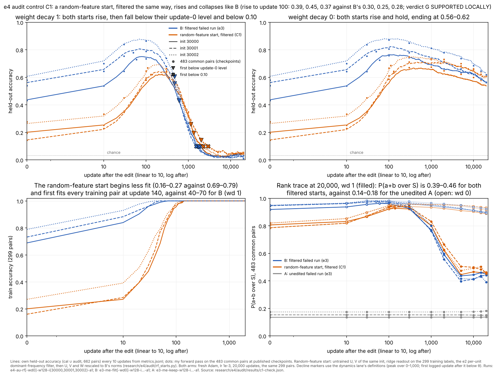

# e4 audit

Session `e4-au-cloud-1`, thread "Correctness audit", branch `claude/project-thread-id1tmm`. The base is `swarm/exploration` `52e7879` (D3), with D11 and D12 merged. Questions and rules were written before any measurement: [QUESTION.md](QUESTION.md) (`33bf731`; addendum 1 `2d81d64`).

Software results are PASS / FAIL / NOT CHECKED. Readings are SUPPORTED LOCALLY / AMBIGUOUS / CONTRADICTED.

| QUESTION section | status |
|---|---|
| 1. Control C1: random-feature starts through the B protocol | done, below |
| 2. Mechanisms decomposition (M1–M4, R1–R4, C2) | NOT CHECKED yet; waiting for the lane's code and first figure |
| 3. Dynamics runs (Y1–Y7) and interventions | NOT CHECKED yet; waiting for the D6 runs |

## Control C1: does the rise and collapse need anything the failed runs learned? (QUESTION §1)



Vector version: [c1.svg](figures/c1.svg).

Look before reading:
- Top left (wd 1): do the orange curves (random-feature starts) rise and fall like the blue ones (B)? Where do the triangles and crosses sit?
- Top right (wd 0): where do the two colours end?
- Bottom right: compare the end of the filled orange and blue lines with the grey ones (the unedited A).

**The control.** Each init seed gets one start file, written by [rf_starts.py](rf_starts.py) before any run (`aa09dd4`):
- the untrained U and V of that init;
- a closed-form ridge readout fitted to the 299 training labels;
- the same per-unit dominant-frequency filter that made B;
- U and V rescaled jointly, and W separately, to B's matrix norms. That is a scale-only change, so it changes no answer.

So this start has no trained features. The only trained content is a readout fitted to the same 299 labels as B's sources. Each start was continued with the e3 B recipe (fresh Adam, lr 1e-3, 20,000 updates) at wd 1 and wd 0. These are the claimed runs `e4-au-rf[-wd0]-w128-i{30000,30001,30002}-a1` (D11, D12).

**Results, per seed.** Common accuracy is on the 483 never-trained pairs at published checkpoints. The peak and the decline times use own held-out accuracy every 10 updates, with the dynamics lane's definitions.

| init | arm | common acc, update 0 → 100 | rise to 100 (class) | first update with train acc 1 (wd 1) | own held-out peak (update), wd 1 | wd 1: first below update-0 level / below 0.10 | wd 1 common acc at 20k | wd 0 crossings | wd 0 common acc at 20k |
|---|---|---|---|---|---|---|---|---|---|
| 30000 | random features | 0.195 → 0.580 | 0.385 (generic) | 140 | 0.624 (240) | 1,330 / 2,060 | 0.054 | none (censored > 20,000) | 0.561 |
| 30000 | B | 0.431 → 0.735 | 0.304 | 70 | 0.751 (80) | 600 / 1,680 | 0.031 | none (censored > 20,000) | 0.561 |
| 30001 | random features | 0.143 → 0.596 | 0.453 (generic) | 140 | 0.645 (250) | 2,000 / 2,910 | 0.035 | none (censored > 20,000) | 0.621 |
| 30001 | B | 0.540 → 0.789 | 0.248 | 50 | 0.807 (70) | 470 / 1,540 | 0.031 | none (censored > 20,000) | 0.565 |
| 30002 | random features | 0.277 → 0.646 | 0.369 (generic) | 140 | 0.693 (200) | 1,140 / 2,250 | 0.046 | none (censored > 20,000) | 0.609 |
| 30002 | B | 0.580 → 0.863 | 0.284 | 40 | 0.878 (70) | 470 / 1,800 | 0.010 | none (censored > 20,000) | 0.619 |

**Re-crossings.** The random-feature i30001 wd 1 run re-crosses both thresholds once. The i30002 wd 1 run re-crosses 0.10 once. B re-crosses neither.

**At 20,000 updates, wd 1, scale-free measures.**

| arm | P(a+b over S) | P(a+b over N) | P(S over N) | σ-margin over N |
|---|---|---|---|---|
| random features | 0.45–0.46 | 0.88–0.89 | 0.91 | 0.01–0.08 |
| B | 0.39–0.45 | 0.87–0.88 | 0.92–0.93 | −0.04–0.11 |
| unedited A | 0.14–0.18 | 0.70–0.75 | 0.94–0.95 | −0.60 to −0.45 |

At wd 0 the two filtered arms also end alike: P(a+b over S) 0.89–0.93 and σ-margin 1.38–1.70.

**Verdict under the pre-stated rule: G is SUPPORTED LOCALLY**, in all three seeds and all three components.
- **Rise.** The random-feature rise to update 100 is 0.37–0.45, more than B's 0.25–0.30 and far above the half-of-B threshold (0.12–0.15).
- **Collapse.** Every wd 1 random-feature run falls below its update-0 level (1,140–2,000) and below 0.10 (2,060–2,910).
- **Hold.** Every wd 0 random-feature run is censored at both thresholds.

**What stays specific to B** (observations, three seeds):
- It starts 0.24–0.40 higher.
- It peaks 0.13–0.18 higher in own held-out accuracy (0.75–0.88 against 0.62–0.69).
- It fits every training pair two to three times sooner (40–70 updates against 140), and it peaks and collapses earlier in updates.
- By 20,000 updates, at either wd, nothing listed above separates the arms. That includes the "rank trace", P(a+b over S) about 0.4–0.46 at wd 1.

**Reading (interpretation, three seeds, one split).**
- **The phenomenon is supplied.** The rise, the collapse under decay 1, the retention without decay and the residual rank preference do not need anything the failed runs learned. Untrained features, a readout fitted to the same 299 labels, and the filter are enough. So the computation between B's peak and its collapse is supplied by the filter plus fitting.
- **What a mechanism found in B describes.** It describes filtered, frequency-concentrated networks trained on these pairs with AdamW. It is not a property of the failed runs. The failed runs contribute a head start: more correct answers at the edit, a higher peak and a faster fit.
- **The rank trace.** e3 read the trace that survives the collapse against the unedited and sham arms. It is equally present when the start came from random features, so it marks the filtered start, not something inherited from the failed run.

**Not shown.**
- That the two arms collapse by the same mechanism. Only their trajectories in scale-free measures were compared.
- That the failed runs contain nothing. Their head start is real in all three seeds.
- Anything beyond three init seeds, one split, width 128 and this recipe.

**Strongest surviving alternative.**
- Two different mechanisms could produce such similar curves.
- In particular, B's decline could start from the structure it inherited from the failed run, while the random-feature start declines from structure built in its first 200 updates.
- The random-feature start's later peak (200–250 against 70–80) and later crossings (2,060–2,910 against 1,540–1,800 for 0.10) are consistent with either.

**Cheapest discriminating check.** Run the mechanisms lane's channel decomposition on these six runs at the same published updates (0, 10, 30, 100, 300, 1,000, 2,000, 5,000, 10,000, 15,000, 20,000). This is analysis only.
- If the same channels change in the same order, the mechanism belongs to the filtered network.
- Where B and the random-feature start differ, that difference is what the failed runs contribute.

**Limits.**
- **Concentration.** The random-feature units keep less of their energy under the filter (U 0.19, W 0.085, against B's 0.42–0.46 and 0.37–0.39). This works against G, so the G verdict is conservative.
- **Timing of the rise.** It was measured at update 100, before the random-feature start's own fit (140) and peak (200–250). Measured to its first fit checkpoint (110–140), the rise is 0.39–0.48. This also works against G.
- **Ridge strength.** Only one value was used (r = 1e-6). Its choice is explained in QUESTION.md and was not made on held-out accuracy.

**Software checks.** All PASS. Sources: [starts/update0.json](starts/update0.json) and [results/c1-check.json](results/c1-check.json).
- **Start files.**
  - U and V equal `experiment.init` for the seed, and every published step-0 checkpoint of that init at width 128 that `load_run` accepts: B's source for 30000 and 30001, and the e1 no-decay run for all three. B's i30002 source has no step-0 file in the repository.
  - The filtered network reproduces e2 audit cycle 3 (0.195 / 0.143 / 0.277).
  - Rescaling leaves the argmax on all 961 pairs, and every scale-free measure, unchanged to within 1.1e-15. The norms equal B's to 1e-12 relative.
  - The split hash is `aa8f7504…`, and the common pairs do not overlap training.
- **Provenance**, for each of the six runs:
  - the config's start-file hash equals the plan's and the file's, and the step-0 weights equal the start file bitwise;
  - wd, lr and steps are as planned, `init_age` is 0 and there is no resume;
  - the registry has one running and one complete event, and 20,000 updates completed;
  - the published files match their manifests;
  - the step-0 logged accuracies equal my forward pass (maximum difference 0.0).
- **Producing code.**
  - The producing commit is `ccb4e16`. Its shared code is identical to `72cfb5d` (`git diff` is empty for `experiment.py`, `launch_runs.py`, `report_map.py`, `publish_run.py`, `instrumentation.py`, `pyproject.toml` and `uv.lock`).
  - The configs differ from B's only in the start file and its hash, `init_age`, run ID, output path, session label and runtime record.
- **Incidental, on existing runs.** My decline times for B reproduce the dynamics lane's addendum (`e5fd1c2`) exactly: 600 / 470 / 470 and 1,680 / 1,540 / 1,800 at wd 1, censored at wd 0.

**Budget.** About 2.0 of 25 min:
- six runs, 108 s elapsed with two workers (one BLAS thread each, launched 02:17:10–02:18:58 UTC);
- start files and analysis, about 12 s.

**Reproduce**
```
export OPENBLAS_NUM_THREADS=1 OMP_NUM_THREADS=1 MKL_NUM_THREADS=1
uv run --locked python research/e4/audit/rf_starts.py
uv run --locked python launch_runs.py --plan research/e4/plan.json --root runs/e4 --registry research/e4/audit/registry.jsonl \
  --session-label e4-au-cloud-1 --workers 2 --timeout 300 --ids e4-au-rf-w128-i30000-a1 e4-au-rf-wd0-w128-i30001-a1 \
  e4-au-rf-w128-i30002-a1 e4-au-rf-wd0-w128-i30000-a1 e4-au-rf-w128-i30001-a1 e4-au-rf-wd0-w128-i30002-a1
for r in runs/e4/e4-au-rf-*-a1; do uv run --locked python publish_run.py $r research/e4/audit/runs --steps 0,10,30,100,300,1000,2000,5000,10000,15000,20000; done
uv run --locked python research/e4/audit/c1_check.py research/e4/audit/results
uv run --locked --group analysis python research/e4/audit/plot_c1.py research/e4/audit/figures/c1 research/e4/audit/results
```
