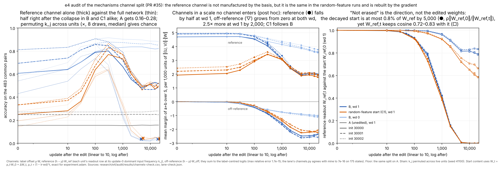

# e4 audit

Session `e4-au-cloud-1`, thread "Correctness audit", branch `claude/project-thread-id1tmm`. The base is `swarm/exploration` `52e7879` (D3), with D11 and D12 merged. Questions and rules were written before any measurement: [QUESTION.md](QUESTION.md) (`33bf731`; addendum 1 `2d81d64`).

Software results are PASS / FAIL / NOT CHECKED. Readings are SUPPORTED LOCALLY / AMBIGUOUS / CONTRADICTED.

| QUESTION section | status |
|---|---|
| 1. Control C1: random-feature starts through the B protocol | done, below |
| 2. Mechanisms decomposition (M1–M4, R1–R4, C2; addenda 1–2) | done, below (lane PR #35 at `52f25d0`) |
| 3. Dynamics runs (Y1–Y7) and interventions | NOT CHECKED yet; waiting for the D6 runs |

## Control C1: does the rise and collapse need anything the failed runs learned? (QUESTION §1)


Vector version: [c1.svg](figures/c1.svg).

Look before reading:
- Top left (wd 1): do the orange curves (random-feature starts) rise and fall like the blue ones (B)? Where do the triangles and crosses sit?
- Top right (wd 0): where do the two colours end?
- Bottom right: compare the end of the filled orange and blue lines with the grey ones (the unedited A).

**The control.** Each init seed gets one start file, written by [rf_starts.py](rf_starts.py) before any run (`aa09dd4`):
- the untrained U and V of that init;
- a closed-form ridge readout fitted to the 299 training labels;
- the same per-unit dominant-frequency filter that made B;
- U and V rescaled jointly, and W separately, to B's matrix norms. That is a scale-only change, so it changes no answer.

So this start has no trained features. The only trained content is a readout fitted to the same 299 labels as B's sources. Each start was continued with the e3 B recipe (fresh Adam, lr 1e-3, 20,000 updates) at wd 1 and wd 0. These are the claimed runs `e4-au-rf[-wd0]-w128-i{30000,30001,30002}-a1` (D11, D12).

**Results, per seed.** Common accuracy is on the 483 never-trained pairs at published checkpoints. The peak and the decline times use own held-out accuracy every 10 updates, with the dynamics lane's definitions.

| init | arm | common acc, update 0 → 100 | rise to 100 (class) | first update with train acc 1 (wd 1) | own held-out peak (update), wd 1 | wd 1: first below update-0 level / below 0.10 | wd 1 common acc at 20k | wd 0 crossings | wd 0 common acc at 20k |
|---|---|---|---|---|---|---|---|---|---|
| 30000 | random features | 0.195 → 0.580 | 0.385 (generic) | 140 | 0.624 (240) | 1,330 / 2,060 | 0.054 | none (censored > 20,000) | 0.561 |
| 30000 | B | 0.431 → 0.735 | 0.304 | 70 | 0.751 (80) | 600 / 1,680 | 0.031 | none (censored > 20,000) | 0.561 |
| 30001 | random features | 0.143 → 0.596 | 0.453 (generic) | 140 | 0.645 (250) | 2,000 / 2,910 | 0.035 | none (censored > 20,000) | 0.621 |
| 30001 | B | 0.540 → 0.789 | 0.248 | 50 | 0.807 (70) | 470 / 1,540 | 0.031 | none (censored > 20,000) | 0.565 |
| 30002 | random features | 0.277 → 0.646 | 0.369 (generic) | 140 | 0.693 (200) | 1,140 / 2,250 | 0.046 | none (censored > 20,000) | 0.609 |
| 30002 | B | 0.580 → 0.863 | 0.284 | 40 | 0.878 (70) | 470 / 1,800 | 0.010 | none (censored > 20,000) | 0.619 |

**Re-crossings.** The random-feature i30001 wd 1 run re-crosses both thresholds once. The i30002 wd 1 run re-crosses 0.10 once. B re-crosses neither.

**At 20,000 updates, wd 1, scale-free measures.**

| arm | P(a+b over S) | P(a+b over N) | P(S over N) | σ-margin over N |
|---|---|---|---|---|
| random features | 0.45–0.46 | 0.88–0.89 | 0.91 | 0.01–0.08 |
| B | 0.39–0.45 | 0.87–0.88 | 0.92–0.93 | −0.04–0.11 |
| unedited A | 0.14–0.18 | 0.70–0.75 | 0.94–0.95 | −0.60 to −0.45 |

At wd 0 the two filtered arms also end alike: P(a+b over S) 0.89–0.93 and σ-margin 1.38–1.70.

**Verdict under the pre-stated rule: G is SUPPORTED LOCALLY**, in all three seeds and all three components.
- **Rise.** The random-feature rise to update 100 is 0.37–0.45, more than B's 0.25–0.30 and far above the half-of-B threshold (0.12–0.15).
- **Collapse.** Every wd 1 random-feature run falls below its update-0 level (1,140–2,000) and below 0.10 (2,060–2,910).
- **Hold.** Every wd 0 random-feature run is censored at both thresholds.

**What stays specific to B** (observations, three seeds):
- It starts 0.24–0.40 higher.
- It peaks 0.13–0.18 higher in own held-out accuracy (0.75–0.88 against 0.62–0.69).
- It fits every training pair two to three times sooner (40–70 updates against 140), and it peaks and collapses earlier in updates.
- By 20,000 updates, at either wd, nothing listed above separates the arms. That includes the "rank trace", P(a+b over S) about 0.4–0.46 at wd 1.

**Reading (interpretation, three seeds, one split).**
- **The phenomenon is supplied.** The rise, the collapse under decay 1, the retention without decay and the residual rank preference do not need anything the failed runs learned. Untrained features, a readout fitted to the same 299 labels, and the filter are enough. So the computation between B's peak and its collapse is supplied by the filter plus fitting.
- **What a mechanism found in B describes.** It describes filtered, frequency-concentrated networks trained on these pairs with AdamW. It is not a property of the failed runs. The failed runs contribute a head start: more correct answers at the edit, a higher peak and a faster fit.
- **The rank trace.** e3 read the trace that survives the collapse against the unedited and sham arms. It is equally present when the start came from random features, so it marks the filtered start, not something inherited from the failed run.

**Not shown.**
- That the two arms collapse by the same mechanism. Only their trajectories in scale-free measures were compared.
- That the failed runs contain nothing. Their head start is real in all three seeds.
- Anything beyond three init seeds, one split, width 128 and this recipe.

**Strongest surviving alternative.**
- Two different mechanisms could produce such similar curves.
- In particular, B's decline could start from the structure it inherited from the failed run, while the random-feature start declines from structure built in its first 200 updates.
- The random-feature start's later peak (200–250 against 70–80) and later crossings (2,060–2,910 against 1,540–1,800 for 0.10) are consistent with either.

**Cheapest discriminating check.** Run the mechanisms lane's channel decomposition on these six runs at the same published updates (0, 10, 30, 100, 300, 1,000, 2,000, 5,000, 10,000, 15,000, 20,000). This is analysis only.
- If the same channels change in the same order, the mechanism belongs to the filtered network.
- Where B and the random-feature start differ, that difference is what the failed runs contribute.

**Limits.**
- **Concentration.** The random-feature units keep less of their energy under the filter (U 0.19, W 0.085, against B's 0.42–0.46 and 0.37–0.39). This works against G, so the G verdict is conservative.
- **Timing of the rise.** It was measured at update 100, before the random-feature start's own fit (140) and peak (200–250). Measured to its first fit checkpoint (110–140), the rise is 0.39–0.48. This also works against G.
- **Ridge strength.** Only one value was used (r = 1e-6). Its choice is explained in QUESTION.md and was not made on held-out accuracy.

**Software checks.** All PASS. Sources: [starts/update0.json](starts/update0.json) and [results/c1-check.json](results/c1-check.json).
- **Start files.**
  - U and V equal `experiment.init` for the seed, and every published step-0 checkpoint of that init at width 128 that `load_run` accepts: B's source for 30000 and 30001, and the e1 no-decay run for all three. B's i30002 source has no step-0 file in the repository.
  - The filtered network reproduces e2 audit cycle 3 (0.195 / 0.143 / 0.277).
  - Rescaling leaves the argmax on all 961 pairs, and every scale-free measure, unchanged to within 1.1e-15. The norms equal B's to 1e-12 relative.
  - The split hash is `aa8f7504…`, and the common pairs do not overlap training.
- **Provenance**, for each of the six runs:
  - the config's start-file hash equals the plan's and the file's, and the step-0 weights equal the start file bitwise;
  - wd, lr and steps are as planned, `init_age` is 0 and there is no resume;
  - the registry has one running and one complete event, and 20,000 updates completed;
  - the published files match their manifests;
  - the step-0 logged accuracies equal my forward pass (maximum difference 0.0).
- **Producing code.**
  - The producing commit is `ccb4e16`. Its shared code is identical to `72cfb5d` (`git diff` is empty for `experiment.py`, `launch_runs.py`, `report_map.py`, `publish_run.py`, `instrumentation.py`, `pyproject.toml` and `uv.lock`).
  - The configs differ from B's only in the start file and its hash, `init_age`, run ID, output path, session label and runtime record.
- **Incidental, on existing runs.** My decline times for B reproduce the dynamics lane's addendum (`e5fd1c2`) exactly: 600 / 470 / 470 and 1,680 / 1,540 / 1,800 at wd 1, censored at wd 0.

**Budget.** About 2.0 of 25 min:
- six runs, 108 s elapsed with two workers (one BLAS thread each, launched 02:17:10–02:18:58 UTC);
- start files and analysis, about 12 s.

**Reproduce**
```
export OPENBLAS_NUM_THREADS=1 OMP_NUM_THREADS=1 MKL_NUM_THREADS=1
uv run --locked python research/e4/audit/rf_starts.py
uv run --locked python launch_runs.py --plan research/e4/plan.json --root runs/e4 --registry research/e4/audit/registry.jsonl \
  --session-label e4-au-cloud-1 --workers 2 --timeout 300 --ids e4-au-rf-w128-i30000-a1 e4-au-rf-wd0-w128-i30001-a1 \
  e4-au-rf-w128-i30002-a1 e4-au-rf-wd0-w128-i30000-a1 e4-au-rf-w128-i30001-a1 e4-au-rf-wd0-w128-i30002-a1
for r in runs/e4/e4-au-rf-*-a1; do uv run --locked python publish_run.py $r research/e4/audit/runs --steps 0,10,30,100,300,1000,2000,5000,10000,15000,20000; done
uv run --locked python research/e4/audit/c1_check.py research/e4/audit/results
uv run --locked --group analysis python research/e4/audit/plot_c1.py research/e4/audit/figures/c1 research/e4/audit/results
```

## Mechanisms channel split (QUESTION §2, addenda 1–2; lane packet PR #35, `52f25d0`)



Vector version: [channels.svg](figures/channels.svg).

Look before reading:
- Left: how far do the thick lines (reference channel alone) sit above the thin ones (full network) after 2,000, compared with the grey lines (A) and the crosses (a permuted basis)?
- Middle: do orange (random-feature start) and dark blue (B) channels move together?
- Right: what happens to the share the decayed start can make up (●), and to the direction (□)?

**What was run.** [channels_check.py](channels_check.py) is my implementation of the lane's design (`d584af7`). It covers every published state of B (wd 1 and 0), A, C (wd 1 and 0) and the six C1 runs. [lane_check.py](lane_check.py) runs the lane's own `channels.py`:
- against mine;
- on the C1 runs, which the coordinator assigned to me (D14 item 4);
- for the basis checks of addendum 2.

The rules were fixed before computing: addendum 1 (`2d81d64`) and addendum 2 (`4e459bf`). When addendum 2 was written, my own channels had already been computed (it says so).

**Software checks, all PASS.**

| # | check | result |
|---|---|---|
| M1 | Reconstruction identity | offset + reference + off-reference = label-centred logits to 1.7e-15 relative, in every state (mine). The lane's `channels()` equals mine to 7.3e-16 on 175 states (B, A, C1). The label-axis DC is a per-pair constant (spread 2e-16). No unit is dead at update 0, so the lane's live-unit rule changes nothing |
| M2 | Basis and labels | k_j read from the update-0 weights equals e2 `dominant()` of the 50k source (the frequency the filter kept) for all three sources; the wd 0 start gives the same k_j. μ uses training inputs only. Task-informed: the lane's alignment and coherence (a+b−c mode, over all 961 pairs including training pairs) |
| M3 | Invariances | Accuracy, P measures and the σ-margin change by at most 6.7e-16 under ×3.7, under a random per-pair constant, and under (2U, 2V, 3W). Linear margins scale by exactly 6 under the last. The lane's channel margins (logits) and weight-part norms are scale-dependent. Its accuracies and P measures are not |
| M4 | Decay is a uniform factor | One `experiment.adam` update with zero gradient gives exactly (1 − lr·wd)·w for wd 1, 0.3, 0.1 and 0 (bitwise). −log ρ_t = E(t) to 1.4e-14 |

**The lane's readings.**

| lane reading | verdict | evidence |
|---|---|---|
| The label offset (Janati's mean term) is not involved in the decline | SUPPORTED LOCALLY | From update 100 on, removing μ·W changes accuracy by at most 0.041 in B and 0.031 in C1 (from 300). Its mean margins are at most 0.017 of the RMS logit. At update 0, removing it lifts accuracy by up to 0.23 in B and in C1. So a channel with near-zero mean margin can move the argmax a lot (R4) |
| "Outvoted, not erased": the reference channel alone still gets about half the common pairs right after the collapse | SUPPORTED LOCALLY as a statement about the readout at the reference frequencies, with three qualifications (below) | At 5,000 and 20,000, B's reference-only accuracy is 0.47–0.52, against A's 0.16–0.28. That is 0.22–0.36 above A in every seed, and the normalised margins do not overlap (C2 rule met). Permuting k_j across units gives 0.034–0.047 (median of 8, max 0.077), so the basis does not manufacture it |
| What decay changes, compared with wd 0, is mostly the reference part | AMBIGUOUS: it depends on the scale | In raw logits the wd 1 − wd 0 difference at 2,000 is 3.5–3.8 in the reference channel and 0.6–0.7 in the off-reference one (lane). But the wd 0 networks are 1.65× larger in ‖(U, V)‖·‖W‖ (1,372–1,409 against 836–851), which inflates their raw margins. Per unit of that product (a scale no channel enters, post hoc), the differences are 1.6–1.7 (reference) and 1.3 (off-reference). The off-reference channel is then 2.5× larger at wd 1. Normalising by the RMS logit instead couples the channels: any growth in one shrinks the others |
| The useful component's loss is not mainly weight shrinkage, since its input weights keep their norm | AMBIGUOUS | The norms hold, but decay acts on those weights exactly on schedule (M4: ρ = 0.15 from 100 to 2,000). They keep their norm because the gradient replaces them. On the readout side, the decayed start can be at most 15–16% of ‖W_ref‖ at 2,000 and 0.8% at 5,000. Benchmarked against passive decay from update 100 (R1), the reference channel's S-margin at 2,000 is 26–36× larger. The channel is actively rebuilt, not passively shrinking |
| Phase alignment and coherence at the a+b mode: not seen | AMBIGUOUS: the index could not show it | The lane's index over all 961 pairs gives A (0% held-out) 0.98–0.99, as high as B. On the 483 common pairs, B's coherence goes 0.97–0.98 at 100 → 0.94–0.96 at 2,000 → 0.91–0.93 at 20,000, and A's is 0.81–0.85. That is a modest decline, not a large decoherence. A full-table projection onto a+b−c gives A implied held-out accuracy 1.0 over all pairs or over training pairs, and 0.0 over common pairs. A table-level a+b mode cannot show that a computation exists |

**Qualifications to "outvoted, not erased".**
1. **Not specific to the failed runs.** The lane's own `channels.py` on the six C1 runs gives the same channels in the same order, SUPPORTED LOCALLY under addendum 2(b) in all three seeds:
   - From 300 to 2,000 at wd 1, both channels fall, with the reference share 0.33 / 0.35 / 0.40 against B's 0.41 / 0.45 / 0.42.
   - The offset carries under 1%.
   - At wd 0 the reference channel rises.
   - The reference-only accuracy at 5,000–20,000 is 0.46–0.52, against B's 0.47–0.52.
2. **"Not erased" describes the direction, not the edited weights.** W_ref,t = ρ_t W_ref,0 + ΔW_ref,t exactly.
   - By 5,000 the decayed start is at most 0.76–0.82% of ‖W_ref‖ in every run (s_t < 0.05; addendum 2c), so the edited readout is gone.
   - The rebuilt readout still points along it: cosine 0.81–0.83 for B and 0.72–0.75 for C1 at 5,000, and c_t 0.62–0.71 ≫ ρ = 0.0067.
3. **The split is per unit, not per frequency (R3).** The set of reference frequencies covers all 15 bins in every run (B, A, C, C1), so the pre-stated "in K / outside K" split is degenerate. Every off-reference component sits at some other unit's reference frequency.
   - Only unit identity separates "competitor" from "useful signal on another unit".
   - Functionally the off-reference channel behaves like a memorizer: alone it scores 0.00–0.004 (lane), and its margin falls against S, not against N.

**Other checks.**
- **R2.** The off-reference channel is exactly zero at update 0 by construction and grows at both wd. The evidence for "competitors overtake" is the excess at wd 1 (2.5× by 2,000 per unit norm product), not the growth itself. The lane compares against wd 0, so this is met.
- **R4.** The exact bilinear split of the reference channel's S-margin change (B, wd 1, 100 → 2,000) depends on the order:
  - features carry 0.90–0.99 of it if they change first, and 0.43–0.55 if the readout changes first;
  - the readout carries 0.01–0.10 or 0.45–0.57.
  So at least about 43% of the reference channel's fall comes through h (input weights and gates). Readout and features cannot be separated further this way, consistent with the lane's "cannot tell which".

**Strongest surviving alternative.** One integrated re-fitting process, cut into two channels by the Fourier basis (the lane's own alternative). It is consistent with three findings above:
- under decay both channels are almost entirely gradient-built by 5,000;
- the rebuilt reference readout keeps the start's direction;
- the same split appears when the start came from random features.

**Cheapest discriminating check.** The lane's approved intervention (D14), restricting decay to or away from the reference parts. It tests whether decay acting on the reference slot is necessary, while the gradient keeps rebuilding it. My review of its shared-code patch is still to come.

**Not checked here.** The lane's gate-change measure, its weight-part norms, its dense replays (the coordinator and the lane checked replay equality) and its current-frequency variant.

**Budget.** About 15 s of analysis in total (channels_check 3.5 s, lane_check 3.7 s, each run twice). Cumulative about 2.3 of 25 min.

**Reproduce**
```
uv run --locked python research/e4/audit/channels_check.py research/e4/audit/results
uv run --locked --group analysis python research/e4/audit/lane_check.py research/e4/audit/results
uv run --locked --group analysis python research/e4/audit/plot_channels_audit.py research/e4/audit/figures/channels research/e4/audit/results
```
