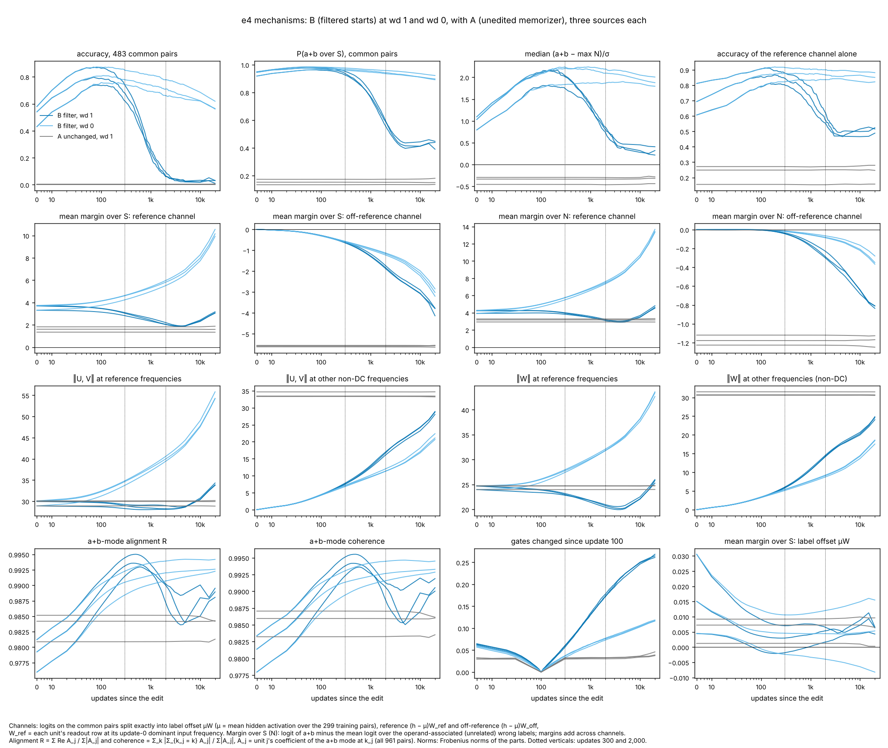
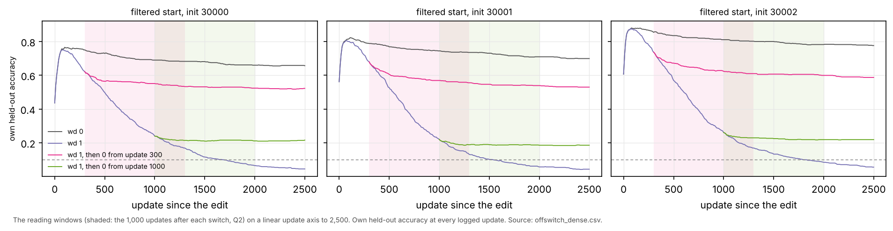
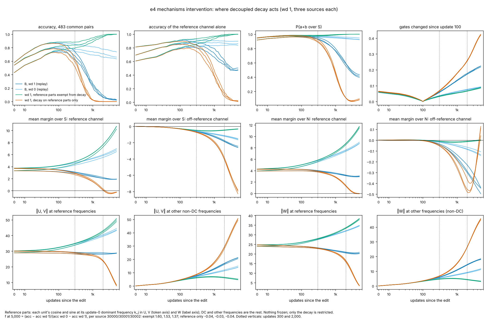

# e4 review index (figures first)

**e4 is open** (2026-10-22). The question: between the post-filter accuracy peak and the collapse, what changes in the computation, and which changes cause the loss of correct answers?

Round e4 runs under the [charter](charter/README.md). Assignments, windows, measures, budgets and claims are in [DECISIONS.md](DECISIONS.md) (D1–D10). Run claims are in [../plan.json](../plan.json) and the literature correspondence is in [LITERATURE.md](LITERATURE.md). e1–e3 are complete and unchanged; e3's packet is [../../e3/coordinator/INDEX.md](../../e3/coordinator/INDEX.md).

e4 base for workers: `ee028d96560a09736ab7846d95cb7a43f80c0aaf`. Shared code is unchanged since `72cfb5d` (D3).

Figures, observations, the explanations that survived or failed, confounds, run accounting and at most three next questions will be added here as packets are reviewed and audited.

## Status

| lane | initial experiment | status |
|---|---|---|
| dynamics | D6: six constant-decay runs at wd 0.1 and 0.3 from the filtered starts | packets 1 (PR #33) and 2 (PR #36, the D13 decay-off follow-up) integrated, audits pending; no further runs |
| mechanisms | analysis of published e3 checkpoints; D7: six dense diagnostic replays | first figure integrated (PR #35) and audited (PR #38); intervention integrated (PR #40), audit pending |
| auditor | audit of the decomposition, the strongest cheap control (random-feature starts, D11–D12), dynamics and intervention checks | C1 (PR #34) and the decomposition audit (PR #38) integrated; dynamics checks and the patch review pending |

## 1. Decay strength between the peak and the collapse (dynamics, packet 1, not yet audited)

Six new runs at wd 0.1 and 0.3 from the three filtered start files, with the e3 wd 0 and wd 1 runs as endpoints, on the decay-exposure axis E = −t·log(1 − lr·wd). The update-axis version is [decay_update.png](../dynamics/figures/decay_update.png), and the packet is [../dynamics/README.md](../dynamics/README.md).

- **Observation.**
  - Fit times (70/50/40) and peaks (within 0.004) do not depend on decay.
  - Every decayed run collapses within 20,000 updates while training accuracy stays at 1. Common accuracy at 20k is 0.06–0.09 at wd 0.1, 0.03–0.05 at wd 0.3 and 0.01–0.03 at wd 1.
  - wd 0 is censored at 0.56–0.62.
  - The global weight norm grows through the decline at every decay value.
- **Pre-stated rule: MIXED.**
  - At the 0.10 threshold, all six runs are on the exposure clock (r 0.80–0.92).
  - At the update-0 threshold, wd 0.3 is on the clock but two of the three wd 0.1 runs are faster.
  - Outside the rule: all twelve ratios are below 1, and they are lower at lower decay.
- **Explanation (lane, untested).** Within 20k, decay strength mainly sets when the decline happens. A decay-independent drift (the slow wd 0 decline) may add to it.

## 2. Does the rise and collapse need anything the failed runs learned? (audit control C1)

The **random-feature start** is built from untrained U and V of the same init, a ridge readout fitted to the same 299 training labels, the same per-unit dominant-frequency filter, and a rescaling to B's norms. It is then trained with B's recipe at wd 1 and wd 0. The rule was stated before the runs. Packet: [../audit/AUDIT.md](../audit/AUDIT.md).

- **Observation.**
  - The random-feature start rises from 0.14–0.28 to 0.58–0.65 by update 100. Its rise (0.37–0.45) exceeds B's (0.25–0.30).
  - At wd 1 it collapses: below 0.10 at 2,060–2,910 updates, against B's 1,540–1,800.
  - At wd 0 it holds, at 0.56–0.62 by 20k.
  - At 20k, at wd 1, its P(a+b over S) is 0.45–0.46, against B's 0.39–0.45 and A's 0.14–0.18.
- **Observation, specific to B.** B starts 0.24–0.40 higher, peaks 0.13–0.18 higher, and fits all training pairs 2–3× sooner.
- **Verdict under the pre-stated rule.** "Generic to filter plus training" is SUPPORTED LOCALLY in all three seeds and all three components (rise, collapse, hold).
- **Explanation (auditor).** The peak-then-collapse, and the rank trace that survives it, do not need anything the failed runs learned. A mechanism found between B's peak and collapse describes filtered networks trained on these pairs. The failed runs contribute a head start. This is not yet shown to be the same mechanism in both arms.
- **Coordinator spot check.** Common accuracy at updates 0, 100, 1k, 2k and 20k, recomputed from the published checkpoints, matches the table. Replaying `e4-au-rf-w128-i30000-a1` to update 300 is bitwise equal at 0, 10, 30, 100 and 300.

## 3. What changes in the logits between the peak and the collapse (mechanisms, first figure, not yet audited)

The logits on the 483 common pairs are split exactly (relative error 1.6e-15) into three channels:
- **the label offset μW**, where μ is the mean hidden activation on training pairs;
- **a reference channel**, the readout at each unit's update-0 dominant frequency, the one the filter kept;
- **the rest**.

States come from the six dense replays (bitwise equal to e3 at every shared checkpoint) and the published e3 runs. Packet: [../mechanisms/README.md](../mechanisms/README.md).

**Observations at wd 1, updates 100 → 2,000**
- The mean margin of a+b over the operand-associated labels S falls by 2.5–3.0 logits:

  | channel | share of the fall (logits) |
  |---|---|
  | reference | 1.1–1.4 |
  | off-reference (from near zero) | 1.4–1.6 |
  | label offset | < 0.01 |

- The reference input weights keep their norm. The reference readout shrinks by about 13%, and the off-reference parts grow from about 4 to 16.
- a+b-mode phase alignment stays at 0.98 or above.
- 17–18% of gates change, against 7–8% at wd 0.
- The reference channel alone still scores 0.47–0.52 at 5,000–20,000, against 0.16–0.27 for the same projection of A. The full network is at 0.02–0.03.

**Observation at wd 0.** The reference channel's margin grows, and the competing contribution grows more slowly.

**On the rise.** At update 0, the label offset costs 0.15–0.23 accuracy, and it is trained away by t_fit.

**Explanation (lane, provisional).** The answers are outvoted, not erased. Decay stalls the reference part while a competing off-reference readout grows against a+b on the operand labels.

**Strongest alternative (lane).** This is one integrated re-memorisation, cut into two channels by a task-informed basis.

**Audit (PR #38, [AUDIT.md](../audit/AUDIT.md)).** Software checks M1–M4 PASS. The lane's `channels.py` equals the auditor's implementation to 7e-16.

| reading | verdict |
|---|---|
| The label offset is not involved in the decline | SUPPORTED LOCALLY |
| "Outvoted, not erased" | SUPPORTED LOCALLY, as a statement about the readout at the reference frequencies |
| What decay changes is mostly the reference part | AMBIGUOUS, scale-dependent |
| The loss is not weight shrinkage | AMBIGUOUS |
| Phase coherence is not involved | AMBIGUOUS |

Why "outvoted, not erased" holds, and its limits:
- The reference-only score is 0.22–0.36 above A in every seed. With a permuted basis it falls to 0.03–0.05.
- The same channels move in the same order on the random-feature control runs, so this belongs to the filtered start and not to the failed runs.
- What is not erased is a direction. By 5k the edited readout itself is under 1% of W_ref, but the rebuilt readout keeps cosine 0.72–0.83 with it.
- The reference frequencies cover every bin, so "off-reference" is a per-unit distinction, not a per-frequency one.

Why the other readings are ambiguous:
- **Scale.** Per unit of ‖(U,V)‖·‖W‖, the off-reference excess at wd 1 is 2.5× larger.
- **Rebuilding.** Decay acts on schedule. The norms hold because the gradient rebuilds the weights.
- **Coherence.** On held-out pairs, coherence falls only from 0.97 to 0.92. The all-pairs index cannot show a computation, since A also scores 0.98–0.99 on it.

The strongest surviving alternative is the lane's own: one re-fitting process cut in two by the basis. The D15 intervention discriminates.

## 4. Does the decline need decay to continue? (dynamics packet 2, endpoint intervention, not yet audited)

The published wd 1 states at update 300 or 1,000 are resumed with weights, Adam moments and the update count, and continued at wd 0 to 20,000 (D13). The comparators are wd 1 and wd 0 from the same start. The full figure is [offswitch.png](../dynamics/figures/offswitch/offswitch.png).

- **Intervention (pre-stated reading).** "Decay must stay on" holds in all six runs. f = −0.01 to 0.14 against a cutoff of 1/3, with no recovery.
- **Observation.** At 20,000 updates, common accuracy is ordered by how much decay a run received before the switch:

  | run | common accuracy at 20k |
  |---|---|
  | wd 0 throughout | 0.56–0.62 |
  | off from 300 | 0.44–0.47 |
  | off from 1,000 | 0.19–0.23 |
  | wd 1 throughout | 0.01–0.03 |

  Train cross-entropy and the weight norm converge to the wd 0 run; accuracy and P(a+b over S) do not.
- **Observation, not anticipated.** After the switch the decline continues at close to the wd 1 rate for about 50 updates, and the effect fades over about 200 updates.
- **Explanation (lane).** The loss of correct answers accumulates with decay exposure. It starts, continues and stops with decay, and fitting without decay does not restore it. So it is not a global-norm effect. The mechanism is not shown.

## 5. Where decay acts (mechanisms intervention, D14–D15, not yet audited)

This rerun is the wd 1 dense replay with the decoupled decay restricted. In **xref**, the reference parts are exempt from decay. In **onlyref**, only the reference parts decay. The reference parts are each unit's cosine and sine at its update-0 frequency, the one the filter kept. Nothing is frozen. The reading was stated in [INTERVENTION.md](../mechanisms/INTERVENTION.md) before any code or run. Packet: [../mechanisms/README.md](../mechanisms/README.md), section "Intervention".

**Pre-stated reading.** f = (acc − acc wd 1)/(acc wd 0 − acc wd 1), on the common pairs at 5,000 updates.

| arm | f at 5,000 | common accuracy at 5,000 | reading |
|---|---|---|---|
| xref | 1.37–1.60 | 0.998–1.000 | decay on the reference parts is **necessary** for the collapse |
| onlyref | −0.04 to −0.03 | 0.000 | decay on the reference parts alone **suffices** |

**Observations, xref.**
- Own held-out accuracy reaches 0.99–1.00.
- The reference parts grow (U, V 31 → 50; W 26 → 38).
- The off-reference parts peak near 7 and 5 at updates 650–850, then shrink.

**Observations, onlyref.** It falls below 0.10 at updates 700–800, against 1,550–1,950 under uniform wd 1.

**Post hoc observation.** Decay steps of similar size give opposite outcomes depending on where they act. At 5,000, xref's decay step norm is 6e-3 with accuracy 1.00, against 5.5e-3 for uniform wd 0.1 with accuracy 0.37–0.43.

**Explanation (lane, provisional).** The competitor grew at wd 1 because the reference parts were being decayed. With the reference parts spared, decay holds the competitor small.

**Caveats (stated in advance).**
- The parts are coupled through the loss.
- The exemption is task-informed. It names the frequencies the filter kept, so part of the 1.00 may be built in by the intervention.
