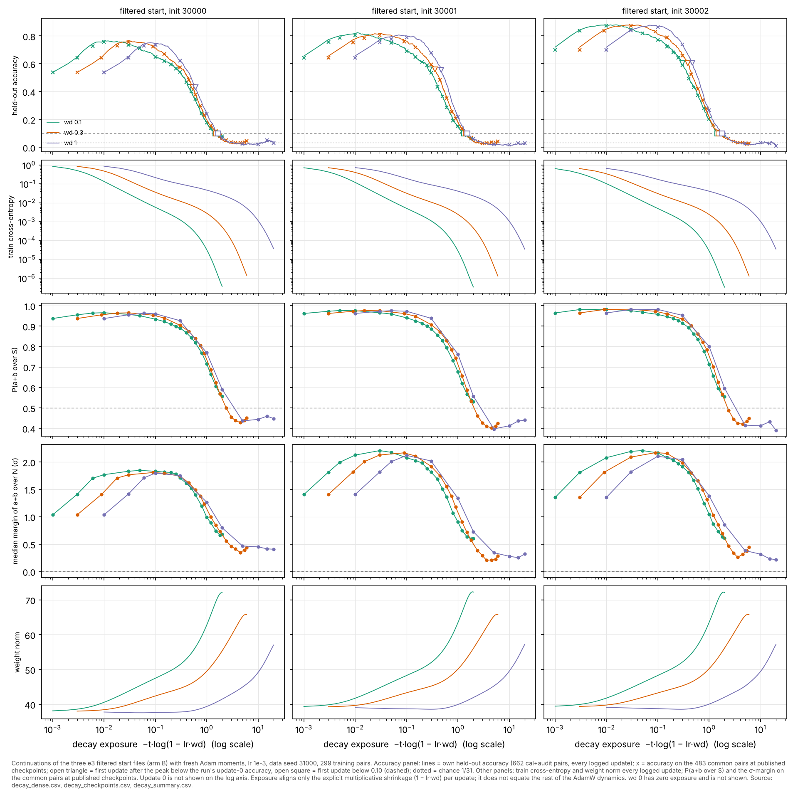

# e4 review index (figures first)

**e4 is open** (2026-10-22). The question: between the post-filter accuracy peak and the collapse, what changes in the computation, and which changes cause the loss of correct answers?

Round e4 runs under the [charter](charter/README.md). Assignments, windows, measures, budgets and claims are in [DECISIONS.md](DECISIONS.md) (D1–D10). Run claims are in [../plan.json](../plan.json) and the literature correspondence is in [LITERATURE.md](LITERATURE.md). e1–e3 are complete and unchanged; e3's packet is [../../e3/coordinator/INDEX.md](../../e3/coordinator/INDEX.md).

e4 base for workers: `ee028d96560a09736ab7846d95cb7a43f80c0aaf`. Shared code is unchanged since `72cfb5d` (D3).

Figures, observations, the explanations that survived or failed, confounds, run accounting and at most three next questions will be added here as packets are reviewed and audited.

## Status

| lane | initial experiment | status |
|---|---|---|
| dynamics | D6: six constant-decay runs at wd 0.1 and 0.3 from the filtered starts | packet 1 integrated (PR #33), audit pending; follow-up claimed (D13: decay off at update 300 or 1,000) |
| mechanisms | analysis of published e3 checkpoints; D7: six dense diagnostic replays | claimed |
| auditor | audit of the decomposition, the strongest cheap control (random-feature starts, D11–D12), dynamics and intervention checks | control C1 integrated (PR #34); decomposition and dynamics checks pending |

## 1. Decay strength between the peak and the collapse (dynamics, packet 1, not yet audited)

Six new runs at wd 0.1 and 0.3 from the three filtered start files, with the e3 wd 0 and wd 1 runs as endpoints, on the decay-exposure axis E = −t·log(1 − lr·wd). The update-axis version is [decay_update.png](../dynamics/figures/decay_update.png), and the packet is [../dynamics/README.md](../dynamics/README.md).

- **Observation.**
  - Fit times (70/50/40) and peaks (within 0.004) do not depend on decay.
  - Every decayed run collapses within 20,000 updates while training accuracy stays at 1. Common accuracy at 20k is 0.06–0.09 at wd 0.1, 0.03–0.05 at wd 0.3 and 0.01–0.03 at wd 1.
  - wd 0 is censored at 0.56–0.62.
  - The global weight norm grows through the decline at every decay value.
- **Pre-stated rule: MIXED.**
  - At the 0.10 threshold, all six runs are on the exposure clock (r 0.80–0.92).
  - At the update-0 threshold, wd 0.3 is on the clock but two of the three wd 0.1 runs are faster.
  - Outside the rule: all twelve ratios are below 1, and they are lower at lower decay.
- **Explanation (lane, untested).** Within 20k, decay strength mainly sets when the decline happens. A decay-independent drift (the slow wd 0 decline) may add to it.

## 2. Does the rise and collapse need anything the failed runs learned? (audit control C1)

The **random-feature start** is built from untrained U and V of the same init, a ridge readout fitted to the same 299 training labels, the same per-unit dominant-frequency filter, and a rescaling to B's norms. It is then trained with B's recipe at wd 1 and wd 0. The rule was stated before the runs. Packet: [../audit/AUDIT.md](../audit/AUDIT.md).

- **Observation.**
  - The random-feature start rises from 0.14–0.28 to 0.58–0.65 by update 100. Its rise (0.37–0.45) exceeds B's (0.25–0.30).
  - At wd 1 it collapses: below 0.10 at 2,060–2,910 updates, against B's 1,540–1,800.
  - At wd 0 it holds, at 0.56–0.62 by 20k.
  - At 20k, at wd 1, its P(a+b over S) is 0.45–0.46, against B's 0.39–0.45 and A's 0.14–0.18.
- **Observation, specific to B.** B starts 0.24–0.40 higher, peaks 0.13–0.18 higher, and fits all training pairs 2–3× sooner.
- **Verdict under the pre-stated rule.** "Generic to filter plus training" is SUPPORTED LOCALLY in all three seeds and all three components (rise, collapse, hold).
- **Explanation (auditor).** The peak-then-collapse, and the rank trace that survives it, do not need anything the failed runs learned. A mechanism found between B's peak and collapse describes filtered networks trained on these pairs. The failed runs contribute a head start. This is not yet shown to be the same mechanism in both arms.
- **Coordinator spot check.** Common accuracy at updates 0, 100, 1k, 2k and 20k, recomputed from the published checkpoints, matches the table. Replaying `e4-au-rf-w128-i30000-a1` to update 300 is bitwise equal at 0, 10, 30, 100 and 300.
