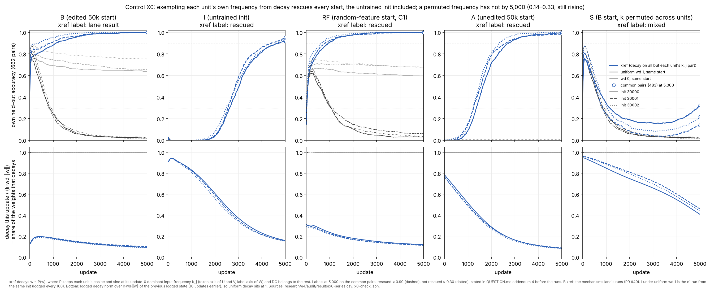

# e4 review packet (figures first)

**e4 is complete** (2026-10-22, [DECISIONS.md](DECISIONS.md) D17).

**Question:** between the post-filter accuracy peak and the collapse, what changes in the computation, and which changes cause the loss of correct answers?

**Where things are**
- Charter: [charter/](charter/README.md). Decisions: [DECISIONS.md](DECISIONS.md) (D1–D17). Claims: [../plan.json](../plan.json). Run accounting: [RUNS.md](RUNS.md). Literature: [LITERATURE.md](LITERATURE.md).
- Packets: [dynamics](../dynamics/README.md), [mechanisms](../mechanisms/README.md), [audit](../audit/AUDIT.md).
- e1–e3 are unchanged. The e3 packet is [../../e3/coordinator/INDEX.md](../../e3/coordinator/INDEX.md).

**Setup**
- **Base:** `ee028d9`. Shared code was unchanged from `72cfb5d` until D15 re-pinned it at `8108d8b`. The re-pin adds an optional restricted decay; without its flags the step is bitwise unchanged (audit Z1).
- **Model and training:** p = 31, one hidden ReLU layer of width 128, float64, full-batch AdamW, lr 1e-3, on the e1 30% split (299 training pairs).
- **Starts:** every run starts from a gated e3 start file, or from the untrained init. Adam is fresh unless the run is a `--resume`.
- **Replicates:** the three init seeds (30000–30002) are the only replicates.
- **Scoring:** accuracy is on the 483 common never-trained pairs unless stated. **B** is the filtered start (e3 arm B), **A** is the unedited failed run, and the **reference parts** are each unit's cosine and sine at its update-0 dominant frequency, the one the filter kept.

**Labels used below**
- **Observation:** measured.
- **Explanation:** a reading of observations.
- **Intervention:** an edit or changed training condition, and its measured effect.

Audit verdicts are PASS or FAIL for software, and SUPPORTED LOCALLY, AMBIGUOUS or CONTRADICTED for readings.

## Figures

**1. Decay strength.** Six new runs at wd 0.1 and 0.3, with the e3 wd 0 and wd 1 runs as endpoints, plotted on the decay-exposure axis −t·log(1 − lr·wd). The update-axis version is [decay_update.png](../dynamics/figures/decay_update.png).

**2. Decay switched off mid-decline.** wd 1 is resumed at update 300 or 1,000 with weights, moments and update count carried over, then continued at wd 0. The full figure is [offswitch.png](../dynamics/figures/offswitch/offswitch.png).

**3. Control C1.** A start built from untrained features with a ridge readout, then filtered and rescaled, compared with B under the same protocol.

**4. Exact logit channels from peak to collapse.** The channels are the label offset μW, the reference readout and the off-reference readout. The audit's version is [channels.png](../audit/figures/channels.png). The same channels on the decay-off runs are in [decay_off.png](../mechanisms/figures/decay_off.png).

**5. Where decay acts.** Two restrictions of wd 1: **xref** exempts the reference parts from decay, and **onlyref** decays only the reference parts.

**6. Control X0.** The xref exemption is applied to an untrained init, to the C1 random-feature starts, to A, and to B with k permuted across units.

## Observations

1. **The rise and the peak do not depend on decay.** Fit times are 70, 50 and 40 updates, and the peaks agree within 0.004 at wd 0, 0.1 and 0.3.
2. **Every decayed run collapses within 20k updates while train accuracy stays at 1.**
   - Common accuracy at 20k is 0.06–0.09 at wd 0.1, 0.03–0.05 at wd 0.3, and 0.01–0.03 at wd 1. At wd 0 it is 0.56–0.62, censored.
   - On the exposure axis the curves nearly overlap.
   - The pre-stated clock rule gives MIXED: 10 of 12 crossings are on the clock, and 2 wd 0.1 runs are faster. All 12 ratios are below 1.
   - The global weight norm grows through the decline at every wd.
3. **Switching decay off stops the decline within about 200 updates. Nothing is recovered.** (Intervention.)
   - f is −0.01 to 0.14 against a cutoff of 1/3, so reading (i) holds in all six runs. It also holds for W = 500 and W = 2,000 and on the common pairs.
   - Accuracy at 20k is ordered by the decay a run received before the switch:

     | run | common accuracy at 20k |
     |---|---|
     | wd 0 throughout | 0.56–0.62 |
     | off from update 300 | 0.44–0.47 |
     | off from update 1,000 | 0.19–0.23 |
     | wd 1 throughout | 0.01–0.03 |

   - Train cross-entropy and the norm converge to the wd 0 run's values.
4. **The same rise and collapse happen without the failed runs.** (Control C1.)
   - Random-feature starts rise 0.37–0.45 by update 100, compared with B's 0.25–0.30.
   - At wd 1 they fall below 0.10 at 2,060–2,910 updates. At wd 0 they hold at 0.56–0.62.
   - At 20k they end with the same rank trace as B: P(a+b over S) is 0.45–0.46, against B's 0.39–0.45 and A's 0.14–0.18.
   - B's advantage is only a head start: it starts 0.24–0.40 higher, peaks 0.13–0.18 higher, and fits 2–3× sooner.
5. **The logits split exactly, to 1.6e-15, and the correct answer is outvoted.**
   - From update 100 to 2,000 at wd 1, the mean margin of a+b over the operand-associated labels S falls 2.5–3.0 logits:

     | channel | share of the fall (logits) |
     |---|---|
     | reference | 1.1–1.4 |
     | off-reference (grows from about 0) | 1.4–1.6 |
     | label offset | < 0.01 |

   - The reference channel alone still scores 0.47–0.52 at 5k–20k. A's floor is 0.16–0.27, and a permuted basis gives 0.03–0.05.
   - The same channels move in the same order on the C1 runs.
   - At wd 0 the reference channel grows instead.
6. **Where decay acts decides the outcome.** (Intervention, wd 1, 5k updates.)
   - onlyref collapses to 0.000. It falls below 0.10 at updates 700–800, against 1,550–1,950 under uniform wd 1.
   - xref reaches 0.998–1.000, while holding the off-reference parts small (they peak near 7 and 5, then shrink).
   - The decay steps are of similar size across these runs.
7. **The xref rescue does not need B.** (Control X0.)
   - The exemption takes an untrained init to 0.92–0.95 and the random-feature starts to 1.00. It takes A, the unedited failed run, from 0.00 to 0.99–1.00.
   - Permuting k across units gives 0.14–0.33 at 5k, still rising.
   - Under uniform wd 1 all of these starts stay at 0.00–0.05.
8. **In the decay-off runs the reference parts regrow, but the larger competitor persists.** (Mechanisms analysis, not audited.)
   - The reference parts regrow to 0.89–0.98 of wd 0's.
   - The competitor ends 1.05–1.31× wd 0's in weight and 1.15–1.54× in margin.

## Explanations

**Survived, SUPPORTED LOCALLY**

| explanation | evidence |
|---|---|
| Decay strength mainly sets *when* the gain is lost. Within 20k it does not set *whether* it is lost (wd ≥ 0.1) | Obs 1–2; audit Y1–Y7 |
| The loss accumulates with decay exposure: it starts, continues and stops with decay | Obs 3; audit Y′ |
| The peak-then-collapse is a property of filtered networks fitted to these pairs, not of the failed runs | Obs 4; C1 rule, all seeds and components |
| The class offset ΔW·μ (Janati et al.) plays no part in the decline. It does matter at update 0 | Obs 5 |
| The answers are outvoted, not erased, *as a statement about the readout at the reference frequencies*. The rebuilt reference readout keeps the start's direction (cosine 0.72–0.83) even though the edited weights themselves are under 1% of it by 5k | Obs 5; audit |
| Decaying only the reference parts is enough to cause the collapse | Obs 6; X1–X5 PASS |

**Failed or contradicted**

| explanation | why |
|---|---|
| The collapse is global weight shrinkage | The norm grows through the decline. After decay is switched off, the norm returns to the wd 0 level and accuracy does not |
| Once started, the decline sustains itself | f ≤ 0.14 in all six decay-off runs |
| Fitting without decay restores the lost answers | No run exceeds its accuracy at the switch over 19k further updates |
| The rank trace that survives the collapse is inherited from the failed runs (e3 reading) | Equal from random-feature starts (C1) |
| xref's 1.00 shows a computation present in B, or measures how much of the collapse is caused by decay on the reference parts | The exemption builds the solution from an untrained init (X0). xref's f (1.37–1.60) mixes the two |

**Ambiguous** (audit)
- **"What decay changes is mostly the reference part."** In raw logits yes. Per unit of ‖(U,V)‖·‖W‖, the off-reference excess at wd 1 is 2.5× larger.
- **"Not weight shrinkage" at the component level.** Decay acts on schedule, and the norms hold only because the gradient rebuilds them.
- **"No phase decoherence."** The all-pairs index cannot show it. On held-out pairs, coherence falls only modestly, from 0.97 to 0.92.

**Strongest surviving alternative.** "Reference stalls, competitor grows" may be one re-fitting process toward an operand-label memorizer, cut in two by a task-informed, per-unit basis. The reference frequencies cover all 15 bins, so "off-reference" is a per-unit distinction. Under decay both channels are almost entirely gradient-built by 5k.

**Answer, as far as e4 goes**
- **What changes.** Under decay the readout at each unit's kept frequency stops growing and loses margin, while an off-reference readout grows against the right answer on operand-associated labels. The training fit stays perfect throughout.
- **Which changes cause the loss.** Decay acting on the kept-frequency parts is *sufficient* for the collapse (onlyref), and the collapse needs decay to continue (D13).
- **Necessity is not separable.** Sparing those parts also supplies the solution by itself (X0), so the xref arm cannot show that decay on them is necessary.
- **Not identified.** Why the competitor grows; the arms are coupled through the loss.

## Confounds and limits

- **Replication.** Three init seeds, one split (data seed 31000), width 128, one lr, float64. Repeated checkpoints of one run are dependent observations. The dense replays and the decay-off runs share states with e3 runs and are not new seeds.
- **Basis.** The Fourier basis is task-informed. The restricted decay is a frequency-selective prior that by itself reaches 0.92–0.95 from an untrained init (X0).
- **Coupling.** The two restricted-decay arms and the two channels are coupled through the training loss. With the reference parts spared, the training pairs are fit about 30× harder by cross-entropy.
- **Choices made with held-out labels.** The D5 windows and the switch points (300, 1,000) were set from held-out accuracy. That choice is disclosed.
- **Post hoc material** is labelled as such where it appears: the exposure-matched table, the decay-magnitude comparison, the margin-ratio carryover, and the audit's change of normalization in Z2.
- **Horizons.**
  - The constant-decay runs run 20k updates and the restricted-decay runs 5k.
  - wd 0 has not converged, so Varma et al.'s prediction at convergence (end state independent of wd) is untested.
  - The S arm is still rising at 5k.
- **Evaluation sets.** Timing uses own held-out pairs (662), and endpoints use the common pairs (483). The audit checked that both give the same readings.
- **One FAIL, bookkeeping only.** Audit Y2′ fails as written: `optimizer_update` is null at the resume row. The state at the switch is bitwise equal, so this changes nothing scientific.
- **Coordinator calibration (D9 disclosure).** The coordinator ran a 2,000-update calibration of filt i30000 at wd 0.3, unclaimed and unpublished. Its audit-split accuracy at 2,000 was 0.38, consistent with the dynamics lane's later run. The coordinator saw it before the dynamics runs. The dynamics predictions had been pushed before the coordinator could share it, and it was not shared.

## Run accounting

- **Claimed runs:** 42, all complete. None failed or were capped, and no registry event has an unclaimed ID ([RUNS.md](RUNS.md)).

  | lane | runs | what |
  |---|---|---|
  | dynamics | 12 | six constant-wd runs and six decay-off resumes |
  | mechanisms | 12 | six dense diagnostic replays and six restricted-decay runs |
  | audit | 18 | six C1 runs and twelve X0 runs |

- **Unclaimed diagnostics.** These were not published as runs and are listed in DECISIONS and the packets:
  - coordinator: the D9 calibration (2k updates), the D3 replay (5k), a 300-update C1 replay spot check, and a 300-update no-flag patch replay;
  - dynamics: a 300-update resume check;
  - mechanisms: a no-flag rerun of one D7 replay at the patch;
  - audit: a 300-update no-flag run at the pin, plus its own replays.
- **Committed checkpoints.** The dense replays and restricted-decay runs commit only the D5 states plus the SHA-256 of every checkpoint (D7).

| session | budget (D9) | used (elapsed numerical execution) |
|---|---|---|
| dynamics | 20 min | about 5.3 min |
| mechanisms | 20 min | about 3 min |
| auditor | 25 min | about 5.3 min |
| coordinator | 10 min | under 1 min |

No paid compute was used.

## Next questions (at most three)

1. **What is the competitor?** Is the off-reference readout that outvotes a+b a re-fit operand-label memorizer? A training-pairs-only linear decoder on h, and readout/feature swaps between declared peak and collapsed states (the Janati et al. diagnostics, not yet run), would separate "lost from the features" from "outvoted at the readout".
2. **How much structure must a decay prior name?** xref rescues even an untrained init. Two cheaper priors are untested:
   - permuted k given longer than 5k (S was still rising);
   - an adaptive rule that re-selects each unit's current dominant frequency, with no fixed k.
   The question is whether either generalizes, and how fast.
3. **Where do wd 0 and weak decay end?** Varma et al. predict an end state independent of wd at convergence. Long `--resume` continuations of the wd 0 and wd 0.1 runs would test whether "delay" turns into "same endpoint".
