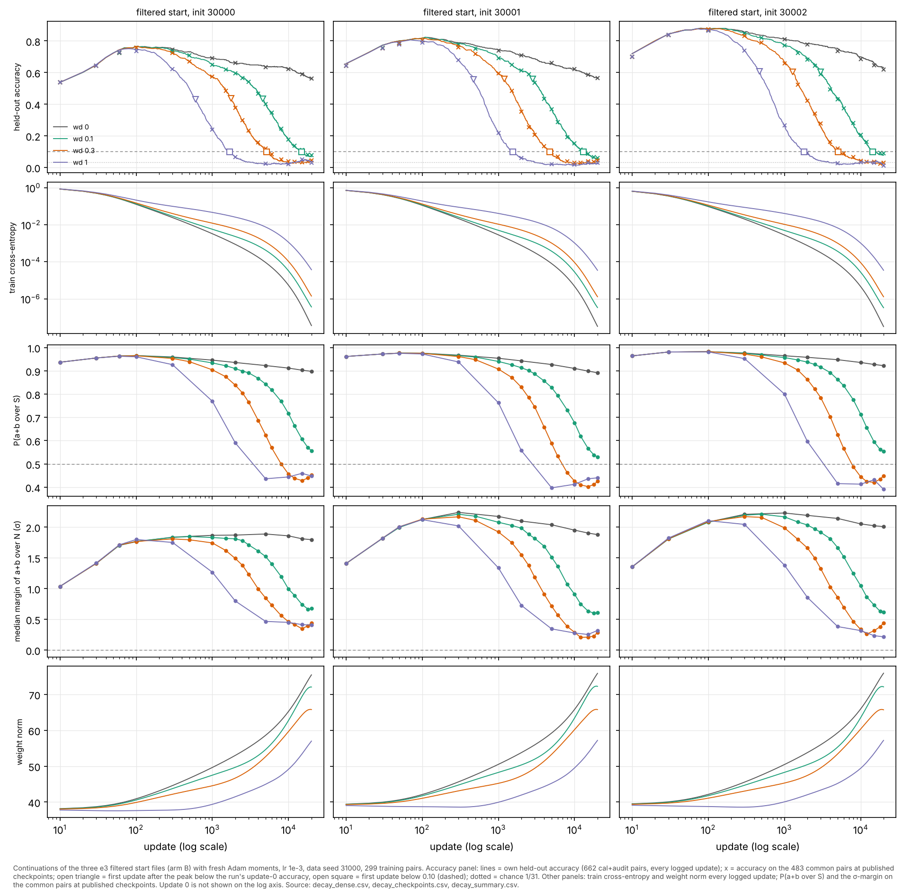

# e4 dynamics: decay strength between the peak and the collapse (packet 1)

Status: the initial experiment (D6) is complete. It is **not audited**, and no follow-up has been proposed yet. The question, the definitions and the predictions were written before any new run: [QUESTION.md](QUESTION.md) Q1 (`e4e5688`) and its addendum (`e5fd1c2`), which fixed the decision rule after measuring only the existing wd 0 and wd 1 runs.

Session label `e4-dy-cloud-1`, branch `claude/project-thread-j8mgkm`. Measures are the shared e3 definitions (e4 D5, `research/e3/audit/pairwise.py`).

## Question

The three filtered start files (e3 mechanisms arm B) rise to 0.75–0.88 held-out accuracy within about 100 updates. At wd 1 they then collapse to chance; at wd 0 they decline slowly and are still at 0.56–0.62 after 20,000 updates.

What do they do at wd 0.1 and 0.3, with everything else held fixed? After the early rise, does lower decay
- (a) mainly delay the decline,
- (b) change how far it goes within 20,000 updates, or
- (c) change the trajectory qualitatively?

The six new runs (D6) are `e4-dy-filt-wd0p{1,3}-w128-i3000{0,1,2}-a1`. Each one:
- starts from `research/e3/mechanisms/starts/e3-me-filt-w128-i<seed>-a1.npz` with fresh Adam moments;
- uses the same 299 training pairs, lr 1e-3 and 20,000 updates;
- uses the same evaluation pairs as the e3 wd 0 and wd 1 runs from the same start, which are the endpoints.

The comparison is paired by start file. The three starts are the only replicates.

## Figure 1: decay exposure axis


Columns are the start files. Rows:
- held-out accuracy: lines are own held-out (662 pairs) at every logged update; × marks are the 483 common pairs at published checkpoints;
- train cross-entropy;
- P(a+b over S);
- σ-margin of a+b over N;
- weight norm.

The x axis is the decay exposure E = −t·log(1 − lr·wd), on a log scale. wd 0 has E = 0 and appears only in Figure 2.

In the accuracy row, an open triangle marks the first update below the run's update-0 accuracy and an open square marks the first update below 0.10.

## Figure 2: update axis



The same panels on the update axis, with wd 0 included.

## Definitions (from Q1, unchanged)

- **Peak.** The maximum own held-out accuracy over updates 0–1,000.
- **Decline times.** T(update-0 level) and T(0.10) are the first logged updates after the peak at which own held-out accuracy is below the run's update-0 accuracy, and below 0.10.
  - A run that never crosses is censored, written "> 20000".
  - No run crossed back above either threshold.
- **Decision rule.** For each new run and threshold, r = observed T / predicted T. The predicted T is the update at which the run reaches the exposure at which the wd 1 run from the same start crossed.
  - 1/1.5 ≤ r ≤ 1.5 is "exposure clock".
  - r > 1.5 or censored is "slower".
  - r < 1/1.5 is "faster".
  - If arms or seeds disagree, the result is "mixed", reported per run with no pooling.

Timing uses own held-out accuracy, as declared in Q1. D5's primary set, the 483 common pairs, is shown at checkpoints and used for endpoints; it is a subset of own held-out.

## Observations

**Table 1. Per run.** E at each crossing is in brackets. Accuracies at 20,000 are common and own held-out.

| wd | start | fit | peak (update) | T update-0 level (E) | T 0.10 (E) | common acc 20k | own acc 20k | train CE 20k | norm 0 → 20k |
|---|---|---|---|---|---|---|---|---|---|
| 0 | i30000 | 70 | 0.766 (100) | > 20000 | > 20000 | 0.561 | 0.560 | 3.6e-08 | 37.9 → 75.5 |
| 0 | i30001 | 50 | 0.823 (110) | > 20000 | > 20000 | 0.565 | 0.565 | 3.2e-08 | 39.2 → 75.9 |
| 0 | i30002 | 40 | 0.881 (80) | > 20000 | > 20000 | 0.619 | 0.631 | 3.2e-08 | 39.3 → 75.9 |
| 0.1 | i30000 | 70 | 0.766 (100) | 4,620 (0.46) | 14,860 (1.49) | 0.079 | 0.068 | 3.7e-07 | 37.9 → 72.1 |
| 0.1 | i30001 | 50 | 0.823 (110) | 2,810 (0.28) | 13,100 (1.31) | 0.060 | 0.053 | 3.4e-07 | 39.2 → 72.3 |
| 0.1 | i30002 | 40 | 0.879 (120) | 3,000 (0.30) | 14,410 (1.44) | 0.089 | 0.077 | 3.3e-07 | 39.3 → 72.1 |
| 0.3 | i30000 | 70 | 0.766 (100) | 1,750 (0.53) | 5,120 (1.54) | 0.046 | 0.042 | 1.4e-06 | 37.9 → 65.8 |
| 0.3 | i30001 | 50 | 0.819 (100) | 1,190 (0.36) | 4,700 (1.41) | 0.043 | 0.039 | 1.3e-06 | 39.2 → 65.8 |
| 0.3 | i30002 | 40 | 0.878 (80) | 1,290 (0.39) | 5,050 (1.52) | 0.029 | 0.030 | 1.3e-06 | 39.3 → 65.7 |
| 1 | i30000 | 70 | 0.751 (80) | 600 (0.60) | 1,680 (1.68) | 0.031 | 0.035 | 3.7e-05 | 37.9 → 57.0 |
| 1 | i30001 | 50 | 0.807 (70) | 470 (0.47) | 1,540 (1.54) | 0.031 | 0.024 | 3.5e-05 | 39.2 → 57.2 |
| 1 | i30002 | 40 | 0.878 (70) | 470 (0.47) | 1,800 (1.80) | 0.010 | 0.015 | 3.5e-05 | 39.3 → 57.2 |

"Fit" is the first logged update with training accuracy 1. Training accuracy stays at 1 at every logged update after the fit, in all twelve runs.

**Table 2. The pre-stated decision rule.**

| run | threshold | E_ref (wd 1) | T predicted | T observed | r | verdict |
|---|---|---|---|---|---|---|
| wd 0.1, i30000 | 0.10 | 1.68 | 16,808 | 14,860 | 0.88 | exposure clock |
| wd 0.1, i30001 | 0.10 | 1.54 | 15,407 | 13,100 | 0.85 | exposure clock |
| wd 0.1, i30002 | 0.10 | 1.80 | 18,008 | 14,410 | 0.80 | exposure clock |
| wd 0.3, i30000 | 0.10 | 1.68 | 5,602 | 5,120 | 0.91 | exposure clock |
| wd 0.3, i30001 | 0.10 | 1.54 | 5,135 | 4,700 | 0.92 | exposure clock |
| wd 0.3, i30002 | 0.10 | 1.80 | 6,002 | 5,050 | 0.84 | exposure clock |
| wd 0.1, i30000 | update-0 level | 0.60 | 6,003 | 4,620 | 0.77 | exposure clock |
| wd 0.1, i30001 | update-0 level | 0.47 | 4,702 | 2,810 | 0.60 | faster |
| wd 0.1, i30002 | update-0 level | 0.47 | 4,702 | 3,000 | 0.64 | faster |
| wd 0.3, i30000 | update-0 level | 0.60 | 2,001 | 1,750 | 0.87 | exposure clock |
| wd 0.3, i30001 | update-0 level | 0.47 | 1,567 | 1,190 | 0.76 | exposure clock |
| wd 0.3, i30002 | update-0 level | 0.47 | 1,567 | 1,290 | 0.82 | exposure clock |

**The verdict under the rule is "mixed".**
- At the 0.10 threshold, all six runs follow the exposure clock.
- At the update-0 threshold, all three wd 0.3 runs follow the exposure clock, but two of the three wd 0.1 runs are faster. The seeds disagree within the wd 0.1 arm.

**A pattern the rule does not test.**
- All twelve ratios are below 1.
- At each start and threshold, the wd 0.1 ratio is below the wd 0.3 ratio (6 of 6 pairs).
- In every one of the six runs, the ratio is lower at the update-0 threshold than at 0.10.

**Table 3. Own held-out accuracy at matched exposure.** This is descriptive. I chose these exposures after viewing Figure 1, and the table is not part of the decision rule. Each value is at the logged update nearest each E. The wd 0 run from the same start, at that same update, is in brackets. Source: `decay_matched.csv`.

| wd | start | E 0.1 | E 0.3 | E 0.6 | E 1 | E 1.5 | E 2 |
|---|---|---|---|---|---|---|---|
| 0.1 | i30000 | 0.650 [0.690] | 0.542 [0.651] | 0.341 [0.636] | 0.172 [0.624] | 0.100 [0.595] | 0.068 [0.560] |
| 0.1 | i30001 | 0.693 [0.745] | 0.538 [0.687] | 0.293 [0.644] | 0.148 [0.619] | 0.082 [0.583] | 0.053 [0.565] |
| 0.1 | i30002 | 0.773 [0.811] | 0.604 [0.772] | 0.376 [0.734] | 0.195 [0.699] | 0.097 [0.659] | 0.077 [0.631] |
| 0.3 | i30000 | 0.715 [0.743] | 0.573 [0.690] | 0.384 [0.660] | 0.198 [0.648] | 0.104 [0.637] | 0.053 [0.636] |
| 0.3 | i30001 | 0.763 [0.787] | 0.594 [0.745] | 0.361 [0.710] | 0.181 [0.675] | 0.085 [0.656] | 0.044 [0.637] |
| 0.3 | i30002 | 0.813 [0.856] | 0.668 [0.811] | 0.424 [0.782] | 0.219 [0.767] | 0.103 [0.751] | 0.071 [0.731] |
| 1 | i30000 | 0.746 [0.766] | 0.622 [0.751] | 0.431 [0.716] | 0.240 [0.690] | 0.116 [0.681] | 0.065 [0.660] |
| 1 | i30001 | 0.801 [0.817] | 0.680 [0.789] | 0.452 [0.763] | 0.221 [0.745] | 0.101 [0.731] | 0.057 [0.710] |
| 1 | i30002 | 0.869 [0.878] | 0.737 [0.855] | 0.502 [0.825] | 0.261 [0.811] | 0.133 [0.801] | 0.085 [0.782] |

What the tables and figures show:

1. **The early rise does not depend on decay.**
   - The fit update is 70, 50 and 40 at all four decay values.
   - At wd 0, 0.1 and 0.3, the peaks agree within 0.004.
   - The wd 1 peak is 0.003–0.016 lower and 10–40 updates earlier.
2. **Every decayed run collapses within the window.**
   - At 20,000 updates, common accuracy is 0.06–0.09 at wd 0.1 (E = 2), 0.03–0.05 at wd 0.3 (E = 6) and 0.01–0.03 at wd 1 (E = 20). Chance is 0.032.
   - The decline is monotone apart from small fluctuations: after the peak, own held-out accuracy never rises by more than 0.014 within any 500-update span. No run crosses back above either threshold.
   - None of the decayed runs levels off at an intermediate accuracy.
   - wd 0 is censored at both thresholds, at 0.56–0.62 common accuracy.
3. **On the exposure axis the decayed curves nearly overlap.** This holds for accuracy, P(a+b over S) and the σ-margin. Lower decay sits slightly to the left (earlier in E).
   - At matched E from 0.3 to 1.5, own held-out accuracy is ordered wd 0.1 < wd 0.3 < wd 1 at every start (Table 3).
   - By E = 2 all three are near the floor, 0.04–0.09.
4. **The decay-free partner has declined by the matched update.** At the matched update, the wd 0 run from the same start has itself declined. Its accuracy is lower at the later updates that the lower-decay runs need to reach the same E (the bracketed values in Table 3).
5. **Train fit is kept throughout, and train CE keeps falling.**
   - The decline happens with training accuracy at 1 in every run.
   - At equal E, train CE is orders of magnitude lower at lower decay. At E = 1 it is about 3e-5 at wd 0.1, 2.5e-3 at wd 0.3 and 4.5e-2 at wd 1.
6. **The global weight norm grows during the decline at every decay value.**
   - At wd 0.1 and 0.3 the norm never drops below its update-0 value.
   - At wd 1 it dips 1–2% below its start, at updates 50–290, and then grows.
   - At the 0.10 crossing the norm is about 68–70 at wd 0.1, 53 at wd 0.3 and 41 at wd 1. Accuracy is lost at very different global norms.
7. **The rank trace remains at 20,000.** P(a+b over S) is 0.53–0.56 at wd 0.1 (E = 2) and 0.43–0.45 at wd 0.3, against the e3 wd 1 values of 0.39–0.45.

## Interpretation (separate from the observations)

**The causal effect of decay on the trajectory.** This experiment varies only wd from the same three start files, so differences between arms are caused by decay strength.

Within 20,000 updates the answer to the Q1 question is (a), delay:
- decay strength mainly sets when the decline happens;
- at wd ≥ 0.1 it does not set whether the decline happens, or how far it goes;
- no qualitative change appeared between 0.1 and 1.

To first order, the timing follows the explicit shrinkage (the exposure clock). The pre-stated rule nevertheless returns "mixed", because two of three wd 0.1 runs reach their update-0 level earlier than the clock predicts. That verdict stands as stated.

**Why lower decay is ahead of the clock.** This is a candidate reading, not tested. The wd 0 runs decline slowly with no decay at all. If that decay-independent drift adds to the exposure-driven decline, a lower-decay run will be ahead of the exposure clock, because it spends more updates to reach the same E. That fits three observations:
- all ratios are below 1;
- the ratios are lower at lower wd;
- the deviation is largest at the update-0 threshold, where the drift is a larger share of what has been lost.

Table 3 is consistent with this in sign. Its magnitudes were not fitted, and an additive model was not tested.

**Mechanism: not shown.**
- The global weight norm grows while accuracy falls, at every decay value. Accuracy is lost at norms from about 41 to 70. So the decline is not "the weights shrink" in the global-norm sense.
- The norm series are correlations, and nothing here identifies which components decay removes, or why removing them costs held-out accuracy and not training fit.
- This packet also does not show whether decay must stay on during the decline once it has started.

**Relation to Varma et al. (2309.02390).** They report that decay changes time scales but not the dataset-size transition point. The delay reading here is compatible with that. In their account, below the critical dataset size the memorizing solution is the more efficient one, and decay drives the network there (ungrokking). The collapse here would fit that if 299 pairs is below this model's critical size; the e1 30% runs that failed point in that direction.

This is a compatible reading, not a test, for four reasons:
- Their setting differs: a transformer at P = 113.
- Their account treats decay as an L2 term, and AdamW's decoupled decay is not that.
- "More efficient" here was not measured, for example as parameter norm at matched train CE between the edited and the collapsed solutions.
- wd 0 has not collapsed by 20,000 updates. Whether the decay-free run ends in the same state is open.

## D5 windows addressed

- **rise [0, t_fit] and peak [t_fit, 300].** Not changed by decay (item 1).
- **decline [300, 2,000].** This window is defined at wd 1. On the update axis, the decline moves later at lower decay, into the late window. On the exposure axis it stays in place (items 2–3).
- **late [2,000, 20,000].** Endpoints and the rank trace (items 2 and 7).

No measure of which components change during the decline is reported here. That is the mechanisms lane's question.

## Limitations

- **Three start files, paired.** Repeated checkpoints of one run are dependent observations. The rule's factor-1.5 band is wide compared with the spread of r across starts within an arm (0.08–0.17).
- **20,000 updates.** wd 0.1 reaches only E = 2. The wd 0 runs' fate past 20,000 updates is unknown.
- **The thresholds use own held-out accuracy (662 pairs)**, as declared, rather than D5's primary 483 common pairs. Common accuracy at checkpoints tracks it (Figure 1, × marks).
- **Exposure aligns only the explicit shrinkage factor.** It does not equate Adam's normalized step or the cross-entropy drive across decay values.

## Reproduce

- **Runs.** Launched from a clean worktree detached at the pin `52e7879`, with 2 workers and 1 BLAS thread each, in plan queue order (positions 1–6), 02:08:47–02:11:28 UTC.
  - Each run took 52–55 s, including startup.
  - All six completed 20,000 of 20,000 updates. Every manifest records `producing_code_commit` `52e7879` and `producing_tree_dirty: false`.
  - Command: `uv run --locked python launch_runs.py --plan research/e4/plan.json --root runs/e4 --registry <repo>/research/e4/dynamics/registry.jsonl --session-label e4-dy-cloud-1 --workers 2 --timeout 600 --ids <the 6 IDs in queue order>`.
  - The published files are in `runs/`: checkpoints at 0, 10, 30, the first-interpolation update that `experiment.py` records (60, 50, 30), 100, 300, 500, 1,000, 1,500, 2,000, 2,500, 3,000, then every 1,000 to 6,000, and 8,000, 10,000, 12,000, 15,000, 18,000 and 20,000. The registry is `registry.jsonl`.
- **Endpoints.** These are the e3 mechanisms runs `e3-me-filt[-wd0]-w128-i<seed>-a1` (wd 1 at `59c822e`, wd 0 at `ad6e923`). The shared code is equal, and the coordinator's D3 replay reproduced the wd 1 i30000 run bitwise.
- **Analysis.** `decay.py` at `35dda72` checks the following for every run:
  - the start-file hash and the update-0 arrays;
  - the training set (the e1 30% split);
  - that the common pairs are disjoint from training;
  - the manifest hash of each checkpoint.

  To regenerate:
  ```
  M=research/e3/mechanisms/runs; E=research/e4/dynamics/runs
  uv run --locked --group analysis python research/e4/dynamics/decay.py \
    $M/e3-me-filt-w128-i3000{0,1,2}-a1 $M/e3-me-filt-wd0-w128-i3000{0,1,2}-a1 \
    $E/e4-dy-filt-wd0p{1,3}-w128-i3000{0,1,2}-a1 --out research/e4/dynamics/figures
  ```
  It takes about 14 s. Outputs are `decay_{dense,checkpoints,summary,decision,matched}.csv` and `decay_{update,exposure}.{png,svg}`.
- `figures/existing/` holds the same analysis on the wd 0 and wd 1 runs only, from `9257c00`, made before the new runs.

## Budget

About 2.7 min of elapsed training (six runs on two workers) out of 20 min. No analysis step took over a minute.

## Next

I have not proposed a follow-up yet. I will propose one, predeclared, after the coordinator has reviewed this figure (D8).
