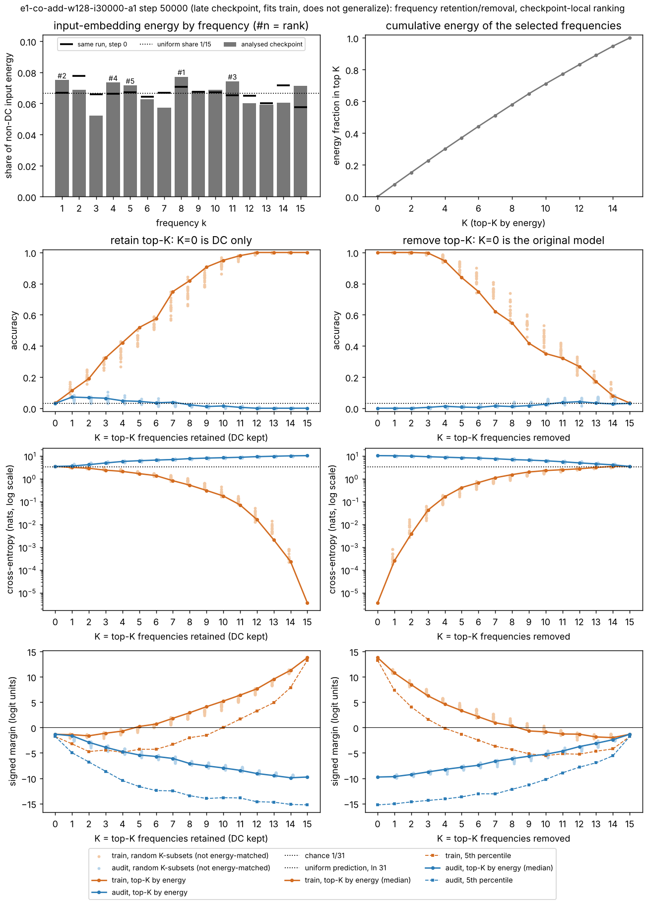
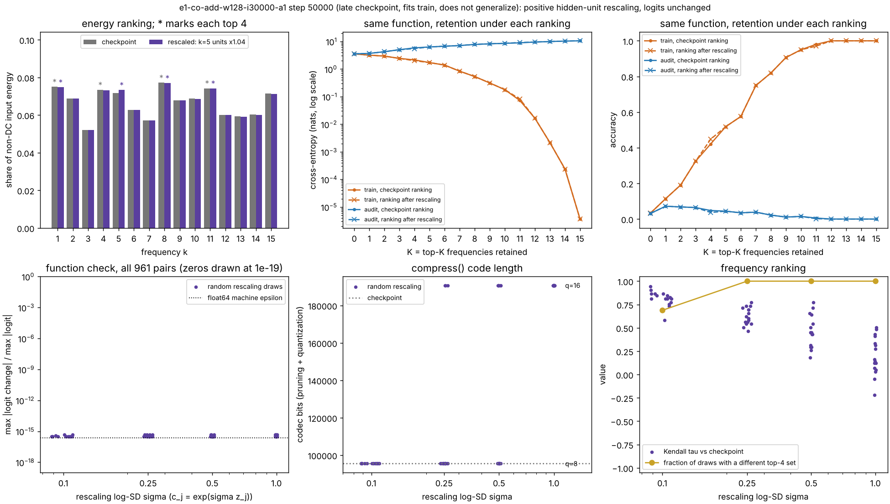
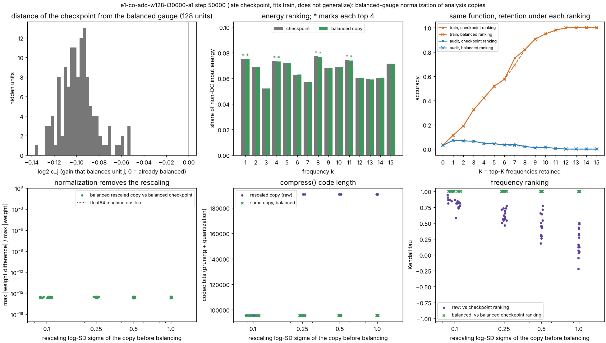
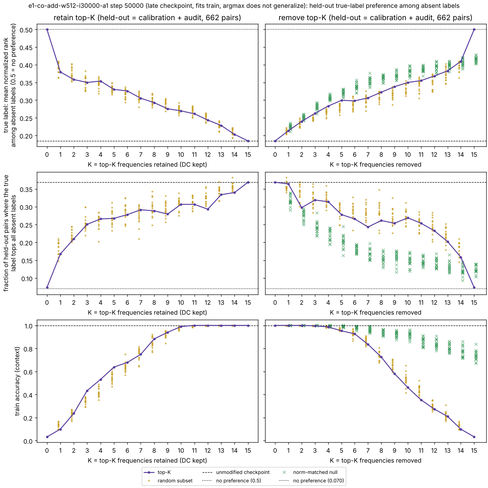
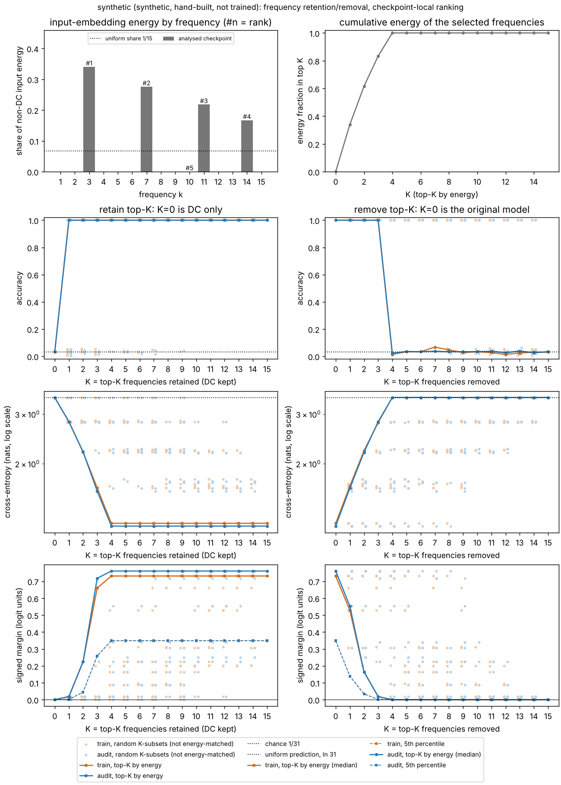

# Mechanism/measurement lane: figures first

Lane branch `claude/project-thread-psralm` (the session's designated branch, standing in for `swarm/mechanisms`). Round 1 started from `c7c1c2a` and was integrated as `fff276c`; round 2 starts from `fff276c`. Shared code is unchanged. Interpretations are kept in [INTERPRETATION.md](INTERPRETATION.md). The auditor lane has not audited anything here yet.

Every trained checkpoint analysed so far comes from the coordinator's seed-30000 preview runs. All of them fit the training split and **do not generalize** (held-out accuracy 0 to 0.004). No generalizing e1 checkpoint exists yet.

Definitions used throughout (`freq.py`, `gauge.py`):

- **Frequency k** is rfft bin k = 1..15 of the input embeddings U and V along the token axis. Its **energy** is |coefficient|² summed over hidden units and over U and V. W is never filtered. This is the historical `interventions()` definition generalized from K=4 to every K; a unit test checks parity at K=4.
- **Checkpoint-local selection**: the ranking comes from the analysed checkpoint itself. There is no retrospective tracing yet.
- **Retain top-K** keeps DC plus the K highest-energy frequencies (K=0 is DC only, K=15 the original model). **Remove top-K** subtracts those frequencies (K=0 is the original, K=15 DC only).
- **Random K-subsets** are 16 uniform draws per K (seed 33100). They are a reference that is **not energy-matched**.
- **Rescaling** multiplies hidden unit j's input weights by a gain c_j > 0 and its output weights by 1/c_j. Since relu(c z)/c = relu(z), logits must not change; this is checked on all 961 pairs before any proxy is read. Random gains are c_j = exp(σ z_j) for σ in 0.1, 0.25, 0.5 and 1, with 16 draws each (seed 33200).
- **Codec** is `experiment.compress()` unchanged: hidden-unit pruning plus per-matrix scalar quantization, which must keep train/calibration agreement ≥ .99 and relative MSE ≤ .01.
- **Balanced gauge** (`gauge.py`, analysis copies only) rescales each unit so that ‖u_j‖² + ‖v_j‖² = ‖w_j‖². This is the minimum-norm point of the unit's rescaling orbit, so every rescaled copy normalizes to the same weights. It removes this one symmetry and no other.

## Packet 1. Retention/removal on a late, non-generalizing checkpoint

Main checkpoint: `e1-co-add-w128-i30000-a1`, step 50,000 (final), width 128, init seed 30000. It fits the training split (train CE 3.7e-6) and does not generalize (audit accuracy 0, audit CE 10.5). The assignment named this checkpoint, and its outcome was known from the coordinator before the analysis.



Look before reading: in the top-left panel, how different are the 15 frequencies from each other and from the step-0 marks? Compare the coloured top-K lines with the pale random-subset dots for the same split. Does any small K reproduce the training fit? What happens to held-out loss as more frequencies are kept?

Observations:

- Input energy is spread across all 15 frequencies: shares run from 0.052 to 0.077 (uniform would be 0.067). The top 4 (k = 8, 1, 11, 4) hold 30.0% of non-DC energy. At step 0 of the same run, shares ran from 0.058 to 0.078 and the top 4 were k = 2, 14, 8, 9.
- Retaining the top K raises train accuracy gradually: 0.42 at K=4 (train CE 2.14), 0.82 at K=8, and 1.0 first at K=12. Train CE reaches the original 3.7e-6 only at K=15.
- Removing the top K leaves train accuracy at 1.0 after 2 are removed (CE 0.004), 0.95 after 4, and 0.55 after 8.
- Train accuracy, top-K versus random K-subsets: retaining the top 4 beats 14 of 16 random 4-subsets (random range 0.27 to 0.43). Removing the top 8 does more damage than all 16 random 8-subsets (random range 0.55 to 0.74). Top-K subsets carry more energy than random subsets of the same size (at K=4, 0.30 versus 0.25 to 0.28), so this comparison is not matched.
- On the held-out audit split, accuracy is at most 0.072 at every K in both directions; the best random subset reaches 0.105, and chance is 0.032. Audit CE rises monotonically from 3.54 (DC only) to 10.55 (original) as frequencies are retained, and the audit median margin is negative at every K.
- Full retention and empty removal reproduce the checkpoint's metrics to within 5.3e-15. This is the reconstruction control.

Files: [retention.csv](figures/e1-co-add-w128-i30000-a1-s50000/retention.csv), [random_subsets.csv](figures/e1-co-add-w128-i30000-a1-s50000/random_subsets.csv), [retention.svg](figures/e1-co-add-w128-i30000-a1-s50000/retention.svg), [summary.json](figures/e1-co-add-w128-i30000-a1-s50000/summary.json).

## Packet 2. Does a function-preserving rescaling change the frequency ranking or the codec?

Same checkpoint.



Look before reading: check the bottom-left panel first (is the function really unchanged?). Then compare the ranking and codec panels against the size of the rescaling.

Observations:

- Targeted rescaling: I multiplied the inputs of the 7 hidden units whose dominant frequency is k=5 (rank 5) by 1.0406, and their outputs by 1/1.0406. No logit changed by more than 3.6e-15 (max |logit| is 22.2). k=5 replaced k=4 in the top 4. For the same function, retained-top-4 train accuracy moved from 0.421 to 0.448 and train CE from 2.14 to 2.00. The codec stayed at 95,496 bits.
- Random rescalings left logits unchanged to within 4.8e-16 (relative) in all 64 draws. The top-4 set changed in 11 of 16 draws at σ=0.1 and in all 16 at σ ≥ 0.25.
- The codec was unchanged at σ=0.1. It doubled to 190,728 bits (q went from 8 to 16) in 3 of 16 draws at σ=0.25, 7 of 16 at σ=0.5 and all 16 at σ=1. The pruning order never changed, because the codec's unit score (‖u_j‖+‖v_j‖)·‖w_j‖ is rescaling-invariant; only quantization responds.
- Every random draw increased the parameter norm.

Files: [rescaling_sweep.csv](figures/e1-co-add-w128-i30000-a1-s50000/rescaling_sweep.csv); the targeted result is in [summary.json](figures/e1-co-add-w128-i30000-a1-s50000/summary.json) under `targeted_rescaling`.

### Packets 1 and 2 on three more checkpoints of the same seed

The same two figures for each checkpoint, produced by the same command: [w128 step 300](figures/e1-co-add-w128-i30000-a1-s300/) (the first logged step with train accuracy ≥ .99), [w32 step 50,000](figures/e1-co-add-w32-i30000-a1-s50000/) and [w512 step 50,000](figures/e1-co-add-w512-i30000-a1-s50000/). The step-300 checkpoint was chosen with no knowledge of the run's later outcome; the others are final checkpoints.

| checkpoint | train / audit acc (train CE) | energy shares, analysed (step 0) | top 4 (energy held) | retain top-4: train acc (16 random 4-subsets) | smallest K with retained train acc ≥ .99 | remove top-4: train acc | targeted gain moving rank 5 into the top 4 | top-4 changed, σ=0.1 | codec bits: checkpoint (other values seen under rescaling) |
|---|---|---|---|---|---|---|---|---|---|
| w32, 50k | 1.0 / 0.004 (5.9e-3) | 0.048–0.096 (0.057–0.078) | 10, 9, 1, 7 (33.2%) | 0.227 (0.174–0.268) | 14 | 0.669 | k=8, 2 units, ×1.061 | 11/16 | 24,072 (47,880) |
| w128, 300 | 1.0 / 0.000 (0.66) | 0.056–0.084 (0.058–0.078) | 2, 4, 11, 5 (30.6%) | 0.321 (0.224–0.314) | 15 | 0.656 | k=14, 7 units, ×1.232 | 0/16 | **190,728 (95,496)** |
| w128, 50k | 1.0 / 0.000 (3.7e-6) | 0.052–0.077 (0.058–0.078) | 8, 1, 11, 4 (30.0%) | 0.421 (0.268–0.428) | 12 | 0.946 | k=5, 7 units, ×1.041 | 11/16 | 95,496 (190,728) |
| w512, 50k | 1.0 / 0.000 (1.8e-6) | 0.056–0.077 (0.064–0.070) | 1, 4, 10, 11 (29.2%) | 0.532 (0.355–0.488) | 11 | 0.987 | k=8, 33 units, ×1.020 | 9/16 | 381,192 (762,120) |

- Every checkpoint has a near-flat input spectrum, with the top 4 holding 29 to 33% of the energy against 26.7% for a uniform spectrum.
- Retaining the top 4 beats all 16 random 4-subsets at w128 step 300 and at w512. At w32 and w128 step 50k it falls inside the random range.
- At w128 step 300, random rescalings *shortened* the codec in 14 of 16 draws at σ=0.1 (from 190,728 to 95,496 bits) while leaving the function unchanged. At the three final checkpoints, no random draw shortened it.
- Logits stayed unchanged to within 3.6e-15 (absolute) in every targeted rescaling and to within 5.3e-16 (relative) in every random draw, at all four checkpoints.

## Packet 3. Balanced-gauge normalization

Same checkpoint as packets 1 and 2; the figures for the other three checkpoints are in their own directories (`gauge.png`).



Look before reading: in the top-left panel, where does 0 (already balanced) sit relative to the histogram? In the bottom row, compare the purple raw copies with the green balanced ones.

Observations (four checkpoints):

| checkpoint | log2 c_j, all units: median abs (range) | parameter norm: checkpoint → balanced | ranking change after balancing: Kendall tau, top 4 | codec bits: checkpoint → balanced | invariance check, 64 rescaled copies balanced |
|---|---|---|---|---|---|
| w32, 50k | 0.155 (−0.229 to −0.046) | 47.83 → 47.28 | 0.90, same set | 24,072 → 24,072 | weights ≤ 3.4e-16, ranking identical, codec 24,072 in all |
| w128, 300 | 0.304 (−0.471 to −0.180) | 32.95 → 31.48 | 0.98, same set | **190,728 → 95,496** | weights ≤ 3.3e-16, ranking identical, codec 95,496 in all |
| w128, 50k | 0.099 (−0.137 to −0.052) | 60.34 → 60.05 | 0.98, same set | 95,496 → 95,496 | weights ≤ 3.6e-16, ranking identical, codec 95,496 in all |
| w512, 50k | 0.047 (−0.079 to −0.019) | 59.87 → 59.80 | 1.00, same set | 381,192 → 381,192 | weights ≤ 3.6e-16, ranking identical, codec 381,192 in all |

- Balancing changes no logit by more than 7.1e-15.
- At every checkpoint, every unit needs a gain below 1: input norms exceed output norms in all units. The gap is largest at step 300 (the median unit's input norm is 2^0.61 ≈ 1.5 times its output norm) and smallest at width 512 (2^0.09 ≈ 1.07).
- Normalized copies are identical to float64 precision, so the ranking and codec of the balanced copy no longer depend on the rescaling. The balanced copy is a convention, not a measurement of the function: see the synthetic check below.

Files per checkpoint: `gauge_summary.json`, `gauge_sweep.csv` (one row per draw, raw and balanced side by side; the raw codec column reproduces `rescaling_sweep.csv` exactly), `gauge_retention.csv` (retention under the balanced ranking).

## Follow-up: is the held-out label preference carried by particular frequencies?

The coordinator asked for this after the audit found the preference (`research/audit/AUDIT.md`). For each of the 662 held-out pairs (calibration + audit splits), labels that never co-occur with either operand in any training pair are "absent", and the true label is always one of them. The readout is the audit's statistic, reimplemented in `relational.py`: the true label's mean normalized rank among the other absent labels (0.5 means no preference, lower means preferred), and the fraction of pairs where it tops them all (0.070 expected with no preference). On the unmodified checkpoints my values equal the audit lane's independently computed ones: rank 0.1848 and top fraction 0.3686 at w512, 0.3098 and 0.1843 at w128.

Interventions use the `freq.py` definitions, plus a **norm-matched removal null**. The null subtracts the removed perturbation Δ after a random orthogonal map of token space that fixes the constant vector, using the same map for U and V (16 draws per K, seed 33300). It has Δ's norm, rank and singular values but random directions. Unlike the projection, it adds energy on average rather than removing it.



Look before reading: how much preference survives with a single retained frequency, and do the top-K points stand out from the random subsets? In the removal column, compare the green null with the top-K line in the top two rows, then in the train-accuracy row.

Observations at w512 step 50,000 (w128 in [its directory](figures/e1-co-add-w128-i30000-a1-s50000/relational.png)):

- Retaining DC plus the single top frequency moves the true label's rank from 0.50 to 0.38 (random single frequencies: 0.36 to 0.41). The true label tops the absent labels for 17% of pairs, while train accuracy is only 0.10. The preference grows gradually with K and reaches 0.29 at K=8, inside the random-subset range at K = 1, 4 and 8.
- Removing the top K weakens the preference gradually: rank 0.21 at K=1, 0.28 at K=4, 0.32 at K=8, and 0.50 at K=15 (DC only).
- The norm-matched null weakens it more than removing the top K at every K ≥ 2, but damages the training fit less. At K=8, null rank is 0.35 to 0.37 against 0.32 for top-K, and null top fraction is 0.13 to 0.18 against 0.26. Train accuracy at K=8 is 0.90 to 0.96 under the null against 0.73 for top-K; at K=12 it is 0.78 to 0.91 against 0.27.
- At w128 the pattern is the same, except that the top-K frequencies carry more of the preference than random subsets: across K = 1 to 10, only 6 of 160 random subsets retain a lower (stronger) rank than the top K (K=1: 0.370 against 0.370 to 0.439).

Files: `relational.csv` (one row per intervention: kind, mode, K, draw, frequencies, train accuracy, rank, top fraction, fraction predicting a present label), `relational_summary.json` (including the audit lane's values for comparison). `crosscheck.py` recomputes every top-K row by sorting and agrees exactly.

## Method check (synthetic, not a trained model)

This is a hand-built network with known ground truth (`freq.synthetic`). Frequencies 3, 7, 11 and 14 each get 32 ReLUs with random phases, at input gains 1, .9, .8 and .7. Each group's output weights are a ridge fit of its own unit-amplitude target cos(2πk(a+b−c)/31), so the four groups contribute equally to the logits but rank by input gain.



- Energy sits only at the four built-in frequencies (all others are below 1e-20 of the maximum), ranked by gain.
- Accuracy is 1.0 with any single built-in frequency retained, while CE and margins keep improving until all four are kept. Judged by accuracy alone, one frequency would look sufficient.
- Removing all four frequencies zeroes every hidden unit, giving logits of 0 and CE of exactly ln 31.
- A gain of 1.116 on the k=7 units moves k=7 to rank 1 without changing the logits ([rescaling.png](figures/synthetic/rescaling.png)).
- Balancing ([gauge.png](figures/synthetic/gauge.png)) reverses the ranking to 14, 11, 7, 3 (energy shares 0.53, 0.24, 0.13, 0.11), although each group's logit contribution has the same norm (109.9). Within a group the units' individual contributions largely cancel: their summed norms are 1,152 for k=3 and 5,671 for k=14. Balanced energy follows per-unit magnitude, cancelling parts included, so it is not functional importance. Balancing also halves this network's codec (190,728 to 95,496 bits).

## Checks run

- Shared tests: `uv run --locked python -m unittest test_exploration test_instrumentation`, 9 OK.
- Lane tests: `uv run --locked --group analysis python -m unittest discover -s research/mechanisms -v`, 14 OK. They cover reconstruction, full removal, parity with `interventions()` at K=4, rescaling invariance of logits and pruning order, filter/rescaling commutation, balanced-gauge logit preservation, orbit invariance, idempotence and norm minimality, the absent-label premise, rank-statistic extremes, the null's norm, rank and singular values, the synthetic ground truth, and targeted reordering.
- Handoff: every input file was verified against the coordinator's `manifest.json` SHA-256 hashes. The split hash equals the plan's `aa8f7504…` and the target hash equals the manifest's `6f1576d4…`. Metrics recomputed at each analysed step equal `metrics.jsonl` exactly at all four checkpoints.
- `crosscheck.py` recomputes with separately written code (cosine/sine projection instead of rfft, its own forward pass and metrics, its own rescaling, and balanced energies computed without rescaling anything). At all four checkpoints, all 32 retention rows agree to within 2.9e-14, the targeted rescaling reproduces the same units and top 4, and balanced energy shares agree to within 8.3e-17 with the same ranking (`crosscheck.json` in each directory). The codec itself was not recomputed independently, because it is `experiment.compress()`, the object being measured.

## Provenance and reproduction

- Input: `research/coordinator/runs/e1-co-add-w{32,128,512}-i30000-a1/` as published at `67a10d8d282fd1d57ae6b3aba5a992f8d040203d` (identical in `fff276c`), produced by code `ebd874e`. The step-0 checkpoints supply the reference spectra.
- Analysis code: the commit recorded in each `summary.json` / `gauge_summary.json`; the tree was clean apart from output files. The environment is CPython 3.12.14, NumPy 2.3.5 and Matplotlib 3.11.2 from the uv lock, with one BLAS thread. Seeds: random subsets 33100, rescalings 33200, synthetic phases 34000.
- Elapsed numerical execution in this lane so far was about 6 minutes. No training jobs were run.

```bash
uv sync --locked --group analysis
R=research/coordinator/runs; F=research/mechanisms/figures; S=67a10d8d282fd1d57ae6b3aba5a992f8d040203d
# one checkpoint (repeat with -w32-/-w512- and with --step 300 for the others; labels as in each summary.json)
uv run --locked --group analysis python research/mechanisms/freq.py --run $R/e1-co-add-w128-i30000-a1 --source-commit $S \
    --reference-step 0 --label "late checkpoint, fits train, does not generalize" --out $F/e1-co-add-w128-i30000-a1-s50000
uv run --locked --group analysis python research/mechanisms/gauge.py --run $R/e1-co-add-w128-i30000-a1 --source-commit $S \
    --label "late checkpoint, fits train, does not generalize" --out $F/e1-co-add-w128-i30000-a1-s50000
uv run --locked --group analysis python research/mechanisms/relational.py --run $R/e1-co-add-w128-i30000-a1 --source-commit $S \
    --label "late checkpoint, fits train, argmax does not generalize" --out $F/e1-co-add-w128-i30000-a1-s50000
uv run --locked python research/mechanisms/crosscheck.py $R/e1-co-add-w128-i30000-a1 50000 $F/e1-co-add-w128-i30000-a1-s50000
# synthetic method check
uv run --locked --group analysis python research/mechanisms/freq.py --synthetic --top 1 --label "synthetic, hand-built, not trained" --out $F/synthetic
uv run --locked --group analysis python research/mechanisms/gauge.py --synthetic --top 1 --label "synthetic, hand-built, not trained" --out $F/synthetic
```

## Next (not yet run)

1. Run the same figures, including the held-out preference readout, on a generalizing checkpoint or on the coordinator's 200k-update width-512 continuation as soon as either is published.
2. Retrospective tracing (scoring final-checkpoint frequencies at earlier steps), kept separate from checkpoint-local selection. The coordinator deferred this until a generalizing checkpoint exists.
3. A removal null that removes energy as the projection does (a random subspace of the same rank), alongside the rotated norm-matched null.
